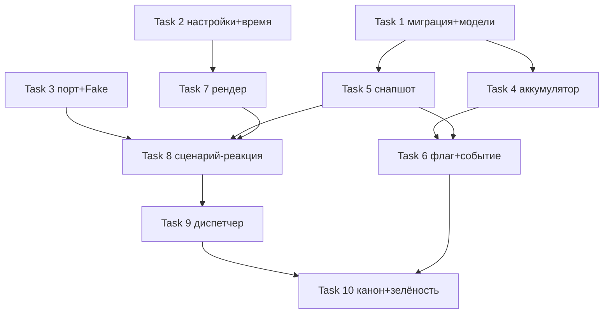

# План #482 — подсистема доменных событий (часть 1 оповещений)

Дата: 2026-10-20 · Спека: [2026-10-19-notify-events-482-design.md](../specs/2026-10-19-notify-events-482-design.md) (рев.2, Gate B пройден) · Семейная спека: [2026-10-11-notify-system-476-design.md](../specs/2026-10-11-notify-system-476-design.md)

## Goal

Построить верхнюю половину конвейера оповещений: транзакционный журнал `domain_events`, диспетчер с тремя циклами за очередевым портом, сценарий-реакция «новая запись» с рендером текста и постановкой задач в очередь. Подсистема полностью выключена по умолчанию (`NOTIFY_ENABLED=false`), стандартный прогон тестов Redis не требует.

## Architecture

`src/notify/` — новый пакет: `models.py` (ORM), `journal.py` (аккумулятор событий), `snapshots.py` (сборка снапшота), `render.py` (песочница Jinja2), `scenarios.py` (реестр реакций), `queue.py` (порт + FakeQueue), `dispatcher.py` (процесс), `time.py` (`business_now`). Врезка третьего аккумулятора — `src/services/decorators.py` по образцу аудита (`src/events/audit.py`). Сценарий `create_record` (`src/usecases/records.py`) протягивает флаг `notify` и помечает событие. Миграция — одна ревизия за головой `4ba65fe87015`. Адаптер очереди на Redis/arq — часть 2 (#483), здесь только порт.

## Tech Stack

Python 3.12 / FastAPI / SQLAlchemy 2 (async, aiosqlite) / alembic / jinja2>=3.1.6 (новая зависимость) / pytest + httpx. Фронт: TypeScript, `@memo/api-client` (ручное зеркало контракта), vitest.

---

## Task 1: Миграция и ORM-модели notify

### Classification: standard

### Required Docs

- Спека #482 §3.1, 3.6, 4 (таблицы, колонки, индекс, сид шаблона)
- Семейная спека §4.3 (состояния), `docs/domain-rules/notify.md`

Одна ревизия alembic (`down_revision = 4ba65fe87015`, голова единственная — проверена): таблицы `domain_events` (частичный индекс `ix_domain_events_pending ... WHERE processed_at IS NULL AND processing_error IS NULL`, объявление через `sqlite_where`), `notify_tasks` (`client_id` FK `ondelete SET NULL`, колонки `channels` JSON, `reenqueues`), `notify_task_attempts`, `notify_templates` (сид-строка дефолтного шаблона `new_record` — черновик текста из спеки §3.5); колонки `clients.notify_enabled` (server_default true) и `records.notify` (server_default false). ORM-модели в `src/notify/models.py` по конвенциям `AbstractModel`.

- DoD: миграция накатывается и откатывается на чистой тестовой базе (`alembic upgrade head` / `downgrade -1`); частичный индекс существует в sqlite_master с обоими условиями; сид-шаблон `new_record` с `is_default=true` на месте.

## Task 2: Настройки, бизнес-время, зависимость

### Classification: small

### Required Docs

- Спека #482 §3.2 (время), 3.9 (настройки)

`src/core/config.py`: `NOTIFY_ENABLED=False`, `NOTIFY_POLL_INTERVAL=1`, `NOTIFY_CHANNEL_PRIORITY="telegram"`, `NOTIFY_REENQUEUE_AFTER=120`, `BUSINESS_TIMEZONE="Europe/Moscow"`; валидатор настроек — в testing-окружении `NOTIFY_ENABLED` принудительно false (спека §3.9, §3.3 семейной спеки: включённая подсистема в тестах запрещена). `src/notify/time.py`: `business_now() -> datetime` — наивный настенный часы зоны `BUSINESS_TIMEZONE` (`ZoneInfo`, `replace(tzinfo=None)`), независимо от TZ сервера. `backend/pyproject.toml`: `jinja2>=3.1.6`.

- DoD: юнит-тесты — умолчания настроек; `NOTIFY_ENABLED` в testing-профиле false (config-тест US-7); `business_now()` равен настенному времени фиксированной зоны при `TZ=UTC` окружения (сравнение с `ZoneInfo("Europe/Moscow")`).

## Task 3: Очередевой порт и FakeQueue

### Classification: small

### Required Docs

- Спека #482 §3.7; семейная спека §4.2, 4.4 (payload, надёжный список)

`src/notify/queue.py`: протокол `NotifyQueue` (`enqueue_task`, `claim_statuses`/`ack_status`, `reclaim_hanging`, `claim_inbound`/`ack_inbound`) — JSON-словари контрактов §4.2/§4.3. `FakeQueue` — внутрипроцессная реализация на списках для тестов (эмулирует обслуживающий список и возврат зависших).

- DoD: юнит-тесты FakeQueue — claim/ack удаляет обработанное, неackнутое возвращается `reclaim_hanging()`, порядок сохраняется.

## Task 4: Аккумулятор журнала и врезка в @transactional

### Classification: standard

### Required Docs

- Спека #482 §3.1
- `src/events/audit.py` (паттерн токен-владения), `src/services/decorators.py` (точки врезки)

`src/notify/journal.py`: `open_journal()` / `mark_domain_event(type, snapshot)` / `draw_events()` / `reset_journal(token)` — копия паттерна аудита (contextvar, токен-владение, владелец-обёртка вставляет). Врезка в `decorators.py`: третий аккумулятор открывается рядом с аудитом, `_insert_event_rows(session)` до `commit()`, сброс в `finally`. Актор не требуется — вставка безусловна.

- DoD: юнит-тесты на декораторе — событие вставляется тем же коммитом, что и сущность; исключение сценария → отката, строка не появляется; вложенные обёртки не дублируют вставку.

## Task 5: Снапшот new_record и хелперы

### Classification: standard

### Required Docs

- Спека #482 §3.2; семейная спека §4.1 (формат)

`src/notify/snapshots.py`: `build_new_record_snapshot(session, record)` — локальные чтения (activity+service+location+master→staff, client, visits+tariffs); все ключи §4.1 всегда, значения могут быть null; `tariffs` по элементу на визит; `event.occurred_at` — UTC ISO с `Z`. `src/services/record.py`: `record_total_price(visits) -> int` — `sum(visit.price)`, семантика SQL-итога списков.

- DoD: тесты — полный снапшот (все поля заполнены) и минимальный (без клиента, без тарифов, без карты — null-толерантность); `record_total_price` равен SQL `_total_price_sq` на одинаковых данных.

## Task 6: Флаг notify по цепочке и событие в сценарии create_record

### Classification: standard

### Required Docs

- Спека #482 §3.1 (марк события), 3.3 (цепочка флага, актор-гейт)
- Семейная спека §3.8 (судьба чекбокса)

Фронт: `useRecordMutations.ts` — `notify: input.notify` в тело `createRecord`; `packages/api-client` — поле `notify: boolean` в типе `RecordCreate` (ручное зеркало). Бекенд: `RecordCreate.notify: bool = False`; в сценарии `create_record` — флаг сохраняется в `records.notify` только при `audit.current_actor() is not None` (аноним → false), после пересчёта статуса — `mark_domain_event("new_record", build_new_record_snapshot(...))`.

- DoD (US-1): контрактный тест POST /records — с актором `notify: true` фиксируется в колонке, анонимный вызов → false, без поля → false; юнит-тест фронтенда — тело запроса содержит `notify` из состояния чекбокса; интеграционный тест — строка `domain_events` появляется при коммите и отсутствует при откате сценария.

## Task 7: Рендер текста

### Classification: standard

### Required Docs

- Спека #482 §3.5 (песочница, фильтры, экранирование, выбор шаблона)

`src/notify/render.py`: `SandboxedEnvironment` + `StrictUndefined` + `autoescape=False`; фильтры `fmt_dt` (`%d.%m.%Y %H:%M` хранимого наивного значения) и `money`; экранирование управляющих символов нейтральной разметки (`*`, `_`, `` ` ``, `[`, `]`) в строковых значениях снапшота перед подстановкой; выбор шаблона из `notify_templates` по `event_type`, fallback на `is_default`.

- DoD (US-4): тесты — отсутствующий ключ → ошибка рендера; null-поля не ломают дефолтный шаблон; имя клиента с `*_[` не ломает разметку; `{{ ''.__class__ }}` блокируется песочницей; фильтры форматируют корректно.

## Task 8: Сценарий-реакция new_record диспетчера

### Classification: standard

### Required Docs

- Спека #482 §3.4 (предикат, порядок причин, заморозка, идемпотентность)
- Семейная спека §4.2, 4.4

`src/notify/scenarios.py`: реестр тип→обработчик; обработчик `new_record` — живые чтения по `event.record_id` и `client.id` из снапшота: запись удалена → `processed_at` без задачи; далее `notify_off` → `no_recipient` (клиент отсутствует/мягко удалён/телефон strip-пуст) → `no_consent` → `past_event` (`activity.start > business_now()`); успех — рендер, задача `queued` с текстом и замороженными `channels` (из `NOTIFY_CHANNEL_PRIORITY`, адрес — телефон), `processed_at` в одной транзакции с задачей, `enqueue_task` после коммита.

- DoD (US-2, US-3): по одному тесту на каждую из четырёх причин + удалённая запись; успех — задача с текстом и каналами, payload §4.2 в FakeQueue, повторная обработка события дубль не создаёт; порядок причин фиксирован (множественные отказы — побеждает первая ветка).

## Task 9: Диспетчер-процесс

### Classification: large

### Required Docs

- Спека #482 §3.8 (циклы, политика ошибок, перезаливка, конкурентность)
- Семейная спека §3.2, 3.3, 4.3, 4.4

`src/notify/dispatcher.py`: вход `python -m src.notify.dispatcher`; `NOTIFY_ENABLED=false` → журналирование и выход 0. Три цикла в `asyncio.TaskGroup`, каждая итерация в своём `try/except`, SIGTERM → корректная остановка. Цикл 1 — поллинг (батч 20, интервал настройки, `processed_at IS NULL AND processing_error IS NULL`, `ORDER BY occurred_at, id`), ошибки сценария/рендера: `attempts` 1→2→3 → `processing_error` (мёртвое), во время попыток 1–2 не пишется. Цикл 2 — `reclaim_hanging()` на старте, затем claim → строка попытки + производное состояние (§4.3: первый `sending` → sending; первый `sent` → sent терминально; финальный `failed` → failed) одним коммитом → ack. Цикл 3 — inbound: реестр пуст → лог + ack. Перезаливка в цикле 1: `queued` старше `NOTIFY_REENQUEUE_AFTER` → сохранённый payload целиком, `reenqueues += 1`, **`updated_at` обновляется (метка перезаливки — иначе предикат возраста срабатывает каждый тик, а не раз в интервал)**, потолок 10 (модульная константа) → `failed` с ошибкой. Парсинг `NOTIFY_CHANNEL_PRIORITY` (CSV, без учёта регистра): пусто/дубликаты → громкая ошибка старта.

- DoD (US-5–US-8): тесты на FakeQueue — поллинг обрабатывает и помечает батч; 3 попытки → мёртвое событие поллингом не берётся; статусы пишут попытки и выводят состояние, повторное применение безвредно, `reclaim_hanging` возвращает зависшие; падение одной итерации не останавливает процесс и соседние циклы; перезаливка по возрасту (не чаще интервала — проверкой `updated_at`) и потолку; парсинг приоритета: пусто/дубликаты — громкая ошибка старта; inbound без обработчика — лог + ack; выключенность — `main()` завершается.

## Task 10: Канон сида и полная зелёность

### Classification: small

### Required Docs

- Спека #482 §5 (канон-исключения, выключенность)

`scripts/gen_seed_canon.py`: исключения `domain_events`, `notify_tasks`, `notify_task_attempts` (прецедент `audit_logs`); `notify_templates` остаётся в каноне. Финальная сверка: полный backend-прогон pytest, линт/тайп-гейты, vitest затронутых пакетов.

- DoD (US-7): канон-генератор пропускает новые недетерминированные таблицы; полный backend-прогон и контракты зелёные без Redis в окружении; `git status` чист от чужих правок (коммит только своих файлов — в общем дереве работают параллельные сессии).

---

## Порядок и зависимости

Задачи 1–3 независимы между собой. Точка возврата: если план вскроет ошибку спеки — стоп Gate C (`gate 482 plan`), решение за пользователем.
