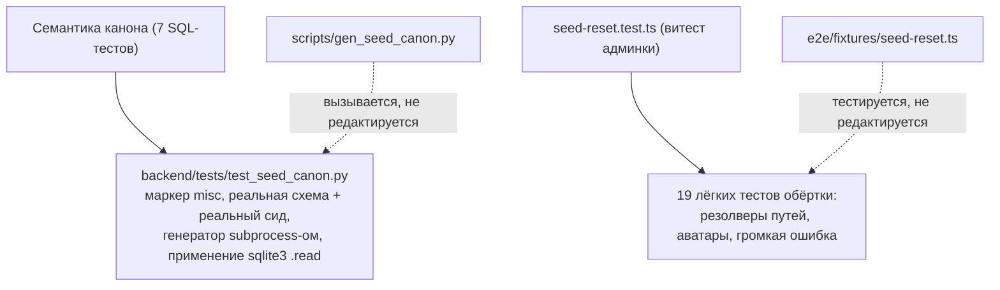

# План: перенос канон-тестов сида из vitest админки в pytest (#373)

Дата: 2026-10-21. Спека: `docs/specs/2026-10-21-seed-canon-pytest-move-design.md` (рев.2, гейт B пройден).

## Goal

Закрепить 7 SQL-семантик канона сида в pytest-сьюте бэкенда (`backend/tests/test_seed_canon.py`, маркер `misc`) и убрать их из `frontend/admin/__tests__/seed-reset.test.ts`, оставив там 19 лёгких тестов TypeScript-обёртки. Закрыть нагрузочный флейк-класс «seed-reset в полном витест-прогоне» (#373). Политика канона не меняется — переезжает только место закрепления.

## Architecture

- pytest-дом: база из `Base.metadata.create_all` + реальный `seed_data()` (как `backend/tests/test_seed.py`), генератор — реальный скрипт списком аргументов (`sys.executable`, `shell=False`, `check=True`, страховочный `timeout`), применение канона — той же командой sqlite-утилиты, что обёртка (`.read`). Всё под `tmp_path` с явным утверждением путей перед применением.
- витест-дом: только чистые функции и файловая система, инвариант «никаких внешних процессов».
- e2e и джобы CI не меняются.

## Tech Stack

pytest (маркеры реестра `backend/pyproject.toml`, `tmp_path`, `subprocess`), sqlite3 CLI, SQLAlchemy-модели и сид бэкенда, vitest (оставшийся файл), `docs/tests_workflow.md` (карта покрытия), `.gitignore`.

---

## Task 1: фикстура и обвязка pytest-файла + первая семантика (total restore)

### Classification: standard

### Required Docs

- `docs/specs/2026-10-21-seed-canon-pytest-move-design.md` §1 (механика фикстуры — обязательна дословно);
- `backend/tests/test_seed.py` (приём построения базы из реальной схемы и сида);
- `backend/pyproject.toml` §markers (реестр маркеров).

### Что делаем

- Создать `backend/tests/test_seed_canon.py`, маркер `misc` на модуле.
- Фикстура (scope function), порядок обязателен:
  1. во временном каталоге pytest (`tmp_path`) — файловая база (URL `sqlite+aiosqlite:///<tmp_path>/canon-test.db`, НЕ in-memory — генератор читает базу отдельным процессом);
  2. импорт модулей моделей ДО `create_all` (метаданные `Base` без импортов пусты; агрегирующий импорт всех моделей, включая `src/auth/session.py` и `src/notify/models.py`);
  3. `Base.metadata.create_all` + `assert` наличия таблиц-исключений (`audit_logs`, `sessions`, таблицы notify-журнала) и `notify_templates` в построенной схеме;
  4. реальный сид `seed_data()`, затем явный COMMIT и закрытие движка (dispose) до запуска генератора — незафиксированные данные из другого процесса не видны; учитывать, что движок ставит `PRAGMA journal_mode=WAL` на каждом соединении (порядок фиксации/закрытия важен);
  5. запуск `scripts/gen_seed_canon.py` списком аргументов: `subprocess.run([sys.executable, str(script), str(db), str(canon)], check=True, timeout=120, shell=False)`, путь к скрипту от `Path(__file__)` к корню репо;
  6. перед применением — `assert` того, что `db` и `canon` лежат под `tmp_path`.
- Хелпер применения: та же команда, что в обёртке `resetToSeed` — `sqlite3 "<db>" ".read '<canon>'"` (списком аргументов, без шелла); однострочный комментарий: retry-обёртка (`sqliteExecWithRetry`) — забота TS-стороны, здесь не воспроизводится намеренно.
- Проверка среды: первым делом `sqlite3 --version` — отсутствие утилиты падает одной именованной причиной.
- Хелпер загрязнения: правка сид-строк, удаление сид-строк, вставка несидовых строк (фиксированные id и UUID) — перенос приёмов из витест-версии.
- Первый тест — `restores deleted/edited seed rows and removes non-seed rows (total restore)`: загрязнить → применить → сид-строки восстановлены, несидовые исчезли.

### DoD

- `cd backend && uv run pytest tests/test_seed_canon.py -v` зелёный локально; User Scenario 3 (изолированный локальный прогон за секунды) выполняется; User Scenario 2 подтверждён хотя бы одной семантикой; в CI бэкенд-джоб зелёный.

## Task 2: остальные 6 семантик канона

### Classification: small

### Required Docs

- Спека §1, список семантик 2–7 (формулировки и уточнения обязательны дословно);
- `scripts/gen_seed_canon.py` (состав исключений дампа — чтение, не правка).

### Что делаем

На обвязке задачи 1, формулировки сохраняются:

1. `restores canonical sort_order, dictionary titles and staff_positions`;
2. `restores users to seed (non-seed user rows vanish — policy flip of GH #310)`;
3. `wipes user_settings whole (GH #267)`;
4. `keeps the by-design exceptions: audit_logs, sessions and the notify journal tables (#482)` — строка-выживанец (сессия с токеном) вставляется ПОСЛЕ генерации канона;
5. `notify_templates stays IN the canon (#482)`;
6. `is idempotent (double application is a no-op beyond the first)` — состояние затронутых таблиц после второго применения совпадает с состоянием после первого (число строк и контрольные значения), ошибок нет.

### DoD

Полный набор 7 семантик зелёный локально и в CI; User Scenario 2 выполнен для всего списка спеки.

## Task 3: сокращение витест-файла

### Classification: small

### Required Docs

- Спека §2 (инвариант «никаких внешних процессов» — обязательный исход);
- `frontend/admin/__tests__/seed-reset.test.ts` (текущая структура describe/`beforeEach`).

### Что делаем

- Удалить из `seed-reset.test.ts` 7 SQL-тестов и весь тяжёлый `beforeEach`/`afterEach` группы `resetToSeed` (временный каталог, схема, сид, вызов python-генератора).
- Тест `throws a LOUD error naming the stack script when the canon file is missing` вынести в собственный легковесный блок: обёртка разрешает путь базы в момент вызова из `SHARD_ID`/`TEST_DB_PATH` — блок обязан выставить `TEST_DB_PATH` на временный файл (без схемы и сида — обёртка проверяет наличие канона до касания базы), снять `SHARD_ID`/`SHARD_RUN_TAG` и восстановить переменные после (как делают выживающие группы); canon-файл отсутствует → бросок с именем скрипта стека.
- Группы `resolveSeedDbPath`, `resolveTestFilesDir`, `wipeAvatarsDir` не трогать.

### DoD

User Scenario 1: полный прогон `frontend/admin` зелёный; в файле не осталось вызовов `execSync`/`spawn` (греп-страж ревью по спеке); 19 тестов остаются.

## Task 4: канон тестов и .gitignore

### Classification: trivial

### Required Docs

- `docs/tests_workflow.md` (coverage map, строки 287–290; TL;DR-таблица раннеров, строка 11; раздел per-test seed reset);
- Спека §3.

### Что делаем

- `docs/tests_workflow.md`: в coverage map расширить строку Backend pytest (семантика канона сида, маркер `misc`), уточнить строку `frontend vitest` (только фронт; тесты обёртки e2e — чистые функции); в разделе per-test seed reset — указатель, что семантика канона закреплена pytest-сьютом; добавить правило-якорь #373: тесты живут по предмету, а не по потребителю.
- `.gitignore`: добавить `*.canon.sql`.

### DoD

User Scenario 5: карта покрытия отражает новый дом семантики канона; `git status` больше не показывает untracked-дампы canon; полный CI зелёный (User Scenario 4).
