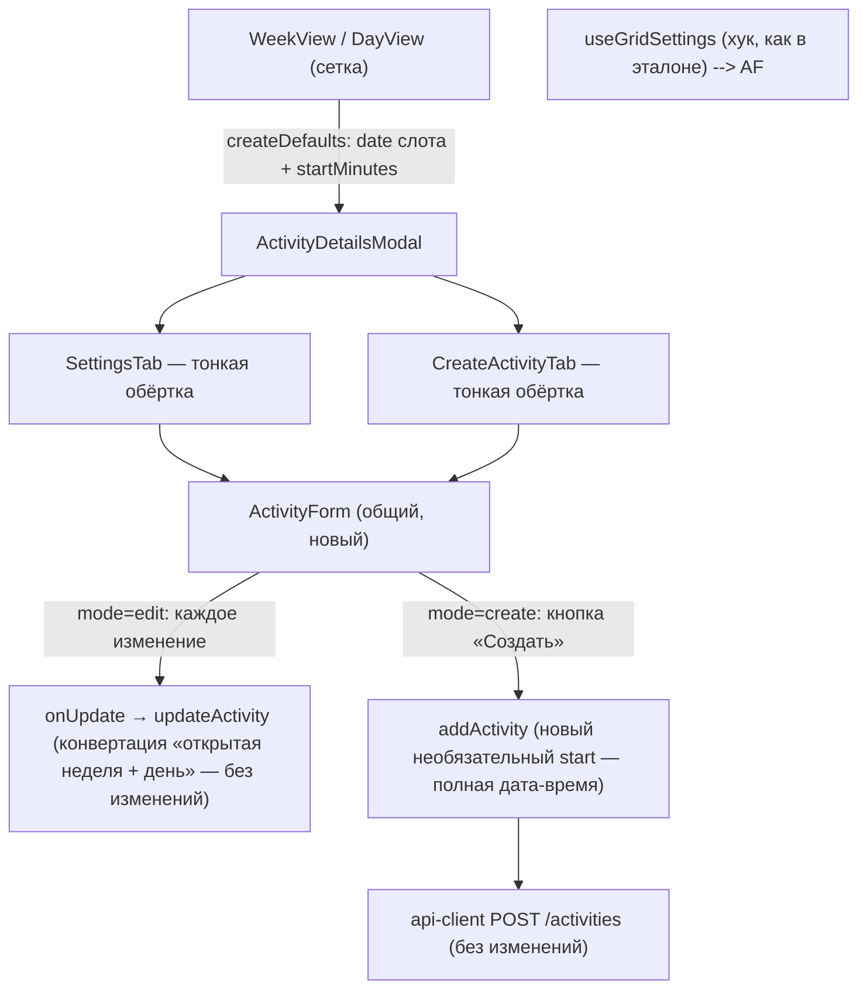

# План: единая форма создания занятия — унификация с формой редактирования (#280)

Спека: `docs/specs/2026-10-23-schedule-create-form-unified-design.md`

## Goal

Форма создания занятия строится на том же компоненте, что и форма редактирования (эталон): один компонент, два режима (edit — instant-patch, create — локальный стейт + кнопка «Создать»). Контролы, порядок, типографика и тестидная схема — как в спеке; создание уходит на выбранную календарную дату; вместимость ≥ 1 в обоих режимах. Сервер не меняется.

## Architecture

- Слои не нарушаются: UI (вкладки модалки) → контекст расписания (мутации) → api-client → бэкенд. Правится только UI-слой и один метод контекста.
- Различие режимов — в проводке (стейт/колбэки), не в разметке; разметка строк 1–3 существует в одном экземпляре (`ActivityForm`).
- `addActivity`: новый необязательный `start` (local ISO) идёт в payload напрямую; легаси-конвертация «открытая неделя + день» остаётся штампу сетки (WeekView/DayView — слот по построению в открытой неделе) и `updateActivity` (редактирование + drag&drop).
- Источник шага сетки: вкладка берёт его хуком `useGridSettings()` — тот же источник, что у эталона (спека рев.2 зафиксировала); через родителя (`createDefaults`) передаётся календарная дата слота, которой сегодня нет.
- `snapMinutes`/`buildDateTimeLocal` переезжают в `lib/datetime.ts` (спека оставила точное место плану): это канонический домен функций даты-времени, где уже живут `composeLocalISO`/`hhmmToMinutes`, поверх которых построен `buildDateTimeLocal`.

## Tech Stack

Next.js/React + TypeScript, Tailwind (классы эталона), react-query (мутации в контексте расписания), vitest + testing-library (юнит), Playwright (e2e + visual regression).

## Task 1: Фундамент — хелперы даты-времени и тестиды комбобоксов

### Classification: small

### Required Docs

docs/design-system.md

### Шаги

1. `lib/datetime.ts`: перенести `snapMinutes(minutes, gridFrequency)` и `buildDateTimeLocal(dateStr, startMinutes, gridFrequency)` из `SettingsTab.tsx` (обе чистые, без привязки к компоненту); `SettingsTab.tsx` импортирует из lib — поведение без изменений.
2. `shared/Combobox.tsx`: необязательный проп `containerTestId?: string` — рендерится на внешней обёртке (паттерн эталона: `select-service`/`select-location` на wrapper-div). Внутренние `combobox-trigger`/`combobox-search`/`combobox-option-*` не меняются.
3. `shared/MasterPicker.tsx`: тот же необязательный проп на обёртке.

### DoD

Существующие юнит-тесты `SettingsTab`/`Combobox`/`MasterPicker` и e2e эталона зелёные **без правки ожиданий** (аддитивность пропа; вынос хелперов — чистый переезд).

## Task 2: Общий компонент ActivityForm — извлечение эталона (режим edit)

### Classification: standard

### Required Docs

docs/design-system.md

### Шаги

1. Новый `modal/ActivityDetailsModal/ActivityForm.tsx`: разметка строк 1–3 эталона (строка 1: `datetime-local` + длительность «ЧЧ:ММ» + тумблер `role="switch"`; строка 2: услуга-Combobox + возраст read-only + вместимость + блок тарифов; строка 3: MasterPicker + локация-Combobox), классы полей `px-3 py-2 text-sm`.
2. Режим `edit`: значения и проводка — как сегодня в `SettingsTab` (каждое изменение → `onUpdate`, instant-patch; тарифы условно от услуги; автозаполнение возраста/тарифов из выбранной услуги). Никакой create-логики внутри компонента: различие режимов — в пропсах-проводке.
3. `SettingsTab.tsx` → тонкая обёртка, рендерящая `ActivityForm` с текущей edit-проводкой. Все существующие якоря сохраняются на тех же элементах: `settings-tab`, `settings-row-datetime-duration`, `settings-row-service-age-capacity`, `settings-row-master-location`, `input-datetime`, `input-duration`, `toggle-private`, `select-service`, `select-location`, `age-display`, `input-capacity`.
4. Гейт вместимости в режиме edit (решение пользователя «вместимость ≥ 1 в обоих режимах»): `onUpdate({ capacity })` вызывается только при `Number(value) >= 1` — пустое/нулевое ввод не применяется, по конвенции instant-patch эталона (некорректный ввод молча игнорируется, как у длительности «ЧЧ:ММ»). Сегодня пустое поле шлёт `Number('') = 0` — этот путь исчезает. Юнит-тесты ассертят только наличие поля (проверено), критерий незаметности не страдает — это единственное намеренное изменение поведения edit-режима.

### DoD

Критерий незаметности из спеки: юнит-тесты редактирования (`ActivityDetailsModal.test.tsx`) и e2e расписания зелёные **без правки ожиданий**. Сценарий US-1 остаётся визуально неизменным для edit-режима.

## Task 3: Режим create — форма создания на общем компоненте

### Classification: large

### Required Docs

docs/domain-rules/activities.md, docs/domain-rules/locations.md, docs/design-system.md

### Шаги

1. `CreateActivityTab.tsx` → тонкая обёртка над `ActivityForm` в режиме `create`: локальный стейт, отправка по `btn-create-activity` → `addActivity`; во время запроса кнопка заблокирована, модалка не закрывается (сегодняшнее поведение сохраняется).
2. Интерфейс `CreateDefaults` расширяется: `{ date: string; startMinutes: number }` — календарная дата слота (ISO) плюс минуты; передают `WeekView`/`DayView` в точках `createDefaults` (дата = колонка дня сетки). `gridFrequency` вкладка берёт хуком `useGridSettings()`.
3. `ScheduleDataContext.addActivity`: тип источника времени — объединение: базовые поля + `{ start: string }` (local ISO, идёт в payload напрямую) **или** `{ dayIndex: number; startMinutes: number }` (легаси-конвертация `composeLocalISO(dayIndexToDate(currentWeek, …))`, остаётся штампу сетки WeekView/DayView — слот по построению в открытой неделе — и `updateActivity`); TypeScript-юнион не даёт форме создания передать несуществующий `dayIndex`.
4. Префилл даты-времени: `buildDateTimeLocal(defaults.date, snapMinutes(defaults.startMinutes, gridFrequency), gridFrequency)`; при каждом ручном изменении — снап и пересборка значения, как в эталоне (`handleDateTimeChange`).
5. Длительность: текст «ЧЧ:ММ»; префилл из выбранной услуги (`service.durationMinutes` → формат «ЧЧ:ММ»), повторный выбор перезаписывает; валидация — `hhmmToMinutes(...)` > 0, некорректный формат блокирует «Создать».
6. Вместимость: `min={1}`; префилл из `location.defaultCapacity`, повторный выбор локации перезаписывает (как длительность от услуги); пустое/0/отрицательное блокирует «Создать» (`canSave` требует `Number(capacity) >= 1`); путь «пустое поле → 0 в payload» исчезает.
7. `canSave`: мастер + услуга + локация выбраны, значение даты-времени непусто, длительность > 0, вместимость ≥ 1.
8. Тосты: успех — «Создано: {услуга} — {день недели, число месяца} {время}» по образцу спеки «среда, 20 октября, 14:00»; дата из значения поля; хелпер форматирования `formatDateRu` фиксируется в `lib/datetime.ts` (день недели + число + месяц, без года); ошибка — `parseApiError`, форма остаётся открытой (как сегодня).
9. Тестиды: на контролах `create-datetime`, `create-duration`, `create-private` (`role="switch"`), `create-capacity`, `btn-create-activity`; на обёртках контролов через `containerTestId` — `create-service`, `create-master`, `create-location`; на блоке тарифов — `create-service-tariffs`; `create-day`/`create-time` удалены вместе с полями.
10. Юнит-тесты: `CreateActivityTab.test.tsx` переписывается (заполнение `create-datetime`, «ЧЧ:ММ», тумблер, выбор через комбобоксы, гейты вместимости/валидации, тосты успеха/ошибки); `ActivityDetailsModal.test.tsx` — точки интеграции вкладок (≈5 мест).

### DoD

Юнит-тесты зелёные; сценарии US-2/US-3/US-4/US-5 покрыты на уровне юнит (e2e — Task 4). Существующие edit-тесты по-прежнему зелёные без правки ожиданий.

## Task 4: E2E сценарии 1–5

### Classification: standard

### Required Docs

docs/tests_workflow.md, docs/design-system.md

### Шаги

1. Переписать 4 файла под новые контролы (паттерн комбобокса — канонный: `[data-testid="create-service"] [data-testid="combobox-trigger"]` + клик по `combobox-option-<id>`; `selectOption` убрать; `create-datetime` заполнять прямым `fill()`):
   - `admin-clicks-empty-slot.spec.ts` — US-1: состав и порядок блоков формы;
   - `dayview-slot-create.spec.ts` — US-1/US-5: создание и отмена без побочных эффектов;
   - `schedule-empty-week.spec.ts` — US-1/US-3: автозаполнение из справочников;
   - `schedule-saving-toast.spec.ts` — US-5 + блокировка кнопки на время запроса.
2. US-2 (новый сценарий в `admin-clicks-empty-slot.spec.ts` или `dayview-slot-create.spec.ts`): префилл из слота; замена даты на дату другой недели → создание → переход на целевую неделю (URL-параметр недели) → занятие в своей неделе; тост успеха содержит выбранную дату.
3. US-4: создание приватного занятия через тумблер (`create-private`).

### DoD

E2E test for scenarios 1–5 passes (RED-GREEN-REFACTOR).

## Task 5: Визуальная регрессия и VCC

### Classification: small

### Required Docs

docs/design-system.md

### Шаги

1. Перегенерировать базлайн `modal-create-mode.png` (`visual-regression.spec.ts`) после лендинга формы; обновлённый базлайн коммитится этой задачей.
2. Прогнать чек-лист §Visual Compliance Checks спеки (8 пунктов, все с машинными указателями).

### DoD

`visual-regression.spec.ts` зелёный; чек-лист VCC пройден полностью.
