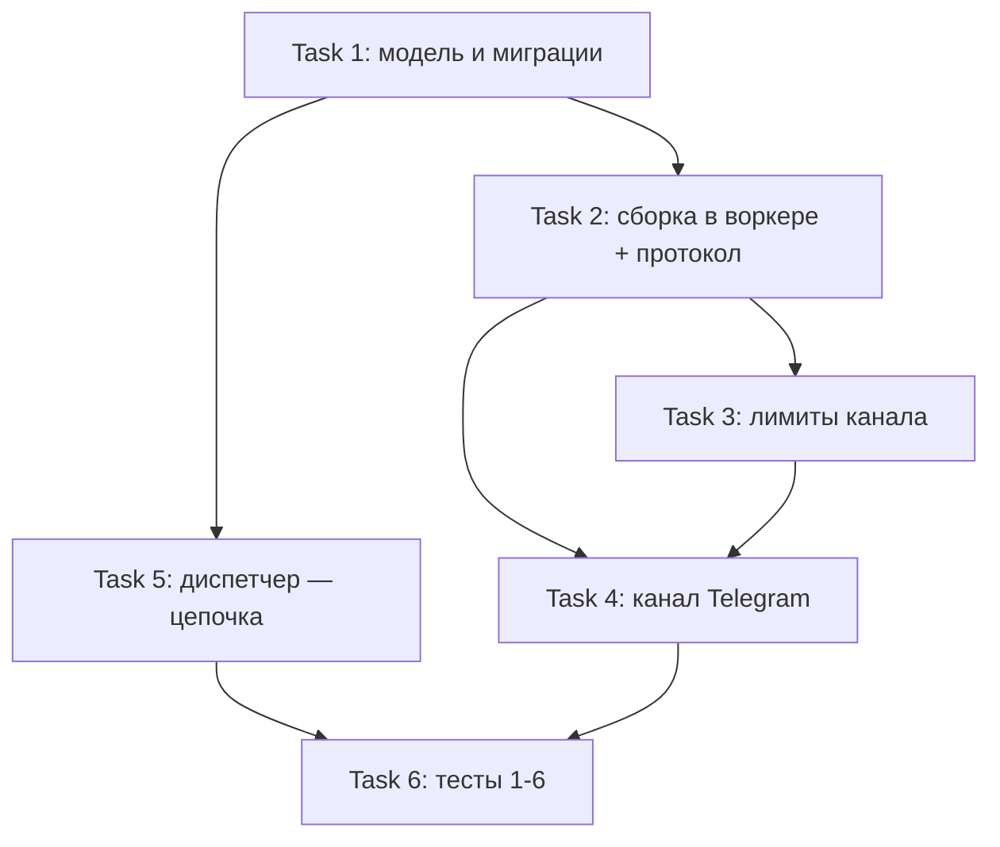

# План #485 — канал Telegram (пользовательский аккаунт): задача на канал, сборка текста в воркере

- **Спека:** `docs/specs/2026-10-25-notify-telegram-channel-485-design.md` (рев.2)
- **Issue:** #485. **Дата:** 2026-10-25.
- Все решения Gate A/B — в спеке (§0); план их не пересказывает, задачи реализуют User Scenarios §12.
- Правки контрактов спеки §10 (семейная спека рев.5, ADR 014, доменные правила notify) внесены дизайн-сессией и **уже в main** (Gate B, коммит 5e656e74) — задач плана они не образуют; план покрывает только код.

## Goal

Первый реальный канал доставки (Telegram через пользовательский аккаунт студии, MTProto/Telethon) и перестройка механизма: задача = один канал с данными рендера и замороженным шаблоном, сборка текста в воркере, цепочка каналов задачами со спавном диспетчером, лимиты отправки с защитой аккаунта, человеческие тексты ошибок, отправленный текст в журнале попыток.

## Architecture

Диспетчер (единственный писатель БД) замораживает данные+шаблон в задаче первого канала приоритета → очередь Redis Streams → воркер (без БД) собирает текст в песочнице Jinja2 (экранирование по формату канала), отправляет через канал (транспортные ретраи `NOTIFY_SEND_RETRIES`), отчёт с отправленным текстом → диспетчер пишет попытки/статусы, при терминальной неудаче спавнит задачу следующего канала (`UNIQUE(root_task_id, channel)` — идемпотентность), итог цепочки — на корневой задаче. ADR 014, неприкосновенное ADR 009 (воркер без БД и переносим).

## Tech Stack

Python 3.12, FastAPI/SQLAlchemy 2 async/aiosqlite (миграции alembic), Redis Streams (redis-py, ADR 013), Jinja2 (SandboxedEnvironment), **telethon>=1.34** (новая зависимость backend), pytest + `pytest -m redis` (контур notify-tests), Playwright (e2e мок-каналы).

---

## Task 1: Модель и миграции — задача на канал, шаблоны с каналом, отправленный текст попытки

### Classification: standard

### Required Docs

- `docs/domain-rules/notify.md` (задачи доставок — рев. части 4)
- Семейная спека `docs/specs/2026-10-11-notify-system-476-design.md` §4.2 (payload), §3.7 (шаблоны)

### Шаги

1. `NotifyTask`: новые колонки `channel`, `address`, `payload` (JSON), `template_id`, `template_body`, `root_task_id` (у первой задачи = собственный id), `parent_task_id` (NULL у первой), `delivery_outcome` (nullable `delivered | not_delivered` + причина), `resend_of` (nullable — ссылка на корень оригинальной доставки ручного повтора, контракт части 5; в текущей модели отсутствует — докстринг «not here yet»); упразднить `text` и `channels`; **сохранить** `client_id`, `skip_reason` + терминальный статус `skipped`, `reenqueues`, штампы.
2. Констрейнт `UNIQUE(root_task_id, channel)` (идемпотентность спавна, спека §8.3).
3. `NotifyTemplate`: колонка `channel: str | NULL` + уникальный индекс по `(event_type, COALESCE(channel, ''))` (NULL-универсальность, спека §4.2).
4. `NotifyTaskAttempt`: колонка `sent_text: Text | NULL` (спека §4.3).
5. Миграция alembic одной головой; сид остаётся универсальным; система за `NOTIFY_ENABLED=false` — обратной совместимости данных нет.

### DoD

- Миграции применяются вверх/вниз чисто; юнит: первая задача цепочки получает `root_task_id = id`; повторная вставка (root, channel) падает на констрейнте; lookup шаблона `(event_type, channel) → (event_type, NULL) → default` проходит по COALESCE-индексу; skip-статусы (`no_recipient` и др.) живы после миграции (спека §13, «skip-landing»).

---

## Task 2: Сборка текста в воркере + протокол канала (escape-режим)

### Classification: standard

### Required Docs

- Спека §5 (шаблоны и сборка), §6.1 (протокол)
- ADR 014 (сборка в воркере, экранирование по каналу)

### Шаги

1. Модуль рендера: вариант окружения по формату шаблона (строгие неопределённые, нейтрализация контрольных символов — сохраняются; HTML-экранирование значений **по формату канала задачи** — для telegram всегда, независимо от происхождения шаблона, спека §5.3).
2. Протокол канала (`channels/base.py`): канал декларирует escape-режим `none | html`; `send(address, text)` принимает собранный текст; докстринги «канал конвертирует нейтральную разметку» переписаны (спека §6.1).
3. Воркер: сборка из `payload` + `template_body` один раз на задачу (кэш в цикле обработки), ретраи шлют тот же текст; ошибка сборки → `app_error` «не удалось собрать текст уведомления: …», без транспортных ретраев.
4. Мок-канал на новый шов: простой текст, маркеры адресов `fail-transport:` / `fail-app:` сохраняются, собственные настройки лимитов (для Task 3/6).

### DoD

- Юниты спеки §13: универсальный шаблон × задача telegram — значение с `<`, `&` уходит экранированным (крестовый кейс); канальный шаблон — разметка канала + экранированные значения; сборка один раз на задачу; ошибка сборки → `app_error`.

---

## Task 3: Общий механизм лимитов канала (пауза, суточный потолок, служебное сообщение)

### Classification: standard

### Required Docs

- Спека §4.4 (ключи Redis), §6.3 (лимиты)

### Шаги

1. Механизм лимитов в реестре каналов: параметры у канала (потолок, пауза, адрес служебных сообщений), ключи `notify:{channel}:cap:<ГГГГММДД>` (INCR, первый INCR ставит EXPIRE 48 ч) и `notify:{channel}:cap-notified:<ГГГГММДД>` (TTL 48 ч); дата — наивное UTC процесса.
2. Проверка потолка перед отправкой: исчерпан → `app_error` «суточный лимит исчерпан»; успешная отправка — INCR.
3. Служебное сообщение админу при первом исчерпании окна: на `TELEGRAM_ADMIN_PHONE`, через тот же канал; не увеличивает счётчик; соблюдает паузу; флаг ставится после успешной отправки (дубль при краше между — принят); адрес не задан — сообщения нет, причина остаётся в журнале.
4. Пауза отправок: асинхронная выдержка между последовательными отправками канала в процессе воркера.

### DoD

- Юниты (пауза мокается): исчерпан → `app_error` с причиной; админ не задан → сообщения нет; флаг стоит → второго сообщения в окне нет.

---

## Task 4: Канал Telegram (Telethon)

### Classification: standard

### Required Docs

- Спека §6 (клиент, нормализация, резолв, отправка, таблица ошибок), §7 (настройки)
- Референс: cmbot `TuserSenderService` / `TelegramUserClient` (синхронный мост НЕ переносится)

### Шаги

1. Зависимость `telethon>=1.34` в `backend/pyproject.toml`.
2. Настройки §7: `TELEGRAM_API_ID`, `TELEGRAM_API_HASH` (SecretStr), `TELEGRAM_SESSION` (SecretStr), `TELEGRAM_ADMIN_PHONE`, `TELEGRAM_SEND_PAUSE=30`, `TELEGRAM_DAILY_CAP=200`; существующие notify-настройки не трогаются.
3. Клиент: один на процесс воркера, лениво; `StringSession`, `connection_retries=3, retry_delay=1`; `connect()` + `is_user_authorized()` перед отправкой; `is_available()` = тройка задана.
4. Нормализация телефона к E.164-подобному виду → своя строка ошибок «некорректный формат номера»; резолв `get_entity(phone)` → `InputPhoneContact` + `ImportContactsRequest`; резолв не дал пользователя → «номер не зарегистрирован в Telegram».
5. Отправка: parse-режим по происхождению шаблона (канальный → HTML, универсальный → без parse-режима), таймаут 30 с на всю операцию (резолв + отправка).
6. Таблица ошибок §6.4 построчно (категория из класса ошибки; русский текст; имена классов не пишутся); `FloodWaitError` → `transport_error` c `retry_after`.
7. Скрипт `backend/scripts/generate_telegram_session.py` (интерактивная генерация строки сессии, перенос из cmbot).
8. Регистрация канала в реестре (нижняя строка модуля по канону #484).

### DoD

- Юниты с заглушкой Telethon-клиента (сеть не трогаем): каждая строка §6.4 даёт свою категорию + русский текст; нормализация номера; parse-режим по шаблону; доступность по настройкам.

---

## Task 5: Диспетчер — заморозка в сценарии, цепочка каналов, отчёты, пере-заливка

### Classification: standard

### Required Docs

- `docs/domain-rules/notify.md` (адрес наследуется; идемпотентность; итог цепочки)
- Семейная спека §3.2–3.3 (рев.5), §4.3–4.4

### Шаги

1. Сценарий `new_record`: при согласии — задача **первого канала** приоритета с адресом (телефон на момент события), `payload` и заморозкой шаблона (правило поиска Task 1); skip-пути без изменений.
2. Цикл статусов: попытки с `sent_text`, статусы задач; терминальная неудача → спавн задачи следующего канала (наследует `payload`/`address` корня, свежая заморозка шаблона) при соблюдении `UNIQUE(root_task_id, channel)`; исчерпание каналов → `delivery_outcome = not_delivered` + причина на корне; успех любой задачи → `delivered`.
3. Отчёт воркера несёт `sent_text` (правка семейной §4.3, рев.5) — только текст, прочие данные клиента не ездят.
4. Пере-заливка: предикат `queued` ∧ старше `NOTIFY_REENQUEUE_AFTER` ∧ **не в PEL группы worker**; пауза канала не зависание.
5. Ручная повторная отправка (контракт части 5, не реализация): новая цепочка (новый корень) + `resend_of` — уникальность не мешает; текст из `sent_text`, при NULL — пересборка из замороженного.

### DoD

- Контур notify-tests: цепочка (падение канала 1 → задача канала 2 → успех / исчерпание с итогом на корне); повторная доставка отчёта не дублирует задачу; отчёты пишут `sent_text`.

---

## Task 6: Тестовое покрытие — сценарии 1–6, контур, E2E

### Classification: standard

### Required Docs

- Спека §12 (User Scenarios), §13 (тесты)

### Шаги

1. Юниты (дополнение к DoD задач 1–4): таблица ошибок построчно; заморозка/lookup; крестовое экранирование; сборка один раз; идемпотентность спавна; лимиты (админ не задан / второго сообщения нет).
2. Контур `pytest -m redis`: счётчик потолка + служебное сообщение + флаг окна (мок-канал с малым потолком); констатация покрытия цикла входящих части 3 — при отсутствии один юнит-тест события-заглушки без обработчика (спека §9).
3. E2E (стек с Redis, мок-каналы, продолжение `frontend/admin/e2e/notify-s6-mock-delivery.spec.ts`):
   - сценарий 1 — успешная доставка, в попытке хранится отправленный текст;
   - сценарий 2 — нерезолвимый адрес → попытка с причиной, «не доставлено» когда канал последний;
   - сценарий 3 — падение канала 1 → доставка каналом 2;
   - сценарий 5 — правка шаблона через базу теста → новые задачи с новым текстом, в полёте — со старым.

### DoD

- E2E-тесты сценариев 1, 2, 3, 5 спеки §12 проходят (RED-GREEN-REFACTOR).
- Юнит-таблица §6.4 зелёная построчно; контурные проверки лимитов/цепочки зелёные.

---

## Порядок и зависимости

Task 6 закрывает все User Scenarios; сквозной прогон — CI (unit + notify-tests + e2e шарды).
