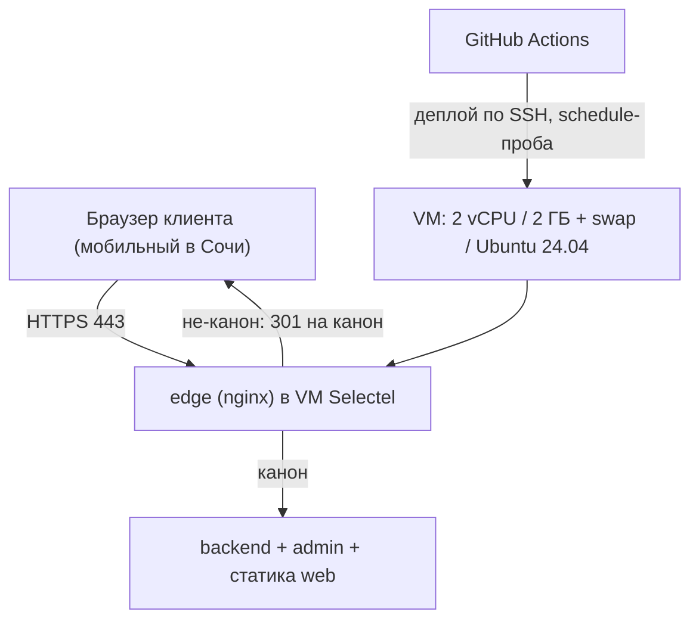

# План: 574 — VPS-хостинг прода (Selectel)

Дата: 2026-11-27 · Задача: #574 (закрывается PR IMPL-этапа) · Спека: `docs/specs/2026-11-27-hosting-provider-574-design.md`

## Goal

Ввести прод-сервер (Selectel, 2 ГБ) в строй: единственная кодовая правка (edge-редирект), скрипт провижининга хоста, workflow ежечасной пробы доступности — и ручной этап создания сервера с приёмкой по 5 сценариям спеки. Поведенческая дельта — в спеке (`## Behavioral Delta`), здесь не дублируется.

## Architecture

Три зоны изменений поверх стека #616 (compose в main, PR #629):

- `deploy/nginx.conf` — map + server-level `return 301` для не-канонов (единственная правка продукта);
- `deploy/provision-vps.sh` — новый скрипт провижининга (новый файл);
- `.github/workflows/uptime.yml` — новый scheduled-воркфлоу (новый файл);
- VM, DNS-записи, GitHub-секреты — вне git (панели Selectel/Яндекса/GitHub — владелец, Task 4).

## Tech Stack

nginx 1.29-alpine (edge), Docker CE + compose v2, certbot (snap), GitHub Actions, Ubuntu 24.04 LTS, SQLite (без изменений).

---

## Task 1: Edge — редирект не-канонов на 443

### Classification: small

В существующем 443-сервере `deploy/nginx.conf`:
- на уровне http (conf.d-файл включается в http) — `map $host $memo_noncanon { hostnames; default 1; colourmountains.ru 0; }`;
- на уровне server — `if ($memo_noncanon) { return 301 https://colourmountains.ru$request_uri; }`.

Хосты не-каноны (любой, кроме канона) → `301 https://colourmountains.ru$request_uri`; канон — без изменений. **Ограничения из спеки обязательны**: без новых location-станз, без второго server-блока, порт 80 не трогать (ACME `^~ /.well-known/acme-challenge/` живёт в port-80 catch-all), HSTS-строку не менять, `nginx.smoke.conf` и `deploy/verify-edge.sh` не трогать.

### Required Docs

- Спека §«Edge: редирект не-канонов» (механика, статус 301 и почему не 308) и §«Зафиксированные решения» п.3 (матрица имён);
- Заголовок `deploy/nginx.smoke.conf` (KEEP IN SYNC-контракт) и header `deploy/verify-edge.sh` (что именно сверяет страж stage 1).

DoD: `deploy/verify-edge.sh` проходит все стадии (в diff нет новых location-станз — страж не задет); `nginx -t` на prod-конфе зелёный; живая curl-проба редиректа — в приёмке Task 4 (сценарий 2 спеки).

---

## Task 2: Workflow ежечасной пробы доступности

### Classification: small

Новый `.github/workflows/uptime.yml`:
- триггеры: `schedule: cron "5 * * * *"` (ежечасно, 5-я минута) + `workflow_dispatch`;
- один шаг: `curl -fsS --max-time 30 https://colourmountains.ru/api/v1/health` — провал = красный run → штатное уведомление GitHub (email владельца);
- URL захардкожен с комментарием (один прод-домен, переменная не нужна); job-комментарий: «до go-live run'ы ожидаемо красные».

### Required Docs

- Спека §«Зафиксированные решения» п.7 (этаж мониторинга) и §«Сеть» (путь healthcheck через edge).

DoD: `workflow_dispatch` прогон выполняется (на PR — синтаксис и права); после go-live — зелёный ежечасный run. Внешний чек сценария 1 спеки.

---

## Task 3: Скрипт провижининга хоста

### Classification: standard

Новый `deploy/provision-vps.sh` (bash, `set -euo pipefail`, безопасен к повторному запуску): по порядку из спеки §«Требования» —
1. non-root sudo-пользователь + SSH-хардендинг (`PasswordAuthentication no`, `PermitRootLogin no`, вход только по ключу);
2. `ufw`: `limit 22/tcp`, allow 80/443;
3. swap 2 ГБ + `vm.swappiness=10`;
4. Docker CE из официального репозитория + compose-плагин v2; проверка `python3` (health-проба деплой-скрипта; в Ubuntu 24.04 есть штатно — скрипт проверяет и доустанавливает при отсутствии);
5. certbot из snap (+ штатный systemd-таймер);
6. хост-пути: `/opt/memo/env` (production.env 0600 — сам файл рендерится деплой-скриптом из GitHub Secrets при каждом деплое; обязательное значение `ENV=production` задаётся секретом в Task 4), `/opt/memo/data` (chown 1001:1001), `/opt/memo/media` (+`media/public`), `/opt/memo/certs`, `/opt/memo/acme`;
7. bootstrap-выпуск сертификата (курица-яйцо: edge отказывается стартовать без пары сертификатов, поэтому webroot-выпуск до деплоя обслуживает временный сервер): поднять временный `python3 -m http.server 80 -d /opt/memo/acme` (python3 уже установлен шагом 4, порт 80 свободен — edge ещё не деплоился) → `certbot certonly --webroot -w /opt/memo/acme -d colourmountains.ru -d www.colourmountains.ru -d xn--b1acfa3biol7a6ce.xn--p1ai` → остановить временный сервер → скопировать пару в `/opt/memo/certs`. Продления после деплоя идут webroot'ом через ACME-location самого edge;
8. deploy-hook reload: hook-файл certbot (`docker exec edge nginx -t && docker exec edge nginx -s reload`) — срабатывает при продлениях после деплоя (проверка хука — Task 4: до деплоя контейнера edge не существует).

В скрипт НЕ входит (ручные шаги Task 4): создание VM, DNS-записи, GitHub-секреты, деплой. Скрипт печатает следующий ручной шаг после каждого завершённого блока.

### Required Docs

- Спека §«Требования» (полный перечень) и §«Готовность к белым спискам» (чек-лист выполняется ДО скрипта — сверка IP первый шаг);
- Header `deploy/deploy.sh` (контракт путей, которые скрипт готовит: env/data/media/certs/acme, пара fullchain.pem+privkey.pem).

DoD: прогон на свежесозданной VM (Task 4) завершается без ошибок; деплой-скрипт проходит префлайт (пути, python3 и сертификаты найдены). Проверка deploy-hook (`certbot renew --dry-run --run-deploy-hooks`) — в Task 4 после деплоя: до него контейнера edge не существует. Прибор приёмки — сценарии 1–3 спеки на живом сервере.

---

## Task 4: Создание сервера и приёмка (ручной этап — владелец + этот сеанс)

### Classification: standard

(многошаговый этап приёмки всего релизного стека; кода не касается и файлов не меняет — Dispatch-секция не требуется: нет ни >5 файлов, ни полного прогона тестов; исполнители указаны в шагах)

Не-кодовый этап, исполняют владелец (панели) и сеанс (проверки). Порядок:
1. Владелец: VM в Selectel — 2 vCPU, 2 ГБ RAM, 30 ГБ, Ubuntu 24.04 LTS, ЦОД Москва или СПб, выделенный статический IPv4.
2. **Сразу после создания** — сверка выданного IP со списками выживших подсетей (спека §«Готовность к белым спискам»; промах → пересоздание VM до любых настроек).
3. Прогон `deploy/provision-vps.sh` (Task 3).
4. Владелец: убеждается в доступе к ЕСИА (спека §«DNS» — до смены записей); три A-записи в панели Яндекса (`@`, `www`, punycode-IDN → IP); секреты в GitHub: `DEPLOY_SSH_HOST` / `DEPLOY_SSH_USER` / `DEPLOY_SSH_KEY` и приложение-секреты для env-рендера, включая `ENV=production` (обязательное значение — Secure-флаг куки).
5. Снапшоты Selectel: включить автобэкапы с еженедельным расписанием (панель Selectel); ручной снапшот перед каждым релизом — внести в ранбук релиза.
6. Проба egress: pull тестового образа из ghcr.io на VM (спека §«Сеть»); при провале — наполнить зеркало и переключиться через `MEMO_REGISTRY_PREFIX` (поддержка уже в деплой-скрипте).
7. Деплой релизного тега; приёмка по сценариям спеки: 1 — HTTPS 200, SAN на три имени, `Set-Cookie: Secure; HttpOnly; SameSite=Lax`; 2 — `301` с сохранением пути/query на оба не-канона, без `Set-Cookie`; 3 — деплой из GitHub Actions зелёный (пробы ранбука #619); 4 — restore-drill из снапшота + `PRAGMA integrity_check`; 5 — IP в списках + наблюдение владельца во время ограничения; плюс `certbot renew --dry-run --run-deploy-hooks` (проверка deploy-hook после деплоя).

### Required Docs

- Спека целиком (сценарии = чек-лист приёмки, §«SSH и деплой» — секреты);
- Ранбук приёмки #619 (пробы сценариев 1–3).

DoD: все 5 сценариев спеки имеют зафиксированный результат (зелёный чек или зафиксированное отклонение с комментарием на issue); карточка #574 → `In-main` после закрытия PR IMPL-этапа.
