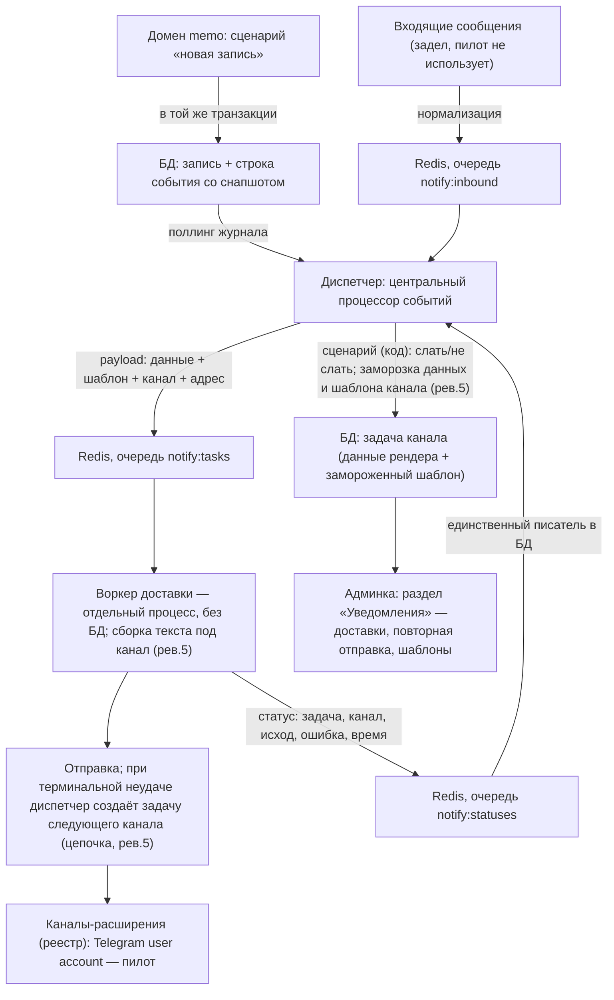

# Система оповещений memo — архитектурная спека-контракт (#476)

Дата: 2026-10-11 · Статус: рев.5 (2026-10-25, дизайн части 4 #485: задача = один канал — данные рендера и шаблон канала замораживаются в задаче, сборка текста в воркере, перебор каналов — цепочка задач со спавном диспетчером; ADR 014; решения рев.3 в силе, кроме «текст формируется один раз» — пересмотрено) · рев.4 (2026-10-21, транспорт arq → Redis Streams, ADR 013) · Контейнер: #476 · Референс: cmbot (github.com/mkosinov/cmbot)

## 1. Контекст и цель

В memo сегодня нет оповещений: сценарии записи молчат, доставка одноразовых ссылок пароля — ручная передача администратором (#398, Hold до готовности каркаса). Задача #476 — построить каркас системы оповещений и провести его пилотом «новая запись → Telegram-клиенту».

Схема адаптируется с cmbot пользователя с исправлением его слабых мест: ручная повторная отправка отсутствовала, канал-фабрика — цепочка «если-иначе», обработка вебхука бота — синхронная и смешанная с бизнес-логикой, вся система — синхронная.

Распределённость очереди, изоляция воркера от базы и отдельные процессы — прямые требования пользователя (#476): асинхронная работа и возможность вынести доставку на отдельную машину без доступа к локальной SQLite; обоснование и отвергнутые альтернативы — ADR 009/013. Внутрипроцессный post-commit-эмиттер репозитория (`src/events/emitter.py`) для доставки не используется: он не переживает рестарт процесса и не переносим на другую машину.

**Это семейная спека.** Она фиксирует архитектуру и межчастевые контракты; пять листовых частей (раздел 9) получают собственные детальные спеки и планы в своих дизайн-сессиях и НЕ пересказывают эту. Архитектурные решения зафиксированы в ADR: `docs/decisions/008`–`013`.

Требования пользователя (тело #476): протокол подключения каналов-расширений; асинхронность; перебор каналов по приоритету при недоступности; мониторинг и хранение статусов; ручная повторная отправка; учёт сценариев «слать/не слать»; гибкие тексты по параметрам (услуга, тарифы, стоимость, ссылка на карту); задел двустороннего потока с централизованной обработкой входящих в отдельных расширениях.

Решения пользователя от 2026-10-11 (рев.3): Telegram в пилоте — отправка **пользовательским аккаунтом** (MTProto, не бот-аккаунт), привязка клиента по коду не строится; текст оповещения формируется один раз при создании задачи, повторная отправка шлёт готовый текст; сетевые ретраи — не более трёх попыток на транспортных сбоях; CRUD шаблонов строим; согласие по умолчанию включено. Пересмотр 2026-10-25 (рев.5, часть 4): «текст формируется один раз при создании задачи» заменено — задача несёт данные рендера и шаблон канала, текст собирает воркер под каждый канал (ADR 014).

## 2. Принятые решения

| Решение | ADR |
|---|---|
| События — транзакционный журнал в основной БД со снапшотом | 008 |
| Воркер доставки без доступа к БД: вниз данные рендера и шаблон канала (рев.5, ADR 014), вверх статусы обратной очередью | 009, 014 |
| Транспорт — Redis Streams + consumer groups напрямую через redis-py (рев.4; до — arq по ADR 010), три категории, ретраи уровня очереди не строятся | 013 |
| Каналы — реестр-расширения; шаблоны и правила — в ядре | 011 |
| Декомпозиция: контейнер #476 + 5 листовых частей | 012 |
| Задача = один канал; сборка текста в воркере из данных и замороженного шаблона; цепочка задач каналов со спавном диспетчером (рев.5) | 014 |

Дополнительные решения: сценарии реакции — код, без редактора в UI; автоматических повторов уровня очереди нет (ретраи уровня очереди не строятся) — повторяются только транспортные сбои внутри отправки канала, до 3 попыток (критерий — раздел 3.4); диспетчер замораживает данные рендера и шаблон канала в задаче первого канала приоритета (рев.5), текст собирает воркер под канал в песочнице Jinja2 (ADR 014); нейтральная разметка и конвертер упразднены (рев.5); при терминальной неудаче канала диспетчер создаёт задачу следующего канала цепочки; пилотный сценарий один («новая запись»), пилотный канал один (Telegram через пользовательский аккаунт); привязка клиента к каналу и бот-аккаунт отложены (вернутся с мессенджерами, требующими идентификатор-адрес); воркер и диспетчер — отдельные процессы.

## 3. Архитектура



### 3.1 Доменные события (часть 1)

Таблица `domain_events`: идентификатор, тип (строка-код; пилот — `new_record`), время возникновения, JSON-снапшот (самодостаточный, формат — раздел 4.1), `processed_at` (NULL = не обработан), `attempts` (счётчик), `processing_error`.

Запись — в транзакции сценария: расширение паттерна `@transactional` третьим аккумулятором рядом с аудитом. Событие появляется ровно тогда, когда зафиксировано доменное изменение; сборка снапшота — до коммита, только локальными чтениями (без внешних вызовов). Продюсер не знает потребителей. Чтение диспетчером — по частичному индексу `processed_at IS NULL`, батчем, курсором по состоянию строк (не по «id > последнего увиденного»). Обработанные строки остаются в журнале как история; очистка/архивация — вне пилота.

Существующий SSE-хаб и журнал аудита не используются как источник событий: хаб раздаёт только имена сущностей (подсказки инвалидации кэша), аудит заточен под журнал действий и не содержит данных для оповещений.

### 3.2 Диспетчер — центральный процессор событий (часть 1)

Отдельный фоновый процесс из той же кодовой базы, три цикла:

1. **Поллинг журнала** необработанных событий (батчем, интервал по умолчанию 1 с): применяет сценарии-реакции — реестр в коде (ADR 011). Сценарий `new_record` проверяет «слать/не слать»: чекбокс записи «отправлять оповещения» (существующий флаг формы создания, до сих пор игнорируемый бекендом, — часть 1 подключает его к контракту) ∧ согласие клиента (живая запись `clients.notify_enabled` на момент обработки; колонку вводит миграция части 1, экран переключения — часть 5) ∧ событие в будущем. При любом отказе создаётся задача с состоянием «пропущено» и причиной (`no_consent` / `no_recipient` / `past_event` / `notify_off`); при согласии — **заморозка данных рендера и шаблона канала** (шаблон из базы по правилу поиска 3.7; песочница Jinja2 — в воркере, рев.5) в задаче первого канала приоритета, состояние «в очереди», постановка в `notify:tasks`. Обработка события помечается (`processed_at`) в одной транзакции с созданием задачи — повторная обработка не создаёт дубль. Ошибка сценария (включая отсутствие шаблона): попытка увеличивает `attempts`, после 3 попыток событие помечается `processing_error` и больше не берётся поллингом (до вмешательства разработчика; ручная переобработка без UI — вне пилота). Ошибка сборки текста в воркере — не сюда: это `app_error` попытки канала (3.4, рев.5).
2. **Чтение `notify:statuses`**: запись попыток (таблица `notify_task_attempts`: задача, канал, стадия, ошибка, время — добавляемые строки) и производного состояния задачи (4.3) в БД, идемпотентно (4.4). Чтение — надёжным паттерном потребления: заявка батчем, обработка, подтверждение; зависшие при старте возвращаются (4.4; механика транспорта — Streams PEL, часть 2).
3. **Чтение `notify:inbound`**: маршрутизация входящих событий в зарегистрированные расширения-обработчики. Задел двусторонности (требование #476): в пилоте потребителей нет; категория очереди и нормализованный формат события закрепляются контрактом, чтобы будущая обработка обратной связи не меняла транспорт.

Диспетчер (включая его inbound-расширения) — единственный писатель в БД со стороны подсистемы уведомлений; кроме него пишет только API ручной повторной отправки (3.8).

### 3.3 Очередь (части 2–3)

Redis + Streams (ADR 013; рев.4 — arq из ADR 010 отклонён при дизайне части 2: сопровождение «только критические исправления», потолок redis-py, асинхронный клиент против синхронного порта). Три категории-стрима: `notify:tasks` (задачи вниз), `notify:statuses` (статусы вверх), `notify:inbound` (входящие, задел) — потребительские группы `worker` / `dispatcher`, ретраи уровня очереди не строятся (статусы идут своей очередью). Перезаливка: задачи в состоянии «в очереди» старше `NOTIFY_REENQUEUE_AFTER` (по умолчанию 120 с) и не заявленные воркером (вне PEL группы worker; рев.5 — пауза отправки канала не считается зависанием) переenqueue'ятся диспетчером — переживание падения или чистки Redis.

`NOTIFY_ENABLED` (по умолчанию выключено; в тестовом окружении — обязательно выключено): журнал `domain_events` пишется всегда (это часть домена); выключенное состояние останавливает диспетчер и воркер и запрещает постановку задач в очередь — события копятся необработанными и обрабатываются после включения. Тестовый контур с включённым Redis — отдельный стек части 2 (маркированные тесты + e2e), стандартный прогон Redis не требует.

Размер payload естественно ограничен одним оповещением (данные рендера + шаблон канала + адрес; рев.5); отдельных лимитов не вводим — объёмы копеечны по меркам Redis.

### 3.4 Воркер доставки (часть 3)

Воркер доставки, отдельный процесс, без доступа к БД (ADR 009/014). Получив задачу канала (рев.5): сборка текста в песочнице Jinja2 из замороженных данных и шаблона (экранирование — по формату канала, сборка один раз на задачу), проверка доступности канала, отправка, публикация статуса попытки с отправленным текстом. Терминальная неудача (транспортные ретраи исчерпаны либо ошибка приложения) → отчёт; диспетчер создаёт задачу следующего канала цепочки либо закрывает цепочку «не доставлено».

Ретраи отправки (решение пользователя: не более трёх): повторяется только **транспортный сбой** — обрыв соединения, таймаут, HTTP 5xx, 429 (с соблюдением Retry-After); не повторяются ошибки приложения (4xx: неверный адрес, отказ доставки, блокировка) — они сразу завершают попытку канала с ошибкой. До 3 попыток на канал суммарно. Редкий дубль при таймауте после фактической доставки принят (4.4).

### 3.5 Каналы-расширения (части 3–4)

Протокол: класс-канал с именем, `is_available()`, escape-режимом (`none | html`; рев.5) и `send(address, text)` — текст приходит уже собранным воркером; подключение — декларативный реестр (ADR 011). Экранирование значений определяется каналом задачи независимо от происхождения шаблона (universal — простой текст без канального parse-режима; шаблон канала — разметка канала + экранированные значения; рев.5) — разметка принадлежит только шаблону канала, данные остаются данными. `is_available()` — «готов к отправке»: настройка заполнена и транспорт отвечает лёгкой проверке; точный состав проверки определяет канал, контракт — единый для реестра. Новый канал = модуль + регистрация + настройки, ядро не меняется. Канал, указанный в настройках приоритета, но не зарегистрированный, — громкая ошибка старта воркера.

Пилот: Telegram-канал через **пользовательский аккаунт** (MTProto-клиент, как `TuserSenderService` в cmbot): адрес доставки — телефон клиента, резолв номера в идентификатор выполняет MTProto-библиотека; сессия аккаунта в настройках. Привязки, бот-аккаунт и вебхук отложены (раздел 7) — вернутся с каналами, которым нужен идентификатор-адрес вместо телефона.

### 3.6 Входящие сообщения — задел двусторонности (часть 4)

Транспортная схема закрепляется контрактом: источник входящего (в будущем — события MTProto-клиента пользовательского аккаунта или вебхук ботового канала) **только нормализует** сообщение в событие `notify:inbound` (канал, внешний адрес отправителя, тип, текст, идентификатор доставки, время события) и не содержит бизнес-логики; обработку выполняют расширения-обработчики в процессе диспетчера. В пилоте потребителей входящих нет; строительство первого (например, привязка или ответы клиентов) — отдельная задача на готовом контракте.

### 3.7 Шаблоны (части 3, 5)

Таблица `notify_templates`: тип события, канал (`NULL` — универсальный шаблон; рев.5), название, текст (Jinja2), признак дефолта; сид-миграция с дефолтом `new_record`, использующим полный набор переменных (4.1). Поиск при создании задачи канала: точное `(event_type, channel)` → `(event_type, NULL)` → дефолтный; уникальность — индекс по `(event_type, COALESCE(channel, ''))`. Управление — в админке (раздел 3.8, CRUD строим — решение пользователя); при сохранении — пробный рендер на примере переменных (песочница, строгие неопределённые). Дефолтный шаблон неудаляем; при отсутствии шаблона для события используется дефолтный. Шаблон замораживается в задаче при её создании (рев.5): редактирование влияет на новые задачи (включая следующие каналы цепочки), но не на задачи в полёте и повторные попытки.

### 3.8 Админка «Уведомления» (часть 5)

Раздел с двумя экранами, оба — типовой экран-таблица с фильтрами через URL-состояние, пагинацией и пустым состоянием (канон списков репозитория). Доступ — только аутентифицированным администраторам (канон авторизации репозитория); публичных точек у подсистемы в пилоте нет.

- **Доставки**: время, событие, получатель, канал, состояние задачи, причина/ошибка; фильтры по состоянию/событию/дате; детально — попытки каналов и текст оповещения; кнопка «Отправить повторно» (на «не доставлено» и «доставлено»).
- **Шаблоны**: список, создание/правка/удаление (кроме дефолтного), пробный рендер при сохранении.

Ручная повторная отправка (решение пользователя): retry доставки — это отправка **уже сформированного текста**. API создаёт новую цепочку (новый корень, рев.5) со ссылкой на оригинал: текст берётся отправленный (`sent_text` попытки оригинала; при отсутствии — пересборка из замороженных данных и шаблона), адрес — по текущим данным клиента на момент повтора (осознанное исключение из правила заморозки). Согласие повторно не проверяется — нажатие администратора является осознанным решением.

Согласие клиента: чекбокс в карточке клиента (`clients.notify_enabled`, колонка миграцией части 1, по умолчанию включено — подтверждение записи ожидается клиентом; отключается по просьбе).

Судьба существующего чекбокса «отправлять оповещения» в форме создания записи: сегодня флаг уходит на бекенд и игнорируется им; часть 1 включает его в предикат сценария (3.2) — до включения чекбокса оповещений не будет, что совпадает с его текущим умолчанием «выключено».

## 4. Контракты (межчастевые швы)

### 4.1 Снапшот события `new_record`

```json
{
  "event": {"type": "new_record", "occurred_at": "<UTC>", "record_id": 123},
  "client": {"id": 1, "name": "…", "phone": "+7…"},
  "activity": {"start": "<локальное время бизнеса>", "duration": 60},
  "service": {"title": "…"},
  "tariffs": [{"title": "…", "price": 1000}],
  "total_price": 1000,
  "location": {"title": "…", "address": "…", "map_url": "…"},
  "master": {"name": "…"}
}
```

Все ключи верхнего уровня присутствуют всегда; значения могут быть null (клиент не указан, у локации нет карты) — дефолтный шаблон написан толерантно к null. Согласие в снапшот не входит: диспетчер проверяет его живой записью на момент обработки (один источник истины). Телефон в снапшоте — рабочий адрес каналов и подстановка в текст; в журнале аудита конвенция маскирования телефонов не затрагивается (журнал событий — внутренняя очередь подсистемы, не пользовательский экран; экран доставок показывает получателя именем). Время начала хранится наивным локальным — снапшот несёт его как есть с явной пометкой в контракте; предикат «будущее» и текст используют одну интерпретацию (фиксируется в спеке части 1). `total_price` — новый доменный helper суммы визитов записи (сегодня итог считается только в SQL списков); `map_url` — существующее поле ссылки на Яндекс-Карты локации.

### 4.2 Payload задачи (`notify:tasks`)

```json
{
  "task_id": "123e4567-e89b-12d3-a456-426614174000",
  "channel": "telegram",
  "address": "+7…",
  "payload": {"…данные рендера — снапшот 4.1…": "…"},
  "template_id": "…",
  "template_body": "…замороженный текст шаблона…",
  "root_task_id": "123e4567-e89b-12d3-a456-426614174000",
  "created_at": "<UTC>",
  "resend_of": null
}
```

`task_id` — строка-UUID (`String(36)`, PK таблицы `notify_tasks`), как все идентификаторы домена. Errata (#560, 25.10): в исходной редакции примеры этого раздела и 4.3 показывали число (`456`); приведено к факту — части 1–3 реализованы на строке, валидатор воркера принимает только непустую строку.

`channel` — один канал задачи (рев.5); цепочку каналов диспетчер разворачивает задачами, адрес наследуется от корня и не переразрешается. Данные рендера и замороженный шаблон ездят в задаче (рев.5): воркер без БД собирает текст из них. Приоритет каналов — настройка `NOTIFY_CHANNEL_PRIORITY` (список через запятую без пробелов, без учёта регистра; пилот — `telegram`).

### 4.3 Состояния и стадии

**Состояние задачи** (выводится диспетчером, хранится в задаче): `queued → sending → sent | failed`; отдельное терминальное `skipped` (решение диспетчера, в очередь не идёт).

**Стадия попытки** (события `notify:statuses` от воркера):

```json
{"task_id": "123e4567-e89b-12d3-a456-426614174000", "stage": "sending|sent|failed", "channel": "telegram", "outcome": "…", "error": "…", "sent_text": "…фактически переданный текст или null…", "occurred_at": "<UTC>"}
```

Промежуточные события — по каждой попытке канала; финальное — одно. Правило производного состояния: первый `sent` любой попытки → задача `sent`; финальный `failed` задачи канала → диспетчер спавнит следующий канал либо закрывает цепочку «не доставлено» с итогом на корневой задаче (рев.5); `sending` — при первом промежуточном событии. В статусах едет отправленный текст попытки (содержит данные клиента по построению — решение рев.5); прочие данные клиента в статусах не ездят.

### 4.4 Гарантии и идемпотентность

- Доставка «хотя бы один раз» на всех стыках: возможен редкий дубль сообщения клиенту (таймаут после фактической доставки; перезаливка задачи при зависшем воркере) — принято: дубль лучше потери, отслеживание идентификаторов сообщений каналов сознательно не строим.
- (событие, сценарий) уникален: повторная обработка события не создаёт дубль задачи (`processed_at` в одной транзакции с задачей).
- Статусы: повторное применение безвредно (производное состояние идемпотентно; попытки — добавляемые строки, дубль строки попытки не искажает мониторинг). Чтение `notify:statuses` — надёжным паттерном потребления: заявка батчем (XREADGROUP), запись в БД, подтверждение (XACK); записи, зависшие в PEL, при старте диспетчера возвращаются в доставку (XAUTOCLAIM).
- Перезаливка задач: предикат «состояние `queued` и не обновлялась дольше `NOTIFY_REENQUEUE_AFTER`»; совместимость с идемпотентностью — через принятый дубль (первый пункт).

### 4.5 Настройки

`REDIS_URL`; `NOTIFY_ENABLED` (default false; testing — false); `NOTIFY_CHANNEL_PRIORITY` (CSV, пилот `telegram`); `NOTIFY_POLL_INTERVAL` (секунды, default 1); `NOTIFY_REENQUEUE_AFTER` (секунды, default 120); `NOTIFY_SEND_RETRIES` (default 3, транспортные сбои, 3.4); Telegram user account: `TELEGRAM_API_ID`, `TELEGRAM_API_HASH`, `TELEGRAM_SESSION` (строка сессии MTProto, как в cmbot); лимиты канала (рев.5, часть 4): `TELEGRAM_ADMIN_PHONE`, `TELEGRAM_SEND_PAUSE` (default 30), `TELEGRAM_DAILY_CAP` (default 200).

## 5. User Scenarios

Сквозные сценарии каркаса; E2E-покрытие распределяется по частям (указано в каждом) — это семейная спека, каждый E2E окончательно закрепляется в спеке соответствующей части.

- **US-1** (части 1–4): администратор создаёт запись на будущее время с включённым чекбоксом «отправлять оповещения» — клиент с Telegram и включённым согласием получает оповещение в мессенджер на номер своего телефона, без каких-либо предварительных действий: услуга, тарифы, итоговая стоимость, локация со ссылкой на карту, время. E2E: канал-мок, проверка адресата и подставленного текста.
- **US-2** (часть 1): запись на прошедшее время (или с выключенным чекбоксом) — событие фиксируется в журнале, задача создаётся с состоянием «пропущено» (`past_event` / `notify_off`), в очередь не идёт. E2E.
- **US-3** (части 1, 3, 5): у клиента выключено согласие — задача «пропущено: нет согласия» с видимостью причины в списке доставок; переключение согласия — в карточке клиента. E2E.
- **US-4** (часть 4): у клиента нет Telegram на указанном номере — резолв номера каналом неуспешен, попытка фиксируется с ошибкой; если канал последний в приоритете — цепочка завершается «не доставлено» с видимой причиной (рев.5). E2E: канал-мок с нерезолвимым адресом.
- **US-5** (части 3, 5): канал сбойнул — цепочка задач каналов по приоритету (рев.5); все каналы недоступны — «не доставлено»; администратор жмёт «Отправить повторно» — доставка проходит с тем же текстом (изменение шаблона на повтор не влияет). E2E: канал-мок падает и чинится.
- **US-6** (часть 5): администратор правит шаблон — новые оповещения идут с новым текстом; сохранение с ошибкой шаблона отклоняется с понятной причиной; дефолтный шаблон удалить нельзя. E2E.
- **US-7** (части 2–3): перезапуск процессов и полная чистка Redis не теряют оповещения — задачи перезаливаются из базы, статусы догоняют; стандартный тестовый прогон проходит без Redis (подсистема выключена). E2E и контурная проверка.

## 6. Behavioral Delta

**До:** система молчит. Запись создаётся без какого-либо оповещения (чекбокс «отправлять оповещения» в форме мёртв — бекенд игнорирует флаг); администратор не видит ни истории, ни статусов; ссылки установки пароля передаются руками (#398 в Hold).

**После:** каркас оповещений работает: события журнализуются транзакционно; пилотный сценарий «новая запись» (чекбокс формы + согласие + будущее) доставляет клиенту Telegram-оповещение на его номер без предварительных действий с его стороны; отказы доставки явные — состояния «пропущено» с причинами и «не доставлено» с ошибками каналов; в админке — раздел «Уведомления» со списком доставок, попытками каналов, текстом оповещения, ручной повторной отправкой готового текста и редактированием шаблонов; чекбокс формы записи обретает действие. Новые события, сценарии и каналы подключаются частями без переделки контрактов.

## 7. Границы (не строим в #476)

- Автоматические повторные отправки уровня очереди (ретраи уровня очереди не строятся; повторяются только транспортные сбои отправки, до 3 попыток).
- Редактор сценариев реакции в UI (сценарии — код).
- Ручная переобработка «мёртвых» событий с ошибками обработки (UI/команды — вне пилота).
- Привязка клиента к каналу (коды привязки, таблица привязок), бот-аккаунт и вебхук Telegram — отложены; вернутся с каналами, которым нужен идентификатор-адрес (Max и др.).
- Обработка входящих сообщений (расширения-потребители `notify:inbound`) — контракт закреплён, потребителей нет.
- События кроме `new_record` (`reset_password` и прочие — следующие задачи на готовом каркасе; #398 вернётся из Hold как сценарий).
- Каналы кроме Telegram (Max, email, SMS — по протоколу реестра позже).
- Управление порядком каналов из UI (настройка окружения).
- Полноценная двусторонняя логика обработки входящих.
- Миграция SQLite на сетевой PostgreSQL (допущение «позже»; контракты от движка не зависят).
- Отслеживание идентификаторов сообщений каналов для дедупликации дублей (принятый дубль — 4.4).

## 8. Риски реализации

- Ветвящийся граф миграций alembic (несколько голов) — часть 1 начинает новой миграцией после проверки и выпрямления голов.
- Наивное локальное время в `activity.start` — предикат «будущее» и текст оповещения обязаны использовать одну интерпретацию времени (фиксируется в спеке части 1).
- Подсистема обязана быть полностью выключенной в тестовом окружении по умолчанию — иначе ~130 тестовых файлов приобретают зависимость от Redis; включённый контур — частью 2.
- Транспорт: arq отклонён при дизайне части 2 (сопровождение «только критические исправления», потолок redis-py) — принято Redis Streams + consumer groups (ADR 013); смоук-проверка остаётся первой задачей части 2.
- Пользовательский аккаунт Telegram: риск спам-блокировки при массовых отправках — пилот обязан соблюдать щедрые лимиты отправки (пауза между сообщениями, суточный потолок), настройка лимитов — частью 4; cmbot эксплуатирует тот же механизм.
- Телефон клиента неуникален в модели — резолв адреса каналом идёт по первому клиенту задачи; коллизии телефонов остаются существующей проблемой данных вне рамок #476.

## 9. Нарезка на части

| № | Часть | Объём | Зависимости |
|---|---|---|---|
| 1 | Доменные события | журнал + транзакционная запись + снапшот; диспетчер (поллинг, статусы, inbound-цикл); сценарий «новая запись» (чекбокс записи + согласие + будущее) с рендером; миграция `clients.notify_enabled`; предикат «будущее»; helper итоговой цены | — |
| 2 | Инфраструктура доставки | Redis в dev/e2e-стеках; транспорт Streams (ADR 013, смоук-проверка первой задачей); настройка `REDIS_URL`; выключенность в testing; включённый тестовый контур; скелеты процессов | — |
| 3 | Воркер отправки | потребление очереди; реестр каналов + мок-канал; приоритет и перебор; конвертация разметки; транспортные ретраи (3) и настройка `NOTIFY_SEND_RETRIES`; статусы обратной очередью (надёжное чтение) | 1, 2 |
| 4 | Канал Telegram (user account) | MTProto-клиент, сессия в настройках; резолв по телефону; отправка; лимиты отправки; пер-канальные задачи и сборка текста в воркере (рев.5, ADR 014) | 3 |
| 5 | Админка «Уведомления» | доставки с фильтрами, попытками и повторной отправкой готового текста; шаблоны CRUD (дефолт неудаляем); переключение согласия в карточке | 3 |

DoD каждой части — её собственная спека и план; семейные контракты (раздел 4) изменяются только через эту спеку.

## Visual Compliance Checks

N/A
