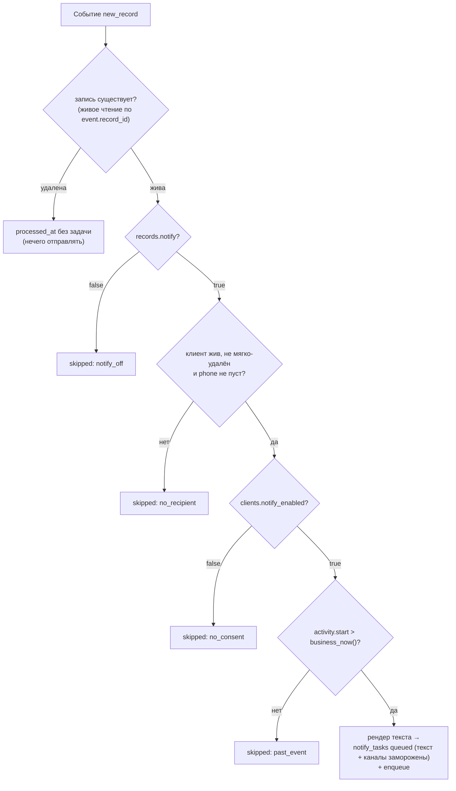

# #482 — подсистема доменных событий (часть 1 системы оповещений) — дизайн

Дата: 2026-10-19 · Статус: Draft рев.2 (Gate A авто-ОК; находки панели р1 — пять отчётов — внесены; consistency — повтор) · Issue: #482 · Семья: #476

Семейная спека-контракт: [2026-10-11-notify-system-476-design.md](2026-10-11-notify-system-476-design.md) (рев.3, Gate B пройден). Контракты её раздела 4 обязательны и здесь не пересказываются дословно — приводятся только решения части 1. ADR: [008](../decisions/008-domain-events-transactional-journal.md)–[012](../decisions/012-notification-system-decomposition.md).

## 1. Контекст и объём

Первая из пяти частей системы оповещений (#476, ADR 012). Часть 1 строит «верхнюю половину» конвейера — от домена до постановки задачи в очередь:

```mermaid
flowchart TD
    A["Сценарий create_record (@transactional)"] -->|"третий аккумулятор,<br>в той же транзакции"| B["таблица domain_events<br>(снапшот §4.1)"]
    B -->|"поллинг батчем"| C["Диспетчер src/notify/dispatcher.py"]
    C -->|"сценарий new_record:<br>флаг ∧ согласие ∧ будущее"| D["таблица notify_tasks<br>(готовый текст / причина отказа)"]
    C -->|"рендер: шаблон из notify_templates<br>+ песочница Jinja2"| D
    D -->|"payload §4.2 через очередевой порт"| E["Порт NotifyQueue<br>(Fake в тестах; адаптер Redis/arq — часть 2)"]
    F["notify:statuses (надёжный список)"] -->|"цикл 2 диспетчера"| G["notify_task_attempts +<br>производное состояние задачи"]
    H["notify:inbound (задел)"] -->|"цикл 3: реестр обработчиков,<br>в пилоте пуст"] --> I["лог + ack"]
```

Вне объёма части 1 (границы — раздел 9): инфраструктура Redis/arq и запуск процессов в стеках (#483), воркер отправки и каналы (#484, #485), админка «Уведомления» (#486).

## 2. Концепт (Gate A)

**Выбрано:** выполнить часть 1 строго по контрактам семейной спеки — журнал событий как третий транзакционный аккумулятор, диспетчер с тремя циклами за очередевым портом, сценарий-реакция в коде с рендером при создании задачи.

Отвергнутые альтернативы:

- **Чекбокс формы хранить в снапшоте события** (расширение §4.1) — отвергнуто: раздел 4 семейной спеки меняется только через неё; снапшот — контракт рендера, а не хранилище флагов формы. Вместо этого флаг становится колонкой `records.notify` (определение — §3.3 этой спеки) и читается диспетчером живой записью — симметрично согласию клиента.
- **Дефолтный шаблон константой в коде** (таблицу отложить в часть 3) — отвергнуто: семейная спека §3.2 прямо требует «шаблон из базы» при рендере в части 1. Таблица `notify_templates` с сид-дефолтом создаётся здесь (уточнение атрибуции: §3.7 помечает шаблоны «части 3, 5», но без таблицы рендер части 1 невозможен; CRUD остаётся в части 5).

## 3. Решения

### 3.1 Журнал `domain_events` — третий аккумулятор `@transactional`

Таблица (миграция — раздел 4): `id` (String(36) PK, canon репозитория), `type` (String(50), код события; пилот — `new_record`), `occurred_at` (DateTime, наивный UTC — конвенция `created_at` репозитория), `snapshot` (JSON, формат §4.1), `processed_at` (DateTime NULL), `attempts` (Integer, 0), `processing_error` (Text NULL), `created_at`/`updated_at`. Частичный индекс `ix_domain_events_pending ON domain_events (occurred_at) WHERE processed_at IS NULL AND processing_error IS NULL` — оба предиката запроса поллинга, чтобы индекс навсегда не нёс «мёртвые» строки, которые запрос всегда отбрасывает (нахождение панели; SQLite поддерживает partial index, в окружении — 3.45.1); объявление — через `sqlite_where` у `Index` модели/`op.create_index`, иначе alembic autogenerate видит дрейф.

Аккумулятор — точная копия паттерна аудита (`src/events/audit.py`): токен-владение через contextvar, новый модуль `src/notify/journal.py` (`open_journal()` / `mark_domain_event(type, snapshot)` / `draw_events()` / `reset_journal(token)`). Обёртка `@transactional` (`src/services/decorators.py`) открывает третий аккумулятор рядом с аудитом; владелец-обёртка после успеха метода и до `commit()` вставляет накопленные строки в ту же сессию — одно приложение записи = один коммит = одна строка события. Отличие от аудита: **актор не требуется** — журнал доменных событий пишется всегда (включая сиды и CLI), это данные, а не журнал действий. Внутренние обёртки не вставляют (правило одного владельца).

Сценарий `create_record` (`src/usecases/records.py`) после пересчёта мест/статуса и до возврата вызывает `mark_domain_event("new_record", build_new_record_snapshot(db_session, record))` — сборка снапшота до коммита, только локальными чтениями (§3.1 семейной спеки).

### 3.2 Снапшот `new_record` — сборка и интерпретации времени

Сборщик `build_new_record_snapshot(session, record)` в `src/notify/snapshots.py` читает локально: activity (start, duration) + service (title) + location (title, address, yandex_map_url→`map_url`) + master→staff (name) + client по `record.client_id` (id, name, phone) + visits с тарифами. Формат — §4.1 семейной спеки без изменений; правила:

- все ключи верхнего уровня присутствуют всегда, значения могут быть null (клиент не привязан, тариф удалён — `tariffs[i].title = null`);
- `tariffs` — по одному элементу на визит записи (заголовок тарифа визита + `price` визита; повторы заголовков допустимы — агрегация в тексте остаётся за шаблоном);
- `total_price` = `sum(visit.price)` — та же семантика, что SQL-итог списков записей (`_total_price_sq`), `custom_price` не входит (паритет со списками). Выносится в именованный хелпер `record_total_price(visits) -> int` (`src/services/record.py`) — единственная точка семантики для Python-потребителей; SQL списков не переделывается;
- **время — одна интерпретация (риск §8 семейной спеки, фиксируется здесь):** `activity.start` хранится наивным локальным временем бизнеса и переносится в снапшот как есть. Предикат «событие в будущем» = `activity.start > business_now()`; фильтр `fmt_dt` рендерит хранимое значение как есть (`%d.%m.%Y %H:%M`, без конверсии). `business_now()` — хелпер `src/notify/time.py`: `datetime.now(ZoneInfo(BUSINESS_TIMEZONE)).replace(tzinfo=None)` — наивный настенный часы **явной бизнес-зоны** (настройка `BUSINESS_TIMEZONE`, раздел 3.9), а не TZ сервера: тестовый контур репозитория закрепляет TZ=UTC (`scripts/test-all.sh`), контейнеры по умолчанию тоже UTC — сравнение с «голым» `datetime.now()` молча сдвигало бы границу «прошлое/будущее» на разницу зон (находка панели, BLOCKER). `occurred_at` — наивный UTC (конвенция таймстампов репозитория), в снапшоте — ISO 8601 с суффиксом `Z`.

### 3.3 Флаг формы «отправлять оповещения»: путь до диспетчера

Разведка уточнила семейную спеку (§3.8: «флаг уходит на бекенд и игнорируется им»): сегодня флаг гибнет **на фронте** — чекбокс есть в payload формы, но в тело запроса `createRecord` не попадает (а `RecordCreate` объявлен `extra="forbid"` — дошедший флаг дал бы 422). Часть 1 протягивает флаг по всей цепочке:

1. `useRecordMutations.ts` — `notify: input.notify` в тело запроса `createRecord`;
2. `packages/api-client` — поле `notify: boolean` в типе `RecordCreate` (ручное зеркало контракта; других потребителей типа нет);
3. бекенд `RecordCreate` (`src/schemas/record.py`) — `notify: bool = False` (умолчание сохраняет существующие вызовы: сиды, e2e-хелперы, контрактные тесты);
4. **флаг уважается только при аутентифицированном акторе** (находка панели, безопасность): маршрут создания записи публичен (`get_optional_scope` — анонимное бронирование веб-формой), поэтому сценарий `create_record` сохраняет `notify: true` в колонку только когда в контексте есть актор аудита (`audit.current_actor()` — вход выполнен); анонимный вызов API с `notify: true` записывается как `false`. Публичная веб-форма бронирования флаг не отправляет (чекбокс есть только в админской форме) — её поведение не меняется; закрыт вектор «аноним навязывает рассылку произвольному клиенту по его телефону»;
5. колонка `records.notify` (Boolean, NOT NULL, server_default false) — значение фиксируется при создании, редактирование записи флаг не меняет (UI для этого нет ни в одной части);
6. диспетчер читает флаг живой записью по идентификатору из снапшота (`event.record_id`) — симметрично согласию (раздел 3.4).

Ответы API не меняются: `notify` — внутреннее состояние записи, читаемое диспетчером; потребителей в части 1 нет.

### 3.4 Сценарий-реакция `new_record` — предикат и задача

Реестр сценариев в коде (`src/notify/scenarios.py`): код типа события → обработчик; пилот — один (`new_record`). Обработчик получает событие (снапшот) и сессию, возвращает решение:



- Живые чтения предиката идут по идентификаторам из снапшота: запись — `event.record_id`, клиент — `client.id`. Снапшот остаётся единственным источником данных рендера (текст frozen), предикат — единственным потребителем живых строк.
- Согласие читается **живой записью** на момент обработки (§4.1 семейной спеки: в снапшот не входит). Запись, удалённая между коммитом события и обработкой, — событие закрывается (`processed_at`) без задачи: оповещать о несуществующей записи нечего. Клиент отсутствует, мягко удалён (`is_active = false`) или его телефон — `None`/пустая строка после `strip()` по **живой** записи — причина `no_recipient` (доставлять некому): листовое уточнение перечня §3.2 семейной спеки (`no_consent`/`past_event`/`notify_off`), не меняющее контрактов раздела 4; экран причин — часть 5.
- Порядок проверки причин фиксирован (детерминирован и дешевле всего первым идёт локальный флаг): `notify_off` → `no_recipient` → `no_consent` → `past_event`.
- Задача: строка `notify_tasks` (раздел 3.6). При отказе — статус `skipped`, причина в колонке, в очередь не идёт. При согласии — рендер (3.5), готовый текст в задаче, статус `queued`, payload §4.2 в очередь через порт (3.7): `channels` из настройки `NOTIFY_CHANNEL_PRIORITY` (порядок = приоритет, адрес — телефон клиента), `created_at` UTC ISO, `resend_of: null`. **Список каналов с адресами замораживается в задаче при создании** (колонка `channels`, JSON): перезаливка и повторная постановка используют сохранённый payload целиком — адрес никогда не переразрешается по текущему телефону (нахождение панели, безопасность: переразрешение против замороженного текста — вектор доставки чужому номеру).
- `processed_at` ставится **в одной транзакции с созданием задачи** (§4.4: повторная обработка не создаёт дубль — уникальность (event, сценарий) обеспечивается этим же). Постановка в очередь — после коммита: сбой enqueue оставляет задачу `queued` без сообщения в очереди — её подберёт перезаливка (3.8) через `NOTIFY_REENQUEUE_AFTER`; дубль принят (§4.4).

### 3.5 Рендер текста — песочница, шаблоны из базы

`src/notify/render.py`: `jinja2.sandbox.SandboxedEnvironment`, `undefined=StrictUndefined`, `autoescape=False` (нейтральная разметка — общий знаменатель Markdown, конверт в канальную разметку делает канал в части 3). Фильтры контекста: `fmt_dt` (наивное локальное → `%d.%m.%Y %H:%M`, та же интерпретация, что предикат), `money` (`1000` → `1 000 ₽`). Данные шаблона — снапшот как есть.

**Экранирование на границе рендера** (нахождение панели, безопасность): строковые значения снапшота (имя клиента, названия услуги/локации, имя мастера, заголовки тарифов) экранируются перед подстановкой — управляющие символы нейтральной разметки (`*`, `_`, `` ` ``, `[`, `]`) нейтрализуются в значениях, но не в разметке самого шаблона. Автор шаблона пишет разметку, данные остаются данными; иначе пользовательский ввод (имя клиента вводится на публичной форме) ломал бы разметку или внедрял ссылки в сообщение от имени студии. Конвертация канала (часть 3) получает уже безопасный нейтральный текст.

Шаблон выбирается из `notify_templates` по `event_type`, при отсутствии — дефолтный (`is_default`). Полное отсутствие шаблона (нет типового и дефолта — возможно только ручным удалением сид-строки из базы) уходит в общий путь «ошибка рендера → 3 попытки → `processing_error`» — осознанное поведение: сид-миграция гарантирует дефолт, CRUD части 5 его не удаляет. Сид-миграция вставляет дефолтный шаблон `new_record`, использующий полный набор переменных §4.1 и толерантный к null (строгие неопределённые ловят только отсутствующие ключи, не null-значения — шаблон строится с ``-ограждениями). Черновик текста дефолта (финальная формулировка — план/IMPL, константы сущностей — из снапшота):

> {{ client.name }}, зЗдравствуйте! Вы записаны на «{{ service.title }}» — {{ activity.start | fmt_dt }} ({{ activity.duration }} мин), {{ location.title }}, {{ location.address }} ({{ location.map_url }}). Ведёт {{ master.name }}. «{{ t.title }}» — {{ t.price | money }}; Итого: {{ total_price | money }}. Если планы изменились — сообщите нам.

Рендер выполняется один раз при создании задачи; правка шаблона влияет только на будущие задачи (повторная отправка готового текста — часть 5).

### 3.6 Задачи и попытки — модель состояний

`notify_tasks`: `id` PK, `event_id` FK `domain_events`, `scenario` (String(50)), `client_id` FK `clients` NULL (`ondelete SET NULL` — история задачи переживает жёсткое удаление клиента), `status` (String(20): `queued`/`sending`/`sent`/`failed`/`skipped` — §4.3), `skip_reason` (String(20) NULL), `text` (Text NULL — готовый текст), `channels` (JSON NULL — замороженный список `[{name, address}]` из §4.2), `reenqueues` (Integer, 0 — счётчик перезаливок), `created_at`/`updated_at`. `resend_of` — колонка части 5 (повторная отправка строит задачу-потомок).

`notify_task_attempts`: `id` PK, `task_id` FK, `channel` (String(50)), `stage` (`sending`/`sent`/`failed` — §4.3), `outcome` (Text NULL), `error` (Text NULL), `occurred_at` (DateTime). Только добавляемые строки.

Производное состояние (цикл 2, §4.3): первое промежуточное событие → `sending`; первый `sent` любой попытки → `sent` (терминальное, не переопределяется); финальный `failed` → `failed`. Повторное применение безвредно; дубль строки попытки не искажает мониторинг (§4.4).

### 3.7 Очередевой порт — шов к части 2

`src/notify/queue.py`: протокол `NotifyQueue` — `enqueue_task(payload)`, `claim_statuses()` / `ack_status(item)` (надёжный паттерн списка: атомарный перенос в обслуживающий список → запись в БД → удаление), `reclaim_hanging()` (при старте: возврат зависших из обслуживающего списка), `claim_inbound()` / `ack_inbound(item)`. Payload и события — JSON-словари контрактов §4.2/§4.3 (без ORM-объектов). `FakeQueue` — внутрипроцессная реализация на списках для тестов части 1. Адаптер Redis/arq — часть 2 (совместимость arq проверяется там первой задачей, ADR 010); диспетчер и сценарии не знают об адаптере.

### 3.8 Диспетчер — процесс и циклы

`src/notify/dispatcher.py`, вход `python -m src.notify.dispatcher`. `NOTIFY_ENABLED=false` (умолчание) — процесс старта не выполняет: журналируется и завершается кодом 0; события копятся необработанными (§3.3 семейной спеки). Запуск процесса в стеках — часть 2.

**Модель конкурентности и остановки** (нахождение панели): три цикла — задачи одного `asyncio.TaskGroup`; каждый цикл оборачивает итерацию в свой `try/except` (падение одной итерации журналируется и не сживает процесс и соседние циклы — молча умерший цикл при живом процессе = невидимая остановка оповещений); SIGTERM/KeyboardInterrupt — stop-event, TaskGroup завершает циклы корректно. Три цикла:

1. **Поллинг журнала** (интервал `NOTIFY_POLL_INTERVAL`, батч 20, `ORDER BY occurred_at, id`, курсор по состоянию строк — запрос `processed_at IS NULL AND processing_error IS NULL`, без «id > последнего»): применяет реестр сценариев. Ошибка сценария/рендера: `attempts += 1`; при `attempts >= 3` — `processing_error` (текст последней ошибки) и событие больше не берётся (до вмешательства разработчика; ручная переобработка — вне пилота). Паузы между попытками нет (следующий цикл поллинга) — объёмы пилота не требуют бэкофф. `processing_error` во время попыток 1–2 не пишется (иначе поллинг исключил бы событие до исчерпания попыток).
2. **Чтение `notify:statuses`**: `reclaim_hanging()` на старте процесса, далее цикл claim → для каждого события: строка `notify_task_attempts` + производное состояние задачи (3.6) одним коммитом → ack.
3. **Чтение `notify:inbound`**: claim → маршрутизация по реестру обработчиков (канал → обработчик, реестр в коде). В пилоте реестр пуст: событие журналируется предупреждением и ack'ается — продюсеров в пилоте нет, путь недостижим на практике; форма контракта закреплена (объём части 1 зафиксирован телом issue и семейной §3.2).

**Перезаливка** (в цикле поллинга): задачи `queued` с `updated_at` старше `NOTIFY_REENQUEUE_AFTER` — повторный `enqueue_task` **сохранённым payload целиком** (текст и каналы из задачи, без переразрешения адресов — 3.4), `updated_at` обновляется (метка перезаливки), `reenqueues += 1`. **Потолок перезаливок** — модульная константа (10, не настройка окружения): при превышении задача переводится в `failed` с ошибкой «не доставлено: очередь не подтверждает приём» и больше не перезаливается — иначе навсегда застрявшая задача порождала бы сообщение каждые 120 секунд неограниченно долго (нахождение панели, полнота). Дубль принят (§4.4).

**Парсинг `NOTIFY_CHANNEL_PRIORITY`**: пустая строка или дубликаты имён — громкая ошибка старта диспетчера (настройка не может порождать пустой/дублированный список каналов в payload); имена каналов диспетчер не валидирует — незарегистрированный канал ловится громкой ошибкой старта воркера (семейная §3.5, часть 3).

Диспетчер — единственный писатель БД подсистемы в части 1 (API ручного повтора появится в части 5). Писатель в SQLite конкурентно с API-процессом: движок репозитория уже ставит `PRAGMA busy_timeout=5000` и `journal_mode=WAL` на каждом соединении (`src/db/database.py`) — диспетчер наследует те же прагмы; пилотная нагрузка (поллинг 1 с, короткие транзакции) в эти рамки укладывается, сетевой PostgreSQL — семейное допущение «позже».

### 3.9 Настройки (вводятся в части 1)

В `src/core/config.py`: `NOTIFY_ENABLED: bool = False` (в testing — обязательно false), `NOTIFY_POLL_INTERVAL: int = 1`, `NOTIFY_CHANNEL_PRIORITY: str = "telegram"` (CSV без пробелов, без учёта регистра), `NOTIFY_REENQUEUE_AFTER: int = 120`, `BUSINESS_TIMEZONE: str = "Europe/Moscow"` (зона настенных часов бизнеса — едина для предиката «будущее» и текста, раздел 3.2; явная зона вместо TZ сервера, находка панели). `REDIS_URL`, `NOTIFY_SEND_RETRIES`, `TELEGRAM_*` — настройки частей 2/3/4, здесь не вводятся. Зависимость `jinja2>=3.1.6` добавляется в `backend/pyproject.toml` (пол не ниже 3.1.6: CVE-2025-27516 — обход песочницы через `|attr`, исправлен в 3.1.6; находка панели).

## 4. Миграция

Одна ревизия alembic, `down_revision = 4ba65fe87015` (единственная голова проверена разведкой). Создаёт: `domain_events` (+ частичный индекс), `notify_tasks`, `notify_task_attempts`, `notify_templates`; колонки `clients.notify_enabled` (Boolean NOT NULL server_default true — согласие по умолчанию включено, решение рев.3) и `records.notify` (Boolean NOT NULL server_default false); сид-строку дефолтного шаблона `new_record`. Ветвления голов нет; следующая миграция любой части цепляется за эту.

## 5. Тестирование (без Redis по построению)

Стандартный прогон pytest Redis не требует: `NOTIFY_ENABLED=false`, адаптер очереди не нужен, `FakeQueue` — в тестах диспетчера. Контур с включённым Redis — часть 2.

- **Журнал**: событие появляется при коммите сценария и не появляется при откате; снапшот содержит все ключи §4.1 с корректными значениями (создание через API с полным набором данных и с минимальным — null-толерантность).
- **Флаг**: POST /records с `notify: true` фиксируется в `records.notify` при аутентифицированном акторе и принудительно `false` при анонимном вызове (контрактный тест HTTP, ADR 006); без поля — false. **Фронт**: юнит-тест `useRecordMutations` — тело запроса `createRecord` содержит `notify` из состояния чекбокса (регрессия «флаг гибнет на фронте» — находка панели: корень именно здесь, без теста невидим для CI).
- **Время**: предикат «будущее» детерминирован при любом TZ сервера (контур закрепляет TZ=UTC, бизнес-зона фиксирована настройкой) — тест на границе «прошлое/будущее» вокруг `business_now()`.
- **Сценарий**: пять причин закрытия события (четыре отказа по одной на ветку предиката с фиксированным порядком + удалённая запись — закрытие без задачи) + путь успеха: задача `queued`, готовый текст содержит услугу/тарифы/итог/локацию/время, каналы с адресами заморожены в задаче, `processed_at` установлен, payload §4.2 зафиксирован `FakeQueue`, повторная обработка события дубль не создаёт.
- **Рендер**: строгие неопределённые (отсутствующий ключ — ошибка → попытка обработки), null-толерантность дефолтного шаблона, фильтры `fmt_dt`/`money`, экранирование управляющих символов в значениях (имя клиента с `*_[` не ломает разметку), песочница блокирует доступ к внутренностям (`{{ ''.__class__ }}` — ошибка, не значение).
- **Циклы диспетчера**: поллинг обрабатывает батч и помечает; политика 3 попыток (`attempts` 1→2→3 → `processing_error`, поллинг больше не берёт); статусы — попытки пишутся, производное состояние по правилу (sending/sent-терминал/failed), идемпотентность повтора, `reclaim_hanging`; падение одной итерации цикла не останавливает процесс и соседние циклы.
- **Перезаливка**: по возрасту `queued`-задачи, payload из замороженных полей; после превышения потолка (10) — задача `failed`, перезаливка прекращается.
- **Парсинг приоритета**: пустая строка/дубликаты — громкая ошибка старта.
- **Inbound** без обработчика — лог + ack.
- **Выключенность**: `NOTIFY_ENABLED=false` — `main()` диспетчера завершается, журнал при этом пишется.
- **Канон сида**: генератор канона (`gen_seed_canon.py`) получает исключения `domain_events`, `notify_tasks`, `notify_task_attempts` (недетерминированное содержимое — прецедент `audit_logs`); `notify_templates` в канон входит (детерминированный сид).

## 6. User Scenarios

| # | Сценарий | Проверка |
|---|---|---|
| US-1 | Администратор создаёт запись — событие фиксируется в журнале в той же транзакции, со снапшотом всех данных оповещения; чекбокс формы доходит до тела запроса и колонки | интеграционный тест: строка `domain_events` после POST /records, отсутствие строки при откате сценария; юнит-тест фронтенда: `notify` в теле запроса |
| US-2 | Запись на прошедшее время / с выключенным чекбоксом / с выключенным согласием / без получателя — задача создаётся «пропущено» с точной причиной, в очередь не идёт; удалённая к моменту обработки запись закрывает событие без задачи | тест сценария: по одному случаю на причину |
| US-3 | Будущая запись, чекбокс включён, согласие включено, есть телефон — создаётся задача с готовым текстом (услуга, тарифы, итог, локация со ссылкой на карту, время) и ставится в очередь | интеграционный тест с `FakeQueue`: текст + payload §4.2 |
| US-4 | Шаблон читается из базы; неопределённая переменная — ошибка рендера; текст терпим к отсутствующим данным клиента; пользовательский ввод не ломает разметку | тесты рендера |
| US-5 | Диспетчер применяет статусы доставок: попытки пишутся в журнал, состояние задачи выводится по правилу, повторное применение безвредно | тест цикла 2 на `FakeQueue` |
| US-6 | Сломанный шаблон — три попытки, затем событие помечается ошибкой и поллинг его не берёт | тест политики ошибок |
| US-7 | Подсистема выключена по умолчанию — стандартный тестовый прогон и e2e идут без Redis, журнал при этом пишется | config-тест + зелёный CI |
| US-8 | Перезаливка: застрявшая в `queued` задача повторно попадает в очередь тем же текстом и адресом; после потолка перезаливок помечается «не доставлено» и перестаёт перезаливаться | тест цикла перезаливки |

UI-E2E семейных сценариев US-1–US-3 (видимость причин и текстов на экране доставок) закрепляется за частью 5 — до экрана «Уведомления» пользователю нечего смотреть; часть 1 покрывает поведение интеграционными тестами бекенда.

## 7. Behavioral Delta

**До:** чекбокс «отправлять оповещения» в форме создания записи мёртв — значение гибнет в слое фронтенда, до API не доходит; событий и задач нет; подсистемы оповещений не существует.

**После:** каждое создание записи фиксирует доменное событие со снапшотом (транзакционно — откат сценария откатывает и событие); флаг формы доходит до базы; при включённом диспетчере будущие записи с включённым флагом и согласием клиента получают задачу доставки с готовым текстом, отказы — задачи «пропущено» с причинами. Для пользователя по умолчанию ничего не меняется: `NOTIFY_ENABLED=false`, экранов ещё нет, доставка появится в частях 2–4, видимость — в части 5. Изменение API одно: POST /records принимает необязательное `notify` (умолчание false — старые клиенты совместимы).

## 8. Границы части 1 (не строим)

- Redis, arq-адаптер порта, запуск диспетчера/воркера в dev/e2e-стеках, включённый тестовый контур — #483.
- Воркер отправки, реестр каналов, мок-канал, конвертация разметки, транспортные ретраи — #484.
- Канал Telegram — #485. Экран «Уведомления», повторная отправка (`resend_of`), CRUD шаблонов, переключение согласия в карточке клиента — #486.
- События кроме `new_record`; редактирование `records.notify` после создания; бэкофф попыток обработки; ручная переобработка «мёртвых» событий; UI-видимость причин.
- Включение `NOTIFY_ENABLED` где-либо кроме явного окружения оператора.

## 9. Риски

- **Общее дерево с параллельными сессиями** — правки `seed.py`/канон-генератора согласуются планом с незакоммиченными правками соседней сессии (seed-smoke #415-семейства); коммит части 1 — только свои файлы.
- **Порядок причин предиката** — изменение порядка меняет видимую причину при множественных отказах; порядок зафиксирован в спеке и тесте (US-2).
- **Конкурентная запись в SQLite (API + диспетчер)** — смягчено существующими прагмами движка (`busy_timeout=5000`, WAL на каждом соединении, `src/db/database.py`); пилотная нагрузка укладывается, сетевой PostgreSQL — семейное допущение «позже».
- **Рост журнала `domain_events`** — семейство сознательно отложило очистку/архивацию (§3.1 семейной спеки «вне пилота»); мониторинг объёма — вопрос эксплуатации.
- **Отзыв согласия в окне между созданием задачи и отправкой** — воркер не имеет доступа к БД по архитектуре (ADR 009), повторная проверка на отправке невозможна; окно равно интервалу поллинга (секунды). Согласие проверяется при создании задачи — семейной спекой §3.2.

## 10. Domain rules

Новый файл `docs/domain-rules/notify.md` (коммитится вместе со спекой): журнал событий пишется в транзакции сценария и не требует актора; снапшот самодостаточен и собирается локальными чтениями до коммита; флаг `notify` уважается только при аутентифицированном акторе; диспетчер — единственный писатель подсистемы; согласие и флаг записи читаются живыми записями на момент обработки; время — наивный настенный часы явной бизнес-зоны (`BUSINESS_TIMEZONE`) в одной интерпретации для предиката и текста; текст и адреса каналов замораживаются в задаче при создании и никогда не переразрешаются; строковые значения экранируются на границе рендера (разметка — только у шаблона); состояние задачи выводится по правилу §4.3, попытки только добавляются.

## Visual Compliance Checks

N/A
