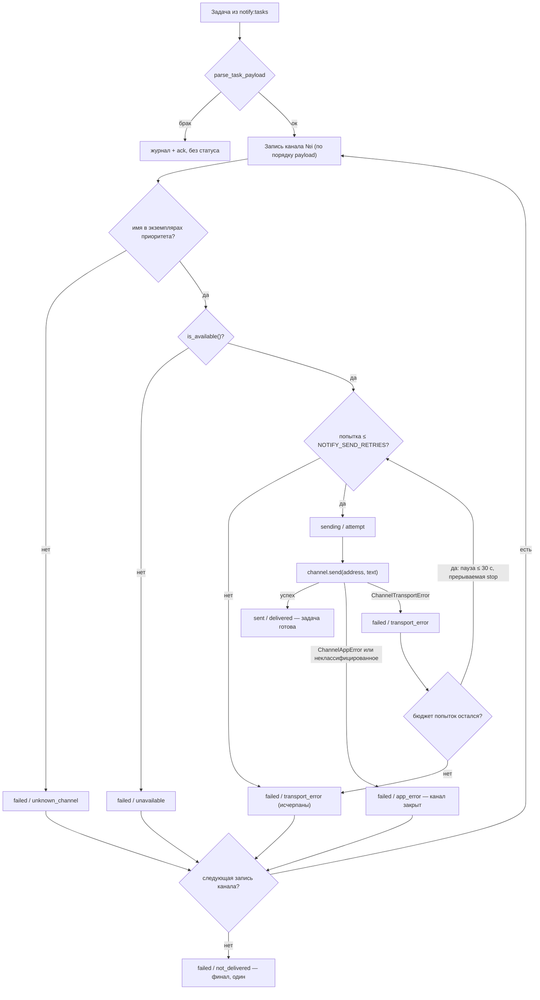

# Воркер отправки оповещений — #484 (часть 3 декомпозиции #476)

Дата: 2026-10-22 · Ревизия: 2 (панель 7 ревьюеров, правки внесены) · Семейная спека-контракт: `docs/specs/2026-10-11-notify-system-476-design.md` (рев.4, §3.4, §3.5, §4.2–4.5) · ADR: 009 (изоляция от БД), 011 (реестр каналов), 013 (транспорт Streams) · Предшественники: #482 (PR #501), #483 (PR #528) — оба в main

Пути кода в тексте — относительно `backend/` (`src/notify/…` = `backend/src/notify/…`).

## 1. Контекст

Части 1–2 построили журнал событий, диспетчер с рендером и транспорт Redis Streams; скелет воркера (`src/notify/worker.py`) стартует, проходит гейты и сознательно простаивает — потребление `notify:tasks` оставлено части 3. Сегодня в включённом контуре задачи копятся в стриме без потребителя, статусы в `notify:statuses` пишет только `FakeQueue` в тестах. Часть 3 делает воркер реальным: потребление очереди, реестр каналов с мок-каналом, перебор по приоритету, транспортные ретраи, публикация статусов.

Поправки разведки к телу issue (комментарий [#484 (issuecomment-6351060336)](https://github.com/mkosinov/memo/issues/484#issuecomment-6351060336)): arq убран ADR 013 (пункты про arq и `max_tries=1` неактуальны); перезаливка `queued`-задач и надёжное чтение статусов уже реализованы диспетчером в #482 — воркер их не строит, воркер только **пишет** статусы.

## 2. Что строим и что не строим

Строим: потребление задач группой `worker`; протокол канала + типизация ошибок; декларативный реестр каналов с мок-каналом; перебор каналов по порядку payload с фолбэком; транспортные ретраи — не более `NOTIFY_SEND_RETRIES` **попыток суммарно на канал** (при N=3: 1 отправка + 2 повтора); публикация стадийных событий после каждой попытки и финала; защита читателя статусов от «вечных» событий; включение воркера и канального приоритета в dev/e2e/CI-контуры.

Не строим (границы): канал Telegram (#485), лимиты отправки (#485), админка «Уведомления» (#486), потребители `notify:inbound` (реестр пуст), шаблоны (таблица и сид — часть 1, CRUD — часть 5), общая конвертация Markdown→HTML для Telegram (часть 4; часть 3 закрепляет контракт владения конвертацией и реализует тождественную конвертацию мока), перезаливка и XAUTOCLAIM на стороне диспетчера (готово), ретраи уровня очереди (семейная граница).

## 3. Решения

### 3.1 Потребление очереди — порт `WorkerQueue`, группа `worker`

Порт очереди (`queue.py`) получает вторую, воркерскую половину — симметрично диспетчерской по механике. Новый `runtime_checkable`-протокол `WorkerQueue` (рядом с `NotifyQueue`, та же философия шва): `claim_tasks() -> list[TaskPayload]`, `ack_task(item)`, `publish_status(event)`, `ensure_worker_group()`, `reclaim_hanging_tasks()`. Имена фиксируются по адаптеру: `publish_status` — как у `RedisQueue` (ADR 013 держит его вне протокола диспетчера; на воркерском протоколе он типизирован явно); `FakeQueue` получает `publish_status` (существующий `push_status` остаётся алиасом тестов частей 1–2) и задачную половину `claim_tasks`/`ack_task`/`_servicing_tasks`; `reclaim_hanging_tasks()` у обеих реализаций — **только задачи** (статусы/inbound — прерогатива диспетчерской половины).

- `RedisQueue`: внутренние `_claim`/`_ack` обобщаются параметром группы; добавляются `claim_tasks` (неизбирательный `XREADGROUP` группы `worker`, счётчик `CLAIM_BATCH`, конверт `_qid`), `ack_task` (`XACK`), `ensure_worker_group` (`XGROUP CREATE id=0 MKSTREAM`, подавляется только BUSYGROUP), `reclaim_hanging_tasks` (цикл `XAUTOCLAIM` группы `worker` по `notify:tasks`; порядок «сначала пере-XADD, потом XACK» сохраняется). `id=0` сознательно вычитывает весь накопленный бэклог при первом старте группы — это и есть цель части 3 (задачи копились без потребителя); «улучшать» до `$` запрещено.
- Воркер — по-прежнему **без БД и без рендера** (ADR 009): на входе готовый текст и адреса, наверх только статусы.

Цикл процесса: стартовые гейты скелета сохраняются (`NOTIFY_ENABLED`, `connect_or_exit`), затем `ensure_worker_group()` → `reclaim_hanging_tasks()` (обе через `asyncio.to_thread`; порог `min_idle` = `NOTIFY_REENQUEUE_AFTER` × 1000 мс — настройка в секундах, XAUTOCLAIM требует миллисекунды) → единый цикл доставки с изоляцией итераций (паттерн `run_loop` диспетчера: краш итерации журналируется и не убивает процесс). Клэйм неблокирующий, темп — `NOTIFY_POLL_INTERVAL`; запас `socket_timeout` адаптера (30 с) при этом просто остаётся неиспользованным — блокирующее чтение не строим.

**Периодический reclaim в цикле**: каждая итерация после клейма запускает `reclaim_hanging_tasks()` с тем же порогом — зависшая посреди работы запись (обрыв батча, транспортный сбой) возвращается в доставку за минуты, а не до рестарта процесса. Порог `NOTIFY_REENQUEUE_AFTER` (120 с) больше худшего времени обработки одной задачи в пилоте (каналы × паузы ≤ 30 с); если конфигурация нарушит это неравенство, reclaimed-дубль задачи в полёте поглощается принятым дублем (семейная §4.4) — корректность не теряется.

Обработанная задача подтверждается (`ack_task`) **после** всей публикации статусов: краш между ними (включая сбой самого `ack_task` после успешных статусов) даёт редкий дубль доставки и дубль строк попыток — оба приняты (§4.4, читатель идемпотентен).

**Два транспортных сбоя — разные режимы, их нельзя путать**: `NotifyTransportError` (сбой Redis-очереди, класс адаптера части 2; его поднимают `claim_tasks`/`ack_task`/`publish_status`) прерывает задачу целиком — попытки не продолжаются без статусов (мониторинг важнее спешки), итерация падает в гард, запись остаётся без ack, возврат — периодическим reclaim'ом; `ChannelTransportError` (сбой канала доставки, §3.2) — ретраи внутри задачи (§3.4).

Бракованный payload (нарушение §4.2): валидатор `parse_task_payload(raw) -> TaskPayload` проверяет верхний уровень (`task_id` — целое > 0, `text` — строка, `channels` — непустой список, `created_at`/`resend_of` — допустимые типы) **и каждую запись `channels`** (`name` и `address` — непустые строки); любое нарушение = брак всей задачи: громкий журнал (идентификаторы и ключи, без текста сообщения), `ack_task` — запись покидает доставку, статус не публикуется. Типы на шве остаются JSON-словарями семейного контракта, новые ORM/pydantic-схемы не вводятся.

**Останов процесса не теряет зависшие записи**: graceful-stop воркера НЕ снимает свой consumer с группы, если у того есть неподтверждённые записи (предварительный `XPENDING`; пусто — снимаем, как диспетчер): `XGROUP DELCONSUMER` удаляет PEL-записи consumer'а, а незакnowledged-запись в PEL — спроектированное состояние abort-пути; снятие consumer по SIGTERM превратило бы его в безвозвратную потерю (задача навсегда `sending` в БД).

### 3.2 Протокол канала — асинхронный шов, конвертация внутри канала

Пакет `src/notify/channels/`:

- `base.py` — протокол канала (семейная §3.5): `name` (строка), `async is_available() -> bool` («настройка заполнена и транспорт отвечает лёгкой проверке»), `async send(address, text_neutral) -> None` (успех = доставлено). Методы **асинхронные**: процесс воркера уже asyncio, а пилотный канал части 4 — Telethon/MTProto, async-нативный; синхронный шов вынудил бы мост async→sync — анти-паттерн, отвергнутый ADR 013 для транспорта по той же причине.
- Конвертация нейтральной разметки (Markdown-знаменатель) в разметку канала — **владение канала**: воркер передаёт нейтральный текст как есть, канал конвертирует внутри `send` (у мессенджеров разные управляющие символы). Часть 3 реализует тождественную конвертацию мока; Markdown→Telegram HTML — часть 4. Общего конвертера не строим (YAGNI — один канал).
- Типизация ошибок (воркер считает ретраи, канал классифицирует сбой — он один знает транспорт): `ChannelError` (база) → `ChannelAppError` (ошибка приложения: неверный адрес, отказ доставки, блокировка — аналог 4xx; ретраев нет) и `ChannelTransportError` (обрыв/таймаут/5xx/429; поле `retry_after: float | None` — секунды из Retry-After).
- **Неклассифицированное исключение** из `send()`/`is_available()` (баг канала — не `ChannelError`) не роняет задачу в PEL-чурн: громкий журнал с трассировкой + канал закрывается как ошибка приложения (`failed/app_error`, класс исключения в `error`) + следующий канал. Ретраить баг бессмысленно, терять доставку и мониторинг — нельзя.

### 3.3 Реестр каналов и приоритет

`registry.py`: декларативный словарь `CHANNELS: dict[str, Callable[[], Channel]]` с регистрацией внизу модуля — паттерн ADR 011, как `SCENARIOS` части 1. Новый канал = модуль + строка регистрации + настройки, ядро не меняется. **Мок-канал не регистрируется при `ENV=production`** (канал наблюдаемости не входит в прод-реестр; прод-приоритет с именем `mock` получит громкую ошибку старта «not registered» — честно до появления реальных каналов в части 4, включённое оповещение в проде — opt-in).

`parse_channel_priority` переезжает из `dispatcher.py` в `registry.py` (канонический дом словаря имён каналов; воркер не должен импортировать диспетчер — тот тянет SQLAlchemy-граф против ADR 009); диспетчер импортирует функцию с нового места, поведение без изменений. Сборка каналов в payload уже следует этой настройке (`scenarios._frozen_channels` парсит `NOTIFY_CHANNEL_PRIORITY`) — отдельной правки сценария не нужно.

Старт воркера: разбор `NOTIFY_CHANNEL_PRIORITY` → проверка «каждое имя приоритета зарегистрировано» → нарушение = **громкая ошибка старта**: `SystemExit(2)` со стабильным сообщением `notify worker: channel '<name>' is not registered` (до создания группы и потребления). Экземпляры строятся только для каналов приоритета; **резолв имени из payload идёт по этим экземплярам** — имя, которого нет среди каналов приоритета (включая зарегистрированное, но не приоритетное; достижимо только рукотворным e2e-payload), даёт исход `failed/unknown_channel` и переход к следующему каналу. Воркер перебирает каналы **в порядке payload** (диспетчер уже упорядочил по приоритету, семейная §4.2); проверка реестра на старте — страховка согласованности настроек, не пересортировка.

**Дефолт против реестра части 3** (решение панели): дефолт настройки `NOTIFY_CHANNEL_PRIORITY="telegram"` (семейная §4.5, пилот — Telegram в части 4) **не меняется** — вместо этого каждый включённый контур до части 4 явно экспортирует `NOTIFY_CHANNEL_PRIORITY=mock` (§3.8); с появлением Telegram экспорты снимаются/меняются контурами. Иначе громкая проверка реестра убила бы каждый контур на дефолте — реестр части 3 содержит только `mock`.

### 3.4 Алгоритм доставки

Попыток на канал суммарно ≤ `NOTIFY_SEND_RETRIES` (при 3: отправка + 2 повтора). Пауза перед повтором: сначала проверка бюджета попыток, затем сон `retry_after` из ошибки, иначе 1 с (модульные константы), потолок 30 с с журналом урезания; пауза прерывается stop-событием (`wait_for(stop.wait(), timeout=пауза)`) — SIGTERM не ждёт хвост паузы.

### 3.5 Статусы — события воркера и защита читателя

Воркер публикует стадийные события §4.3 после **каждой попытки** и **один финал** (колонка `channel` в журнале попыток NOT NULL — финал несёт имя последнего канала):

| stage | outcome | Когда |
|---|---|---|
| `sending` | `attempt` | перед каждой попыткой канала |
| `sent` | `delivered` | успешная отправка (первая; задача готова, остаток каналов не пробуется) |
| `failed` | `transport_error` | `ChannelTransportError`, попытка n/N (включая исход исчерпания бюджета попыток канала) |
| `failed` | `app_error` | `ChannelAppError` или неклассифицированное исключение — канал закрыт без ретраев |
| `failed` | `unavailable` | `is_available()` = false, без попытки |
| `failed` | `unknown_channel` | имя из payload не среди каналов приоритета |
| `failed` | `not_delivered` | финал: все записи каналов исчерпаны — одно событие |

Правило производного состояния читателя (#482, без изменений): `sent` терминален (первый побеждает), прочие события просто сменяют состояние — последовательность сходится к итоговому (`sending → failed → sending → sent` при фолбэке), журнал попыток хранит всю историю. Ни текста оповещения, ни данных клиента в статусах нет (семейная §4.3).

Защита читателя (малая правка диспетчера, мотивированная частью 3 — появляется реальный продюсер): в `statuses_once` брак события определяется **двумя слоями**: (1) пред-валидация формы — `task_id` целое, `stage` из словаря, `channel` непустая строка, `occurred_at` парсится; (2) `ValueError` из `apply_status_event` (неизвестная задача/стадия после валидной формы). Оба случая: журнал (идентификаторы) и **ack** — событие покидает доставку. Причина безопасна: строка задачи коммитится раньше постановки в очередь (#482), «неизвестная задача» = рукотворный/битый payload или потеря БД, повторная доставка это не исправит; прочие ошибки (БД недоступна, целостность на коммите) — прежнее поведение: без ack, возврат при старте.

### 3.6 Мок-канал и наблюдаемость

`mock.py`: имя `mock`, `is_available()` → всегда true, конвертация тождественная (нейтральный текст без изменений), `send` записывает доставку `{address, text, occurred_at}` в рекордер. Исход сценарится **префиксом адреса** (контракт payload не расширяется): `fail-transport:…` → `ChannelTransportError`, `fail-app:…` → `ChannelAppError`, прочее → успех. Это закрывает US-4-стиль «нерезолвимый адрес» (fail-app) и падающий/чинящийся канал US-5 без второго канала в реестре.

Рекордер — протокол `record(address, text)`: `InMemoryRecorder` (юнит-тесты) и `RedisListRecorder` (`LPUSH` JSON в список `notify:mock:deliveries` + `LTRIM` до 1000 записей — артефакт наблюдаемости ограничен; тот же `key_prefix`, что у `RedisQueue`, — изоляция маркированных тестов; e2e-контуру достаточно чтения `LRANGE`). Фабрика реестра мока строит `RedisListRecorder` из `REDIS_URL`; тесты внедряют экземпляры с in-memory-рекордером напрямую (шов `main(queue=…, channels=…)`). Фолбэк по каналам e2e проверяет рукотворным payload с двумя записями `mock` (fail-transport-адрес, затем обычный) и **реальным** `task_id` существующей задачи — статус применяется к настоящей строке, брака у читателя не возникает.

### 3.7 Общие модули процессов

`_install_signal_handlers` (сегодня — дословный дубликат в `dispatcher.py` и `worker.py`) и `run_loop` (живёт только в диспетчере; воркеру он нужен для цикла доставки) переезжают в общий `src/notify/process.py`; диспетчер импортирует оттуда без изменения поведения, холостой `idle_loop` скелета замещается настоящим циклом доставки. Воркерский `main(queue=None, channels=None)` сохраняет тестовый шов: тесты передают `FakeQueue` и словарь готовых экземпляров каналов.

### 3.8 Стеки и контуры

- `dev.sh --notify`: воркер уже запускается; контур до части 4 дополнительно экспортирует `NOTIFY_CHANNEL_PRIORITY=mock` (§3.3) — без этого громкая проверка реестра останавливает воркер на дефолте `telegram`.
- `e2e-shard-start.sh` (режим `NOTIFY_E2E_ENABLED=1`): воркер добавляется вторым child-процессом рядом с диспетчером (та же дисциплина сигналов и `|| true` на kill) + тот же экспорт `NOTIFY_CHANNEL_PRIORITY=mock`.
- CI-джоба `notify-tests`: то же значение в окружении джобы; маркированные redis-тесты части 3 подхватываются автоматически (`pytest -m redis`); стандартный прогон и 4 e2e-шарда остаются без Redis (инвариант S2 части 2). На плане: список исключений покрытия в `pyproject.toml` сегодня содержит `worker.py`/`redis_queue.py` — наполнившийся логикой воркер вернуть в покрытие.
- Настройка: `NOTIFY_SEND_RETRIES: int = 3` в `config.py` (семейная §4.5).

## 4. User Scenarios (часть 3; нумерация продолжает S1–S5 части 2)

- **S6 — сквозная доставка моком** (E2E notify-контура + маркированная проверка): стек с Redis, диспетчером и воркером (`NOTIFY_CHANNEL_PRIORITY=mock`); создание записи (чекбокс оповещений, согласие, будущее время) — задача проходит очередь, воркер доставляет мок-каналу адрес и готовый текст (рекордер), диспетчер применяет статусы — задача `sent` в БД; UI записей не меняется [семейные US-1, US-7].
- **S7 — фолбэк и «не доставлено»** (маркированный интеграционный): рукотворный payload — первый канал `fail-transport` (исчерпывает ретраи), второй обычный → доставка вторым, события `transport_error` затем `sent`; вариант «все каналы сбойны» → финал `not_delivered`, задача `failed` [семейной US-5, воркерная половина].
- **S8 — переживание падения воркера** (маркированный интеграционный): задача захвачена и не подтверждена (запись в PEL группы `worker`) → цикл доставки с малым порогом reclaim (переопределение `NOTIFY_REENQUEUE_AFTER` малым значением в тесте) → доставка проходит, дубль допустим; сюда же — graceful-stop с непустым PEL не снимает consumer [семейной US-7].
- **S9 — контракт воркера** (юнит, без Redis, паузы через шов часов — без реальных секунд): реестр — незарегистрированный канал в приоритете = ошибка старта 2, мок не регистрируется при `ENV=production`; порядок payload; попыток ≤ `NOTIFY_SEND_RETRIES` (1+N−1), `retry_after` с потолком 30 с, пауза прерывается stop-событием, `ChannelAppError` и неклассифицированное исключение не повторяются; исходы `unavailable` (stub-канал) и `unknown_channel` (в рантайме, не только на старте); конвертация мока тождественна; брак payload — верхнего уровня и записи канала → ack без статуса; `NotifyTransportError` в обработке прерывает задачу без ack (регрессионная фиксация семантики); защита читателя статусов — пред-валидация формы + неизвестная задача/стадия → ack, на **настоящем** `statuses_once` (интеграционная строка); худшее время задачи ограничено (каналы × паузы ≤ 30 с); изоляция итераций — краш-луп в цикле доставки не убивает процесс; идемпотентность `ensure_worker_group` на повторном старте (BUSYGROUP).
- **S10 — инвариант выключенности** (юнит/инвариант CI): стандартный прогон и 4 e2e-шарда идут без Redis, новые тесты юнит-слоя не требуют Redis [семейной US-7].

## 5. Behavioral Delta

**До:** в включённом контуре задачи копятся в `notify:tasks` без потребителя (воркер-скелет простаивает), статусы не публикует никто, кроме тестовой заглушки; доставка оповещений невозможна.

**После:** включённый контур доставляет end-to-end: воркер потребляет очередь, проходит каналы по приоритету (пилот — мок-канал), выдерживает транспортные сбои (≤3 попытки, Retry-After) и завершает «не доставлено» с полной историей попыток; задача в БД доезжает до `sent`/`failed` силами диспетчера. Для прод-пользователей ничего не меняется: `NOTIFY_ENABLED` по умолчанию выключен, канал Telegram — часть 4, админский экран — часть 5.

## 6. Риски

- **Задача в `sending` при полной чистке Redis**: перезаливка диспетчера берёт только `queued` (семейная §4.4) — задача, взятая воркером и потерянная вместе с Redis, не вернётся. Семейное ограничение (окно «в доставке» против «в очереди»), фиксируется здесь как известное, лечится только через семейную спеку — в пилоте принято; пересмотр правила — в дизайне части 4 (решение Gate B #484, 2026-10-23), когда начнутся реальные доставки.
- **Дубли при периодическом reclaim**: порог 120 с больше худшего времени обработки задачи в пилоте; нарушение неравенства конфигурацией (много каналов × длинные Retry-After) даёт дубль задачи в полёте — поглощается принятым дублем (§4.4), клиент может получить второе сообщение.
- **Худший такт одиночного воркера**: каналы × (попытки−1) × 30 с пауз плюс таймауты отправки — конвейер стоит, но не замирает навсегда (паузы прерываемы stop-событием); масштабирование — вне пилота.
- **Одиночный воркер** (без leader election, ADR 013) — задокументированное допущение транспорта.
- **Async-шов каналов** — ставка на Telethon части 4; если канал окажется синхронно-нативным, мост решается внутри его `send` (локально, без смены протокола).
- **Флап состояния задачи** (`failed` промежуточно при фолбэке) — сходится терминальными правилами читателя; журнал попыток хранит истину.

## 7. Границы части 3

Telegram/MTProto, лимиты отправки (#485); админка доставок и шаблонов (#486); потребители `notify:inbound`; ретраи уровня очереди; дедупликация дублей по идентификаторам сообщений каналов (принятый дубль); общая конвертация разметки (кроме тождественной мока); управление порядком каналов из UI — #541 (Hold; решение Gate B #484, 2026-10-23: до появления второго реального канала приоритет остаётся настройкой окружения); изменение семейных контрактов §4 — только через семейную спеку.

## Visual Compliance Checks

N/A
