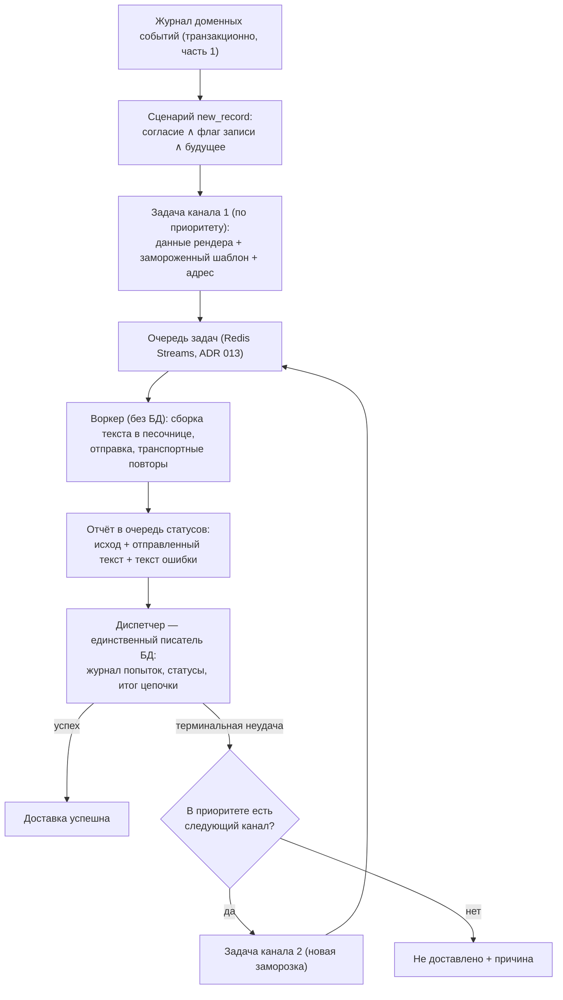

# Дизайн #485 — канал Telegram (пользовательский аккаунт): MTProto, резолв по телефону, лимиты; задача на канал, сборка текста в воркере

- **Issue:** #485 (часть 4 декомпозиции #476, ADR 012)
- **Семейная спека-контракт:** `docs/specs/2026-10-11-notify-system-476-design.md` (рев.5) — правки внесены этим дизайном (§10)
- **Доменные правила:** `docs/domain-rules/notify.md` — обновляются вместе со спекой (§10)
- **Зависимости:** #482 (события, шаблоны), #483 (транспорт Redis Streams), #484 (воркер, реестр каналов, ретраи) — всё In-main. #563 (пробуждение по сообщению) — строго после этой части, общие файлы циклов.
- **Дата:** 2026-10-25. **Статус:** рев.2 — после панели 7 ревьюеров (все находки среды отклонены с проверкой по main, содержательные внесены; Gate B — авто-ОК по решению пользователя).

---

## 0. Решения пользователя (Gate A, 2026-10-25)

1. **Задача несёт данные для рендера и шаблон канала**, а не готовый текст. Пересматривает решение от 2026-10-11 «текст оповещения формируется один раз при создании задачи».
2. **Сборка текста — в воркере**, отдельно под каждый канал, из данных и замороженного шаблона. Нейтральная разметка и конвертер «нейтральная разметка → Telegram HTML» из контракта выпадают: шаблон канала пишется сразу в формате канала.
3. **Шаблоны живут в базе и редактируются админом** (таблица существует с части 1; экран правки — часть 5). Шаблон канала **замораживается в задаче** в момент её создания.
4. **Задача = один канал.** Сценарий создаёт задачу первого канала приоритета; при терминальной неудаче диспетчер создаёт задачу следующего канала цепочки. Перебор каналов уходит из воркера.
5. **Суточный лимит исчерпан** — попытка фиксируется неудачей с причиной «лимит исчерпан» и отправляется **одно служебное сообщение админу** за суточное окно.
6. **Ответы клиентов не обрабатываются**: живого прослушивания входящих нет; контракт события входящих остаётся зафиксированным (семейная §3.6), существующий цикл подтверждается тестом.
7. Пробуждение циклов по сообщению очереди — **отдельная задача #563** (после этой части); здесь остаются интервальные циклы части 3.

## 1. Контекст и цель

Части 1–3 построили каркас: журнал доменных событий → сценарий → задача в очереди Redis Streams → воркер с реестром каналов → отчёты о попытках в базу. Единственный канал — учебная заглушка. Часть 4 добавляет первый реальный канал: **Telegram через пользовательский аккаунт студии** (MTProto-клиент), доставку на телефон клиента, лимиты отправки, защищающие аккаунт от спам-блокировки, и человеческие тексты ошибок в журнале попыток (требование Gate B #484).

Одновременно часть 4 перестраивает механизм под решения §0: задача становится задачей одного канала и несёт данные+шаблон вместо готового текста, а сборка текста переезжает в воркер.

## 2. Границы

**Строим:** канал Telegram (Telethon) в реестре; настройки канала и лимитов; резолв телефона с нормализацией номера; перевод ошибок; общий механизм лимитов канала (пауза, суточный потолок, служебное сообщение админу); пер-канальные задачи с заморозкой шаблона; таблица шаблонов получает измерение канала; журнал попыток хранит отправленный текст; скрипт генерации сессии; обновление контрактов — семейная спека рев.5, ADR 014, доменные правила notify, докстринги протокола канала.

**Не строим (осознанно):** бот-аккаунт и вебхук, привязку клиента по коду (решения 2026-10-11); живое прослушивание входящих (решение 2026-10-25); экран правки шаблонов и настроек канала (часть 5 #486); ручную повторную отправку — экран части 5, контракт сохранения отправленного текста и правило пересборки готовим здесь; распределённую паузу для нескольких инстансов воркера; E2E с реальным Telegram (внешняя сеть и креды в CI недоступны — реальный канал закрывается юнит-тестами с заглушкой клиента и контуром notify-tests).

## 3. Архитектура после части 4

Неприкосновенно (ADR 009 сохраняется в остальной части): воркер не читает и не пишет базу, переносим на отдельную машину; диспетчер — единственный писатель со стороны оповещений; отчёты доставляются хотя-бы-раз, идемпотентность обязательна. Изменения против ADR 009 фиксирует ADR 014 (§10).

Три цикла диспетчера (события, статусы, входящие) и цикл воркера остаются интервальными (по умолчанию 1 с); переход на пробуждение по сообщению — #563.

## 4. Модель данных

### 4.1 `NotifyTask` — становится задачей одного канала

| Поле | Смысл |
|---|---|
| `id` | UUID |
| `event_id`, `scenario` | ссылка на журнал доменных событий, идентификатор сценария |
| `channel`, `address` | канал доставки и адрес (для Telegram — телефон клиента); замораживаются на первой задаче, задачи цепочки **наследуют** адрес (не переразрешаются — доменное правило) |
| `payload` | JSON: данные рендера — снапшот переменных сценария (контракт §4.1 семейной спеки, без изменений) |
| `template_id`, `template_body` | замороженный шаблон: ссылка на строку и её текст на момент создания задачи |
| `root_task_id` | корень цепочки (у первой задачи = собственный `id`); основа идемпотентности спавна |
| `parent_task_id` | nullable; предыдущая задача цепочки (у первой — NULL) — связность для чтения |
| `status` | `queued → sending → sent \| failed`; терминальное `skipped` (решение диспетчера, в очередь не идёт) — без изменений |
| `error` | текст причины неудачи (последней) |
| `delivery_outcome` | nullable; итог цепочки на корневой задаче: `delivered \| not_delivered` + причина — пишет диспетчер при успехе/исчерпании цепочки (экрану части 5) |
| `created_at`, `processed_at`, `updated_at` | штампы |

**Сохраняются без изменений** (существуют с частей 1–3): `client_id` (FK, `SET NULL` — история переживает удаление клиента), `skip_reason` (причины `no_recipient / no_consent / past_event / notify_off`), `reenqueues` (счётчик пере-заливок застрявших задач, кап 10 — живёт **над** транспортными ретраями: `NOTIFY_SEND_RETRIES` — попытки отправки внутри воркера, `reenqueues` — возврат задачи в очередь после сбоя процесса).

**Упраздняются миграцией:** `text` (готовый текст) и `channels` (список адресов). Система за `NOTIFY_ENABLED` (по умолчанию выключена), боевых данных нет — обратной совместимости не требуется.

### 4.2 `NotifyTemplate` — измерение канала

Новая колонка `channel: str | NULL`. `NULL` — универсальный шаблон (простой текст без разметки канала). Поиск при создании задачи: точное `(event_type, channel)` → `(event_type, NULL)` → дефолтный (`is_default`, без учёта канала — дефолты только универсальные, отдельного `(default, channel)` яруса пилоту не нужно — осознанно). Уникальность: индекс по выражению `(event_type, COALESCE(channel, ''))` — SQLite считает NULL различными, обычный уникальный индекс универсальную строку не покрыл бы. Отсутствие шаблона вообще (нарушение инварианта сида — дефолт обязан существовать для каждого типа события со сценарием) — ошибка сценария: событие после 3 попыток помечается `processing_error` (механика части 1). Сид-миграция части 1 остаётся универсальной.

### 4.3 `NotifyTaskAttempt` — отправленный текст

Новая колонка `sent_text: Text | NULL` — текст, фактически переданный транспорту канала в этой попытке (требование пользователя: «отправленный текст в БД по каждому каналу»). Пишется в строки стадий, где текст передавался (`sending`/`sent`); неудача до передачи (сборка, лимит, резолв) — `NULL`. Прочие поля без изменений (`stage`, `outcome`, `error`, `occurred_at`).

### 4.4 Ключи Redis (транспорт, не база) — общий механизм лимитов канала

- `notify:{channel}:cap:<ГГГГММДД>` — счётчик отправок суток канала (дата — наивное UTC-время процесса; после мержа #529 — `utc_now()`), атомарный INCR, первый INCR выставляет EXPIRE 48 ч.
- `notify:{channel}:cap-notified:<ГГГГММДД>` — флаг «служебное сообщение админу отправлено» на окно, TTL 48 ч.

Каналы в реестре декларируют свои параметры лимитов (потолок, пауза, адрес служебных сообщений) — Telegram первым потребителем, мок-канал наследует механизм для контурных тестов потолка.

## 5. Шаблоны и сборка текста

1. **Заморозка.** Диспетчер при создании задачи канала читает шаблон из базы (правило поиска §4.2) и замораживает его текст и `template_id` в задаче. Правка шаблона админом влияет на новые задачи, включая задачи каналов, до которых цепочка дойдёт позже — каждая заморозка берёт актуальный на момент создания текст.
2. **Сборка в воркере.** Один раз на задачу (ретраи транспорта шлют тот же текст — защита от расхождения при деплое между попытками). Песочница Jinja2 — модуль части 1 **расширяется** вариантом окружения по формату шаблона (не чистое переиспользование): строгие неопределённые переменные и нейтрализация контрольных символов в данных сохраняются.
3. **Экранирование определяется каналом задачи.** Значения экранируются по формату канала **независимо от происхождения шаблона**: задача `telegram` → значения HTML-экранируются всегда (и из канального, и из универсального шаблона). Универсальный шаблон (`channel IS NULL`) — простой текст без разметки, отправляется **без** канального parse-режима; шаблон канала — разметка канала (HTML) + экранированные значения. Мок — простой текст. Разметка принадлежит только шаблону канала, данные остаются данными.
4. **Ошибки сборки** — `app_error` с текстом «не удалось собрать текст уведомления: …»; ретраи не выполняются (детерминированная ошибка), цепочка идёт к следующему каналу.

## 6. Канал Telegram (Telethon)

Библиотека `telethon>=1.34` (MIT, чистый asyncio — совместима со стеком backend). Референс — `TuserSenderService` / `TelegramUserClient` в cmbot; синхронный мост потоков cmbot НЕ переносится (у нас нативный asyncio).

### 6.1 Клиент, сессия, протокол канала

- Один клиент на процесс воркера, ленивая инициализация: `TelegramClient(StringSession(TELEGRAM_SESSION), api_id, api_hash, connection_retries=3, retry_delay=1)`.
- Перед отправкой: `connect()` + `is_user_authorized()`; неавторизованная сессия — `app_error` «аккаунт Telegram не авторизован — сессия недействительна».
- `is_available()` — заданы все три: `TELEGRAM_API_ID`, `TELEGRAM_API_HASH`, `TELEGRAM_SESSION`. Ненастроенный канал, указанный в приоритете, не роняет старт (старт-гвард реестра #484 отличает «неизвестный канал» от «недоступен»): задача канала завершается `app_error` «канал не настроен», цепочка идёт дальше.
- Генерация сессии — офлайн-скрипт `backend/scripts/generate_telegram_session.py` (интерактивно: api_id, api_hash, телефон, код, 2FA → печатает строку сессии для настроек). Перенос из cmbot практически дословно.
- **Протокол канала (правка реестра #484):** канал декларирует escape-режим (`none | html`) и принимает в `send(address, text)` уже собранный текст; докстринги протокола обновляются вместе с правкой (утверждение «канал конвертирует нейтральную разметку» из контракта выпадает).

### 6.2 Нормализация телефона, резолв, отправка

- Адрес хранится в карточке клиента в форматированном виде (форматтер #414); канал перед резолвом нормализует его к E.164-подобному виду (удаление пробелов/дефисов/скобок, ожидается ведущий `+`). Некорректный формат — `app_error` «некорректный формат номера» (своя строка, не «номер не зарегистрирован»).
- Резолв: `get_entity(phone)`; при неудаче — `InputPhoneContact` + `ImportContactsRequest` (рецепт cmbot). Резолв не дал пользователя — `app_error` «номер не зарегистрирован в Telegram» (семейный US-4).
- Отправка: `send_message(entity, text)` — parse-режим по происхождению шаблона (канальный → HTML; универсальный → без parse-режима), значения уже экранированы при сборке (§5.3). Таймаут 30 с на всю операцию канала (резолв + отправка) — зависший резолв не блокирует последовательного воркера сверх лимита.

### 6.3 Лимиты отправки (общий механизм, защита аккаунта)

Механизм лимитов общий для каналов реестра; параметры — у канала.

- **Пауза между отправками**: `TELEGRAM_SEND_PAUSE` (30 с) — асинхронная выдержка между последовательными отправками канала в процессе воркера. Пилотный воркер обрабатывает задачи последовательно; параллельные инстансы воркера в пилоте не запускаются (зафиксировано ограничение, распределённая пауза — за рамками).
- **Суточный потолок**: `TELEGRAM_DAILY_CAP` (200). Перед отправкой — проверка счётчика (§4.4): исчерпан → попытка `app_error` «суточный лимит исчерпан»; успешная отправка — INCR.
- **Служебное сообщение админу**: при первом исчерпании окна (флаг §4.4 не стоит) — одно сообщение на `TELEGRAM_ADMIN_PHONE` через тот же канал: «Суточный лимит Telegram исчерпан, уведомления не доставляются до конца окна». Семантика: не увеличивает счётчик (единственное допускаемое нарушение потолка — сама эта отправка); соблюдает паузу отправок; флаг ставится **после успешной отправки** — краш между отправкой и флагом может дать дубль при повторе, дубль принят (лучше дубль, чем молчание). `TELEGRAM_ADMIN_PHONE` не задан — сообщение не отправляется, в журнале остаётся причина неудач.
- **FloodWait** от Telegram — `transport_error` с `retry_after` (механика повторов #484 сохраняется).
- **Пауза × пере-заливка:** задача, заявленная воркером (запись в PEL группы потребителя), не пере-заливается диспетчером; пауза канала не считается зависанием. Предикат пере-заливки части 3 уточняется: `queued` ∧ старше `NOTIFY_REENQUEUE_AFTER` ∧ **не в PEL группы worker** — иначе очередь длиннее 4 задач с паузой 30 с порождала бы дубли отправок.

### 6.4 Таблица перевода ошибок (требование Gate B #484)

| Исключение Telethon / ситуация | Категория исхода | Текст в журнал попыток |
|---|---|---|
| `AuthKeyUnregistered`, `UserDeactivated`, неавторизованная сессия | `app_error` | «аккаунт Telegram не авторизован — сессия недействительна» |
| резолв не дал пользователя | `app_error` | «номер не зарегистрирован в Telegram» |
| некорректный формат номера после нормализации | `app_error` | «некорректный формат номера» |
| `PeerFloodError` | `app_error` | «Telegram ограничил отправку с аккаунта (подозрение в спаме)» |
| `UserIsBlockedError` | `app_error` | «клиент заблокировал аккаунт студии» |
| `FloodWaitError` | `transport_error`, `retry_after=seconds` | «Telegram просит паузу N с» |
| сетевые ошибки, таймауты (`ConnectionError`, `asyncio.TimeoutError`) | `transport_error` | «канал недоступен: проблема сети» |
| прочие `RPCError` | `app_error` | «ошибка Telegram: <код>» |

Категория исхода берётся из класса ошибки, конкретику несёт русский текст (решение Gate B #484). В журнал не пишутся имена классов исключений; цифровой код RPC в человеческом тексте допустим.

## 7. Настройки

Новые:

| Ключ | Тип | По умолчанию | Смысл |
|---|---|---|---|
| `TELEGRAM_API_ID` | `int \| None` | `None` | идентификатор Telegram-приложения |
| `TELEGRAM_API_HASH` | `SecretStr \| None` | `None` | хэш приложения |
| `TELEGRAM_SESSION` | `SecretStr \| None` | `None` | сессия-строка пользовательского аккаунта |
| `TELEGRAM_ADMIN_PHONE` | `str \| None` | `None` | адрес служебных сообщений администратору |
| `TELEGRAM_SEND_PAUSE` | `int` (сек) | `30` | пауза между отправками канала |
| `TELEGRAM_DAILY_CAP` | `int` | `200` | суточный потолок отправок |

Существующие без изменений: `NOTIFY_ENABLED`, `NOTIFY_CHANNEL_PRIORITY` (пилот `telegram`), `NOTIFY_POLL_INTERVAL`, `NOTIFY_REENQUEUE_AFTER`, `NOTIFY_SEND_RETRIES`, `REDIS_URL`. Секреты — `SecretStr` по образцу `REDIS_URL`; тестовый контур принудительно не требует их (канал недоступен = честное «канал не настроен»).

## 8. Цепочка каналов и отчёты

1. **Создание первой задачи** — сценарий (существующая точка: согласие ∧ флаг ∧ будущее; «пропущено» с причинами — без изменений, телефон пуст → `no_recipient`). Создаётся задача первого канала из `NOTIFY_CHANNEL_PRIORITY` с адресом (телефон клиента из карточки на момент события) и заморозкой данных+шаблона.
2. **Адрес цепочки не переразрешается:** задачи-продолжения наследуют `payload` и `address` корня (доменное правило «адреса замораживаются и никогда не переразрешаются»). Согласие и флаг на спавне повторно не проверяются (окно — секунды; решение принято на первой задаче; отступление осознанное — как и в контракте ручного повтора части 5). Терминальная неудача задачи канала (транспортные ретраи исчерпаны `NOTIFY_SEND_RETRIES`, либо `app_error`) → диспетчер: если в приоритете есть следующий канал — новая задача (свежая заморозка шаблона, наследованные данные и адрес); нет — цепочка закрывается «не доставлено» с причиной последней неудачи. Успех любой задачи — цепочка успешна. Итог пишется на корневую задачу (`delivery_outcome`, §4.1).
3. **Идемпотентность спавна**: `UNIQUE(root_task_id, channel)` — повторная доставка отчёта (at-least-once) не создаёт дубль задачи. Ручная повторная отправка (часть 5) — **новая цепочка** (новый корень) со ссылкой на оригинал: уникальность не мешает повтору канала, уже пробованного в оригинальной цепочке.
4. **Отчёт воркера** несёт: исход, отправленный текст, текст ошибки с категорией — диспетчер пишет попытку (`sent_text`), статус задачи и итог цепочки. В статусах едет только отправленный текст (содержит данные клиента по построению — решение части 4); прочие данные клиента в статусах не ездят (правка семейной §4.3).

## 9. Входящие события

Контракт §3.6 семейной спеки без изменений: источник приводит входящее к форме (канал, адрес отправителя, тип, текст, идентификатор доставки, время) и кладёт в `notify:inbound`; потребителей нет. Часть 4 ничего живого не строит (решение пользователя 2026-10-25). План констатирует фактическое покрытие цикла входящих контуром части 3; при отсутствии — добавляется один юнит-тест события-заглушки без обработчика.

## 10. Изменения контрактов (вносятся вместе с этим дизайном)

**Семейная спека** `2026-10-11-notify-system-476-design.md` → рев.5 (каждая правка помечена «рев.5, часть 4»): §1 решения рев.3 — пометка пересмотра «текст один раз»; §2 таблица решений (ADR 014) и доп. решения; §3 схема; §3.2 п.1 (заморозка вместо рендера); §3.3 (состав payload; предикат пере-заливки «не в PEL»); §3.4 (сборка в воркере, задача на канал); §3.5 (escape-режим канала, `send` с готовым текстом); §3.7 (колонка `channel`, правило поиска, заморозка); §3.8 (повтор — из `sent_text` либо пересборка из замороженного; новая цепочка); §4.2 (payload: данные+шаблон+канал+адрес); §4.3 (отправленный текст в статусах; производное состояние цепочки); §4.5 (+3 настройки лимитов); US-4/US-5 (цепочка).

**Новый ADR 014** «Задача на канал; сборка текста в воркере» (Accepted; заменяет пункты ADR 009 о точке рендера, отсутствии шаблонизатора в воркере и переборе каналов; неприкосновенное ядро 009 сохранено).

**`docs/domain-rules/notify.md`**: заморозка данных и шаблона вместо рендера текста; адрес наследуется цепочкой; экранирование по формату канала; сборка в воркере, ошибка сборки — `app_error` попытки (не `processing_error` события); задача = канал, отчёт несёт отправленный текст.

**Докстринги протокола канала** (`backend/src/notify/channels/base.py`): контракт «канал конвертирует нейтральную разметку» заменяется на escape-режим + готовый текст.

## 11. Behavioral Delta

**До части 4:** доставку умеет только учебная заглушка; текст уведомления собирается один раз, до выбора канала, в нейтральной разметке; журнал попыток не хранит отправленный текст; ошибок реальных каналов нет.

**После части 4:** клиенту уходит настоящее Telegram-уведомление с аккаунта студии на телефон клиента (MTProto); текст каждого канала собирается в воркере из данных и шаблона этого канала — правка шаблона меняет новые уведомления, разные каналы могут писать разным стилем; в журнале попыток виден фактически отправленный текст и человеческая причина неудачи («номер не зарегистрирован в Telegram», «лимит отправки», «недоступно транспорту»); суточный потолок и паузы защищают аккаунт, при исчерпании админ получает одно служебное сообщение; цепочка каналов — задачами, смена канала видна в журнале отдельной задачей.

## 12. User Scenarios

| # | Сценарий | Покрытие |
|---|---|---|
| 1 | Запись создана (согласие + флаг + будущее) — клиенту уходит уведомление; в попытке задачи хранится фактически отправленный текст (экран доставок — часть 5) | E2E через канал-мок; реальный канал — юнит с заглушкой клиента |
| 2 | На телефоне клиента нет Telegram — попытка с причиной «номер не зарегистрирован в Telegram»; доставка «не доставлено», если telegram — последний канал цепочки (семейный US-4) | E2E мок (маркер адреса) + юнит таблицы ошибок |
| 3 | Первый канал упал — доставка проходит вторым каналом цепочки; все недоступны — «не доставлено» с причиной (семейный US-5) | E2E два мок-канала; спавн идемпотентен — контур notify-tests |
| 4 | Суточный потолок исчерпан — попытки «суточный лимит исчерпан», админу уходит одно служебное сообщение за окно | Контур notify-tests (мок-канал с малым потолком через общий механизм) |
| 5 | Админ правит шаблон — новые задачи собираются с новым текстом; задачи в полёте доезжают со старым | Юнит (заморозка/lookup) + E2E-мок с правкой шаблона через базу теста |
| 6 | Любая ошибка канала приходит в журнал русским текстом с категорией исхода | Юнит-таблица (каждая строка §6.4) |

E2E-сценарии гоняют канал-мок (механика задачи/цепочки/журнала едина для всех каналов); реальный Telegram в CI недоступен (внешняя сеть, креды) — закрыт юнитом с заглушкой Telethon-клиента.

## 13. Тесты и верификация

- **Юнит:** таблица ошибок §6.4 (по строке на категорию, включая нормализацию номера); заморозка шаблона и правило поиска (канал → универсальный → дефолт; уникальность COALESCE-индекса); **крестовый кейс экранирования: универсальный шаблон × задача telegram (значение с `<`, `&`)**; экранирование канального шаблона; сборка один раз на задачу (ретраи — тот же текст); ошибка сборки → `app_error` без транспортных ретраев; сценарий создаёт задачу первого канала с payload+шаблоном; skip-landing (`no_recipient` и др. — на месте после миграции); идемпотентность спавна (UNIQUE); лимиты (пауза мокается, потолок по Redis-счётчику, «админ не задан → сообщения нет», «второго сообщения в окне нет»); реальный канал — заглушка Telethon-клиента, сеть не трогаем.
- **Контур notify-tests (Redis, `pytest -m redis`):** цепочка (падение канала 1 → задача канала 2 → успех/исчерпание, итог на корне); отчёты пишут `sent_text` в попытки; счётчик потолка + служебное сообщение + флаг окна; повторный отчёт не дублирует задачу; покрытие цикла входящих (констатация/один тест-заглушка).
- **E2E (Playwright, стек с Redis):** сценарии 1–3, 5 таблицы §12 (мок-каналы; продолжение специ `frontend/admin/e2e/notify-s6-mock-delivery.spec.ts`).
- **Миграции:** пер-канальная задача (+`root_task_id`/UNIQUE, `delivery_outcome`), `channel` шаблонов (+COALESCE-индекс), `sent_text` попыток; сид остаётся универсальным.

## 14. Риски

- **Поверхность атаки воркера растёт** (шаблонизатор в воркере) — та же изолированная песочница со строгими неопределёнными; авторы шаблонов — администраторы.
- **Персональные данные: контакты аккаунта студии пополняются телефонами клиентов** (побочный эффект резолва через импорт контакта) — согласие клиент давал на уведомления, а не на передачу контактов третьей стороне; осознанная цена резолва по телефону, альтернативы дороже.
- **Сессия-строка — долговечная валюта**: доступ к настройкам = доступ к аккаунту; `SecretStr`, ротация ручная (перегенерация скриптом).
- **FloodWait возможен вне наших пауз** — обрабатывается транспортной ошибкой с повтором.
- **Один процесс воркера**: параллельные инстансы обошли бы паузу — ограничение пилота, задокументировано.
- **Переход цепочки между каналами** стоит до 2 интервалов циклов (≤2 с) — снято в #563.
- **Исчерпание потолка — потеря доставки до конца окна** (без авто-переноса): напоминание, не приехавшее до события, теряет смысл; митигация — служебное сообщение админу + ручная досылка в части 5.

## Visual Compliance Checks

N/A
