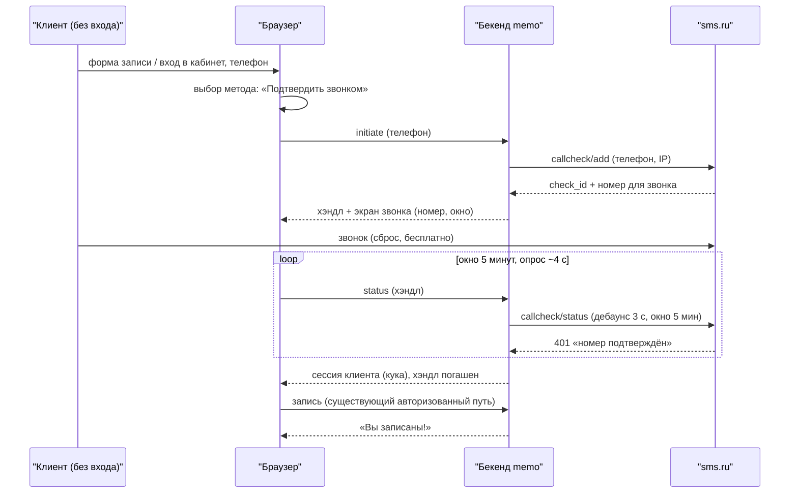

# #593 Спека: вход по звонку (sms.ru callcheck) — метод авторизации наряду с SMS-кодом

- Дата: 2026-11-11. Статус: DESIGN, рев.7 — гейт B пройден (ОК владельца 2026-11-11). Решение по сессиям: **без ротации** — параллельные сессии клиента уважаются, гашение только явным выходом («Выйти из устройства» / «Выйти со всех устройств» — вне скоупа задачи). Рев.6 — решения владельца: целевой отказ без CAPTCHA принят; окно проверки — полные 5 минут, отдельный кап числа обращений к провайдеру снят (при дебаунсе 3 с верх — ~100 обращений на проверку, хвост окна не отрезается); на экране звонка — явный таймер остатка окна. Рев.5 — правки владельца: таблицы `auth_calls`/`auth_call_attempts` вместо `otp_*` (в схеме нет одноразового пароля), шаг входа `auth` вместо `otp`, единый компонент экрана авторизации для записи и кабинета, номер клиенту строго в формате `+7…`, честные факты о звонке на экране, биллинг 0,8 ₽ только за успешную авторизацию. Рев.4 — панель рев.3 внесена (второй прогон): двойной гейт дев-маршрута, честная доступность через резолвер, атомарное погашение хэндла с финализацией, глобальный потолок initiate, паритет тихого пропуска стафф-номеров, исчерпывающий маппинг кодов провайдера.
- История: рев.1–2 — «подтверждение записи звонком» — отвергнуты владельцем на гейте B: callcheck остаётся **методом авторизации** в дополнение к SMS-коду (в будущем Telegram-bot OTP, Max OTP); записи создаются только авторизованными; состояний подтверждения у записей нет.
- Связанное: #586 SMS-транспорт OTP — не трогаем, он остаётся методом `sms_otp` (прод сейчас выключен, ждёт #587); #587 аккаунт SMS-провайдера (здесь регистрация в sms.ru — ручной шаг владельца); #499 §4.2 — шов OTP, гейты, финализация входа; #513 кабинет клиента (сессия `memo_client_session`); исследование API — `docs/research/2026-11-11-smsru-callcheck-api.md` (коммитится вместе со спекой).
- Словарь: **callcheck** — проверка звонком sms.ru: клиент сам звонит на выданный номер, звонок сбрасывается (бесплатен), сервис подтверждает совпадение номера звонившего с заявленным; **метод авторизации** — способ подтвердить телефон для входа (SMS-код, звонок; будущее: Telegram-bot OTP, Max OTP); **хэндл проверки** — непрозрачный одноразовый секрет, связывающий опрос статуса с инициатором.

## Контекст

Вход web-клиента (и запись, и кабинет) — подтверждение телефона. Шов `OtpTransport` имеет только dev-реализацию: в проде эндпоинт запроса кода отвечает 503 — анонимный клиент не может ни войти, ни записаться. SMS-путь заблокирован (#586 ждёт ОК спеки, #587 — оба провайдера-финалиста застряли).

Решение владельца (2026-11-11): sms.ru callcheck — дополнительный метод авторизации; клиент выбирает способ; архитектура закладывает выбор методов. Запись онлайн — только после авторизации: требование авторизации остаётся на эндпоинте бекенда. Не может авторизоваться — кнопка «Связаться» со ссылками на мессенджеры администратора; в форме записи текст сообщения предзаполнен данными заявки (требование владельца).

## Границы

Строим:

- метод авторизации «звонок» поверх sms.ru callcheck: эндпоинты initiate/status, экран звонка, сессия после подтверждённого звонка;
- реестр методов авторизации: честная доступность из бекенда (`GET /auth/methods`);
- выбор метода на экране входа (форма записи и кабинет): пикер доступных методов + возврат «Другой способ»;
- кнопку «Связаться» на экране входа: мессенджеры администратора; в форме записи текст предзаполнен данными заявки (требование владельца) + кнопка «Скопировать текст» (страховка от разницы мессенджеров);
- активную строку проверки звонка (`phone` — PK, новая заменяет старую — как строка OTP-кода) и журнал попыток по образцу #586;
- гейты на initiate по образцу OTP-гейтов #499 §4.1 + глобальный потолок;
- дев-транспорт и дев-имитацию звонка для разработки и e2e;
- конфигурацию: ключ sms.ru вне git, fail-fast/fail-closed;
- e2e нового метода (web: форма записи и кабинет).

Осознанно НЕ строим в v1:

- изменения в домене записей и админке — записи создаются только авторизованными, состояний «ждёт подтверждения» нет (решение владельца);
- сами методы Telegram/Max OTP — реестр даёт слот, рецептов добавления не плодим (упоминание — один раз, §Реестр);
- вебхуки провайдера — статус тянем опросом (доктрина #586; рекомендация провайдера отклонена сознательно);
- правки SMS-пути и шва `OtpTransport` (#586 не трогаем);
- селектор методов в конфиге бекенда — каждый метод включается своими переменными; реестр их только перечисляет (урок панели #586 про мёртвые селекторы);
- CAPTCHA на initiate — отклонено по масштабу (салон, ~десятки входов/мес): расходы режут гейты + глобальный потолок; пересмотреть при росте (риск №4);
- очередь/воркер — вызовы синхронны в пути запроса (прецедент #586).

## Концепция (гейт A пройдена; перезапуск на гейте B — решение владельца)

Единственная концепция: **параллельный метод входа рядом с OTP-кодом, с общим финализатором сессии**. Отсеянные альтернативы:

- «Подтверждение записи звонком без входа» (рев.1–2) — отвергнуто владельцем на гейте B.
- «Обобщение шва `OtpTransport` под произвольный метод» — у звонка нет кода, исход узнаётся опросом, форма шва не совпадает; свой тонкий путь + общий финализатор, без рефактора шва.
- «Приём вебхука провайдера» — доктрина #586; приёмный эндпоинт с аутентификацией источника в v1 не заслуживает.

## Архитектура

### Реестр методов авторизации

- Доступность метода = **резолвер транспорта вернул не-None** (не «переменная непуста»): `sms_otp` — резолвер #586 (`get_otp_transport()`; `dev` вне development и unknown-значения резолвятся в None — пикер их не покажет); `call` — свой резолвер по тем же правилам.
- `GET /auth/methods` (публичный): `[{ "id": "sms_otp" | "call", "available": bool }]` — единственный источник для пикера фронта; выключенный метод не показывается.
- Методы в будущем (Telegram/Max): код-методы — на шве #586, звонко-подобные — на паттерне этой спеки.

### Эндпоинты (публичные, `verify_origin`, как OTP-маршруты)

- `POST /auth/call/initiate` — тело `{ phone }` (каноническая строка `+7XXXXXXXXXX`; иначе 422 до гейтов и провайдера — опечатка не прячется под 503). Порядок: валидация → **тихий пропуск стафф-номеров** (паритет с OTP-путём: неотличимый 202 без проверки — тот же предикат, что у запроса кода) → гейты (телефон, IP, глобальный потолок) → `callcheck/add` → при успехе одна транзакция: upsert активной строки (PK — телефон: **последний запрос выигрывает** — та же семантика, что у строки OTP-кода), строка журнала, регистрация лимитов. Ответ 202: `handle` (uuid4-hex; в БД — только хэш), `call: { phone, pretty, expires_at }`, где `phone` — номер для звонка строго в формате `+7XXXXXXXXXX`: без знака «+» часть операторов не пропускает звонок («неправильно набран номер»), особенно из-за рубежа; вариант с ведущей `8` годится только для звонящих из РФ — не используем (требование провайдера). IP клиента валидируется по формату и передаётся провайдеру (роуминг: подмена 8-800 на обычный номер). Любая неудача провайдера (сеть/HTTP ≠ 2xx/код ≠ 100, включая 202 «кривой номер» — аномалия после нашей валидации) → 503 `NOTIFICATION_TRANSPORT_UNAVAILABLE`, строка не пишется, лимиты не расходуются. Отклонение от образца `otp_service.issue` (там регистрация до отправки) — сознательное: неудача провайдера не расходует лимит (семантика #586).
- `POST /auth/call/status` — тело `{ handle }`. Невалидный/погашенный хэндл → 404 (существование проверок не раскрываем). Обращение к провайдеру — дебаунс 3 с на телефон; отдельного капа числа обращений нет — общий объём ограничен самим окном (5 минут / 3 с = не более ~100 обращений на проверку), хвост окна не отрезается: поздний звонок подтверждается до конца окна. Маппинг кодов провайдера — исчерпывающий: `100` и `400` → `waiting`; `401` → `confirmed`; `402` → `expired`; любое иное (другой код, HTTP ≠ 2xx, таймаут, сеть) → `waiting` без смены состояния и без журнала. Порядок: **сначала статус провайдера, потом локальная экспирация** (`created_at + окно`) — звонок в последние секунды окна не теряется. `401`: **атомарное погашение + финализация одной транзакцией** — условный апдейт строки `pending → consumed` (сравнение с обменом / `UPDATE … WHERE status='pending' RETURNING`), в той же транзакции find-or-create клиента и сессионная запись; ровно один из параллельных опросов погашает, остальные видят 404; при сбое транзакции строка остаётся `pending` — повторный опрос повторяет попытку (хэндл не сгорает зря). Кука ставится после коммита. Ответ: `{ status: "waiting" | "confirmed" | "expired" }`, при `confirmed` — кука в этом же ответе.
- Дев-режим: `POST /auth/call/dev-done` — имитация звонка (аналог `dev_code`). Маршрут регистрируется **только когда резолвер вернул дев-транспорт** (`CALLCHECK_TRANSPORT="dev"` и `ENV=development` — двойной гейт, как у `dev_code`; `ENV` по умолчанию `development`, поэтому один ENV-гейт недостаточен) + `verify_origin`. Валидатор (fail-fast): `smsru` + пустой ключ → ошибка старта; `dev` при `ENV=production` → ошибка старта.

### Хранение (домен auth)

- `auth_calls` — активная строка проверки: `phone` PK, `provider_check_id`, `call_phone`, `handle_hash`, `status` (`pending` | `consumed` | `expired`), `created_at`. TTL = окно + запас, purge по образцу `otp_codes`. Сырой хэндл в БД не попадает.
- `auth_call_attempts` — дописываемый журнал: `id` uuid, `phone`, `ip_hash`, `provider_check_id`, `outcome` (`created` | `confirmed` | `expired`), `created_at`, `checked_at` nullable. Строка пишется только при успехе провайдера (`created`) и на терминальные исходы; неудачный initiate (503) не пишется (попытки не было — семантика #586). Читатель — разбор инцидентов владельцем (запросы к таблице; потребителя-интерфейса в v1 нет, как у журнала #586). `ip_hash` — маскированный IP для разбора атак/расходов (гейты IP-ключевые — журнал обязан нести след). Без ключа, хэндлов и тел запросов. Ретеншн не настраиваем: объём мал, копим.

### Клиент провайдера

- `CallcheckProvider` (Protocol, `backend/src/auth/`): `create(phone, ip) -> CheckCreated(check_id, call_phone, window_seconds)`; `status(check_id) -> waiting | confirmed | expired`.
- `SmsRuClient` — единственный sms.ru-знающий класс: база `https://sms.ru/callcheck/`, `api_id` (`SecretStr`), `json=1`; конвертация `+7…` → `7…` (формат не подтверждён живым вызовом — риск №2); окно 5 минут — **константа клиента** (в ответе `add` поля времени нет, `expires_at` вычисляется локально); парсинг терпим к `call_phone`/`call_number` (несогласованность доков) и к кодам ошибок строкой/числом; любая неудача → исключение без тела запроса и ключа. httpx per-call с таймаутом (зависимость объявлена; прецедент — #586).
- Wiring: `CALLCHECK_TRANSPORT` = `""` (дефолт, fail-closed: метод выключен, initiate 503) | `dev` (резолвится только в development) | `smsru`.

### Гейты (in-memory; допущение одного процесса — риск №7)

- `initiate`: 5/телефон, 20/IP, 5 разных телефонов/IP за 15 мин — числа OTP-гейтов; исчерпание → 429 `AUTH_LOCKED_OUT`. Регистрация — только на успех провайдера (см. эндпоинт).
- **Глобальный потолок**: константа (100 initiate / 15 мин на процесс; при фоне ~десятки входов/мес — запас ×100) — при превышении fail-closed 503: режет ротацию IP по кошельку. Пересмотр константы — кодом.
- `status` — без числовых гейтов: дебаунс 3 с (объём обращений к провайдеру ограничен самим окном, см. §Эндпоинты), поиск по хэшу хэндла дёшев; 404 не различим.
- Источник IP — ASGI-клиент; доверие proxy-headers — обязательный инвариант развёртывания (allowlist прокси), значение валидируется по формату до передачи провайдеру.

### Финализация входа (общая для методов)

Хелпер выделяется из OTP-верификации (сегодня кука ставится инлайн в роутере): find-or-create клиента по телефону, `phone_is_confirmed=true`, установка куки. **Сессии не ротируются** — предъявленная и ранее выданные сессии клиента уважаются, несколько входов = несколько параллельных сессий; гашение — только явным выходом («Выйти из устройства» / «Выйти со всех устройств» — вне скоупа; решение владельца 2026-11-11). Используется `otp/verify` и `call/status`. После `confirmed` фронт продолжает существующий сценарий: в форме записи — авто-отправка записи авторизованным путём, в кабинете — редирект. Координация с #586: хелпер выделяется здесь; если #586 реализуется параллельно — общий файл роутера, порядок задаётся планом (#593 строго после/до #586).

### Фронт web

- Ввод телефона переиспользует существующее поле экрана входа (нормализация на клиенте по действующему паттерну); серверная 422 — задняя страховка. Терминология OTP из этого флоу уходит: одноразового пароля здесь нет, шаг оверлея переименовывается из `otp` в `auth`.
- Экран входа — **один и тот же компонент** для формы записи (шаг `auth` в `BookingActivityOverlay`, сегодня `otp`) и экрана `CabinetLogin`: пикер доступных методов (`auth-method-picker`, данные `GET /auth/methods`): «Подтвердить звонком» / «Код по SMS». Ни один метод не доступен → «Вход временно недоступен» + «Связаться». Дев: оба метода. Различие двух мест только контекстное — предзаполненный текст заявки в «Связаться» при записи.
- Экран звонка (`auth-call-screen`): видимый номер в формате `+7…` (крупно), кнопка-ссылка `tel:+7XXXXXXXXXX` (RFC 3966 — в href плюс и цифры; `callto:` и `call_phone_html` провайдера не используем), подсказка: звонок бесплатен — в том числе в роуминге и с зарубежного номера; прозвучит голосовое сообщение-гудок, звонок сбросится и не будет тарифицирован; видимый таймер остатка окна (мм:сс) до `expires_at` — клиент видит, сколько времени осталось; ссылка «Другой способ» (возврат в пикер), опрос ~4 с (react-query `refetchInterval` функциональной формы: `false` на терминальных `confirmed`/`expired` и на 404; `refetchIntervalInBackground: false`). Результат опроса побеждает отсчёт: `confirmed` фиксируется даже в последней секунде окна.
- 404 на опросе (хэндл погашен/заменён параллельной вкладкой): останов опроса, «Проверка недействительна» + «Начать заново» + «Связаться».
- Истечение окна: «Время вышло» + «Позвонить ещё раз» (новый initiate: новый хэндл и окно) + «Связаться».
- «Связаться» (`auth-contact-channels`), видна на экране входа постоянно: текст (в форме записи — предзаполнен данными заявки: услуга/МК, дата, время, гости, имя, телефон; в кабинете — простое приветствие) + кнопка «Скопировать текст» (clipboard) + мессенджеры администратора: WhatsApp `https://wa.me/<7XXXXXXXXXX>?text=…`, Telegram `https://t.me/<user>?text=…` (предзаполнение текста задокументировано для обоих; надёжность различается между клиентами — живая проверка в IMPL, копирование — универсальная страховка). Контакты — `NEXT_PUBLIC_CONTACT_TELEGRAM`, `NEXT_PUBLIC_CONTACT_WHATSAPP`; пустой контакт — кнопка скрыта; оба пустые — панель скрыта целиком (остаётся текст заявки и копирование).
- Ошибки: фронт показывает серверное структурное сообщение по коду ошибки существующим каналом (`booking-error`/`otp-step-error`); новых захардкоженных текстов не вводится.

## Конфигурация

| Переменная | Значение | Смысл |
|---|---|---|
| `CALLCHECK_TRANSPORT` | `""` (дефолт) / `dev` / `smsru` | пусто = метод выключен (в реестре `available:false`, initiate 503); `dev` резолвится только в development; `smsru` — прод |
| `SMSRU_CALLCHECK_API_KEY` | ключ `api_id` | `SecretStr`; не отражается в repr/логах |

Валидатор (fail-fast): `smsru` + пустой ключ → ошибка старта; `dev` при `ENV=production` → ошибка старта. Веб: 2 публичные переменные контактов (не секреты), дефолт пусто.

## Логирование и маскирование

Логгеры `memo.<пакет>.<модуль>` по канону. Логируются: маскированный телефон, идентификатор проверки провайдера, исход и длительность вызова. Никогда — ключ провайдера и сырой хэндл. Нормализация ошибок клиента не включает тело запроса и заголовки.

## User Scenarios

- **US-1 «Запись после входа звонком»**: анонимный клиент в форме записи выбирает «Подтвердить звонком» → экран звонка → звонок (сброс) → сессия → запись отправляется существующим авторизованным путём → «Вы записаны!». Тест: web-e2e полного флоу на дев-транспорте (initiate → дев-имитация звонка → poll confirmed → запись создана под сессией).
- **US-2 «Вход в кабинет звонком»**: тот же метод на экране кабинета → сессия → «Мои записи». Тест: web-e2e кабинета на дев-транспорте.
- **US-3 «Пикер показывает только живые методы»»: доступность = резолвер вернул транспорт (dev вне development и unknown не показываются). Тест: integration матрица (`OTP_TRANSPORT` × `CALLCHECK_TRANSPORT` × `ENV`) + web-e2e ассерт пикера; при пустом реестре — «Вход временно недоступен» + «Связаться».
- **US-4 «Связаться»»: кнопка на экране входа → панель с текстом заявки (в форме записи), копированием и мессенджерами администратора. Тест: web-e2e с заполненными контактами (ассерты текста и ссылок) + component-тест с пустыми контактами (кнопки скрыты, панель скрыта).
- **US-5 «Окно истекло / проверка недействительна»»: на экране — «Время вышло» + «Позвонить ещё раз» + «Связаться»; 404 опроса — «Начать заново»; молчун — строка протухает по TTL, очередей нет. Тест: integration (истёкшая проверка → `expired`; приоритет провайдера над экспирацией) + web-e2e/component (экран истечения и повтор работают).
- **US-6 «Честная недоступность и гейты»»: без транспорта initiate 503 и метод выключен; дев-маршрут отсутствует вне development (в т.ч. при дефолтном `ENV=development` без `CALLCHECK_TRANSPORT=dev`); гейты 429 (три правила) и глобальный потолок 503. Тест: integration.
- **US-7 «Ничего не утекает»»: ключ и хэндл отсутствуют в логах и ответах (успех и сбой). Тест: капча логов и тел ответов.

## Behavioral Delta

| Ситуация | До | После |
|---|---|---|
| Анонимный клиент в форме записи | шаг «код по SMS»; в проде 503 — не записаться | пикер методов; «Подтвердить звонком»: экран звонка → звонок → сессия → авто-отправка записи |
| Вход в кабинет | экран «код по SMS» | тот же пикер и экран звонка |
| Клиент не может авторизоваться | застревал (в проде входа нет) | «Связаться» — мессенджеры администратора (в форме записи — с готовым текстом заявки) |
| SMS-метод | dev работает, прод 503 (#586+#587) | остаётся как есть; появляется в пикере, когда транспорт включён |
| Сессии клиента | параллельные сессии живут | так же — правило зафиксировано: без ротации, гашение только явным выходом |
| Записи и админка | — | не меняются вовсе |

## Тесты

- **Контракт `SmsRuClient`** (httpx `MockTransport`): тело запроса (`api_id`, `phone` без `+`, `ip`, `json=1`), обе формы ответа (`call_phone`/`call_number`, код строкой/числом), исходы 100/202/400/401/402, HTTP ≠ 2xx, таймаут → корректные типы; текст ошибки не содержит тело запроса и ключ; окно — константа, не поле ответа.
- **Реестр методов**: матрица `OTP_TRANSPORT` × `CALLCHECK_TRANSPORT` × `ENV` → `GET /auth/methods` и initiate (503 при выключенном; `smsru` реально доходит до стаба клиента, а не отвечает вхолостую; `dev` вне development резолвится в None).
- **Валидатор**: `smsru` + пустой ключ, `dev` при `ENV=production` → ошибка старта; дев-маршрут отсутствует, когда резолвер не вернул дев-транспорт (включая дефолтный `ENV=development` без `CALLCHECK_TRANSPORT=dev`).
- **Хранение**: `auth_calls` upsert по телефону, TTL-purge; замещение: после нового initiate по тому же телефону **старый хэндл не выдаёт сессию** (404); `auth_call_attempts` строки `created`/`confirmed`/`expired` с `ip_hash`; неудачный initiate строку не пишет; миграции — roundtrip.
- **Хэндл**: невалидный/погашенный → 404; сессия только при `401` + валидный хэндл; негатив — до подтверждения кука не ставится ни на один ответ; **параллельные опросы одного хэндла — ровно одна сессия** (второй — 404).
- **Integration (TestClient + стаб провайдера)**: US-5 (экспирация; приоритет провайдера — поздний звонок подтверждается до конца окна), US-6 (503/404/429 — три правила гейтов; глобальный потолок → 503), финализация (find-or-create + `phone_is_confirmed` + кука; предъявленная сессия не аннулируется — параллельные сессии живут); **дебаунс**: серия быстрых poll → ≤1 вызов `status` на 3-с окно; сбой провайдера → `waiting` без флипа; 422 на неканоническом телефоне до провайдера; initiate: номер клиенту в ответе — `+7…` (с плюсом), провайдеру — `7…` (контракт); **тихий пропуск стафф-номеров** (неотличимый 202, проверка не создаётся — паритет с OTP-путём, тест на том же предикате).
- **Web-e2e**: US-1 (полный флоу записи через звонок), US-2 (кабинет), US-3 (пикер), US-4 («Связаться»: текст и ссылки), US-5 (экран истечения + повтор).
- **US-7**: капча логов/ответов в успехе и сбое.
- **Регресс**: e2e кабинета на SMS-методе не тронуты; unit-тесты `BookingActivityOverlay`/`OtpStep` обновляются под пикер; admin — без правок.

## Visual Compliance Checks

- [ ] экран звонка в форме записи — после выбора «Подтвердить звонком» появляется блок с data-testid="auth-call-screen" с текстом инструкции и номером телефона url="/"
- [ ] экран звонка в кабинете — блок с data-testid="auth-call-screen" появляется на экране входа в кабинет url="/cabinet"
- [ ] выбор метода входа — элемент data-testid="auth-method-picker" содержит кнопку «Подтвердить звонком» и, при включённом SMS, кнопку «Код по SMS»
- [ ] кнопка-номер для звонка — элемент data-testid="auth-call-number" оформлен ссылкой tel: с номером из цифр, видимый текст — формат +7 …
- [ ] панель «Связаться» — после нажатия появляется data-testid="auth-contact-channels" с текстом заявки и кнопками мессенджеров

## Риски и принятые остаточные риски

1. **Цена**: система сейчас бесплатна; планируется 0,8 ₽ за каждую **успешную** авторизацию — успешной считается проверка, в которой клиент позвонил на выданный номер в течение 5 минут с момента запроса; молчуны и брошенные проверки не тарифицируются (данные провайдера, 2026-11-11). Бюджетировать пессимистично 0,8 ₽ × успешные подтверждения; расход режут гейты (5/телефон за окно), тихий пропуск стафф-номеров и глобальный потолок.
2. **Доки sms.ru не проверены живыми вызовами**: формат телефона, имена полей, окно (константа 300 с), лимиты аккаунта — в т.ч. квоты на `callcheck/status`: объём ограничен окном и дебаунсом (~100 обращений на проверку при опросе 4 с). Проверить при регистрации, зафиксировать в исследовании.
3. **АнтиАОН/городской номер**: проверка не подтвердится — «Позвонить ещё раз» или «Связаться»; подсказка на экране.
4. **Целевой отказ входа по чужому телефону** (знающий номер может: истратить 5/телефон → 429 жертве на окно; тайминг-заменой убить живое окно — жертва увидит 404 и начнёт заново): модель угроз та же, что у SMS-кода сегодня (#499); замена «последний выигрывает» сохраняет за жертвой право перезаписать строку своим запросом. Принятый остаточный риск (parity с OTP-путём; принято владельцем 2026-11-11); CAPTCHA и иные репутационные гейты — вне v1.
5. **АОН-подмена / PSTN как ограниченный аутентификатор**: звонок — тот же класс, что SMS (NIST SP 800-63B-4 restricted); защита — владение номером; хэндл одноразовый и хэширован. Принятие риска и путь миграции (методы-мессенджеры) фиксируются в `docs/domain-rules/auth.md`.
6. **In-memory гейты/дебаунс/потолок — допущение одного процесса**: при нескольких воркерах лимиты умножаются на N (деплой-ограничение, прецедент #586/#499; прод — один процесс). Источник IP — доверие proxy-headers по инварианту развёртывания; IP валидируется по формату до передачи провайдеру (приватность: IP уходит sms.ru для роуминг-подмены — осознанно).
7. **Телефон клиента в URL мессенджера** — осознанное действие клиента; текст виден в панели до отправки.
8. **Один активный звонок на телефон** (PK): параллельные вкладки одного клиента — выигрывает последняя инициированная проверка; замещённая вкладка получает 404 с экраном «Начать заново».

## Требуемые правки документов

- `docs/domain-rules/auth.md` — раздел методов авторизации: реестр, метод «звонок», хэндл, гейты, маскирование, правило сессий без ротации, принятие риска restricted-аутентификатора и путь миграции.
- `backend/.env.example` — 2 переменные (селектор, ключ) с пустыми значениями и комментариями.
- Пример окружения web — 2 публичные переменные контактов.
- `docs/research/2026-11-11-smsru-callcheck-api.md` — коммитится вместе со спекой (панель работает в чистом клоне).

Закрытие задачи — IMPL PR (`Closes #593` в описании PR).
