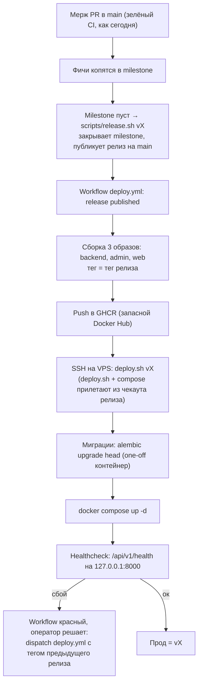

# 616 — Прод-деплой из main: релизы milestone → образы → VPS с откатом

Дата: 2026-11-21 · Issue: #616 · Статус: спека рев.2 (гейт B)
Скаут: 3 зоны (сборка/рантайм, CI, конфиг приложения), 21.11 — разрыв «воспроизводимой доставки нет» подтверждён всеми тремя; скорректированные посылки — комментарием на issue (Docker в репо отсутствует полностью; веб — статический экспорт; CSV-загрузчик #612 не в main).
Панель 21.11: 3/7 отчётов (security: NEEDS_REVISION; simplicity, best-practices: SOUND_WITH_CONCERNS); 4 ревьюера (completeness, consistency, feasibility, test-design) пропущены — провайдер zen free дважды упал на старте агентов (UnknownError, по одному повтору на каждого); находки внесены в рев.2, отклонённые — с причинами в отчёте гейта B.

## 0. Порядок волн и зависимости

- **Дизайн не ждёт никого; IMPL тоже стартует без сервера.** Всё проверяемо локально: сборка 3 образов, compose-смоук на imac, workflow сборки. Реальный деплой на VPS — приёмочный шаг, операционно ждёт #574 (VPS) и #617 (nginx/TLS). `depends-on` НЕ объявляется: кода, зависящего от #574, нет.
- Швы по владению: #574 — VPS и выбор провайдера; #617 — провижининг, nginx, TLS, DNS; #618 — бэкапы и восстановление тома с БД; #619 — go-live ранбук (env-файл, сид, первый админ, SMS, приёмка).
- #612 (CSV-загрузчик) на ветке, в main нет: до его мержа ранбук сида якорится на YAML-вход (`--dir`), после — на `--csv`. Спека #616 не зависит от порядка: сид не часть деплоя.

## 1. Контекст и решения владельца (гейт A, 21.11)

1. **Триггер выката — релиз GitHub, публикуемый вручную по готовности milestone.** Фичи копятся в milestone и мержатся в main по зелёному CI как обычно; когда milestone пуст — владелец одной командой публикует релиз; событие `release: published` запускает сборку и деплой. У GitHub Actions триггера на milestone нет — цепочку замыкает release-команда (§4.1). Отставание прода от main видно на странице релизов и в milestone.
2. **Хранение образов — реестр GitHub (GHCR).** Запасной — Docker Hub: адрес образа собирается из переменной префикса реестра (по умолчанию — от владельца репозитория), переход = правка переменных, не редизайн.
3. **Адресная модель — один хост с путями:** `https://<домен>/` — веб клиентов, `/admin` — админка, `/api` — API. Всё same-origin: куки работают как сегодня (host-only, `Lax`, `secure` включается прод-режимом), CORS на проде не участвует (same-origin запросы его не проходят), правок кода авторизации нет. Приложения собираются с **относительным** `NEXT_PUBLIC_API_URL=/api` — образы не зависят от домена, смена домена пересборки не требует.
4. **Веб — тоже контейнер** (решение владельца): статический экспорт вшивается в лёгкий nginx-образ. Все 3 части приложения доставляются и откатываются одинаково — тегом образа.

## 2. Концепция

## 3. Образы, compose, контракт окружения

### 3.1 Три образа (каталог `deploy/` в корне репо)

| Образ | Содержимое | Примечания |
|---|---|---|
| `backend` | Python + uv, uvicorn `src.main:app` без `--reload`, ровно 1 процесс, `--proxy-headers --forwarded-allow-ips=<адрес nginx>` | Событийный fanout рассчитан на один процесс (архитектурное ограничение) — workers не поднимаем. Значение `--forwarded-allow-ips` — это граница доверия: строго адрес, с которого приходит nginx (шлюз compose-сети при публикации на loopback), никогда подстановочный; чужой `X-Forwarded-For` при этом не доверяется (защита подмены IP в лестнице блокировок входа) |
| `admin` | Next standalone-сборка (`output: 'standalone'`), build-args: `NEXT_PUBLIC_API_URL=/api` (относительный), `NEXT_PUBLIC_BASE_PATH=/admin` (basePath только от build-арга, dev не тронут), `images.unoptimized: true` как у веба | Обоснование standalone: рантайм-образ без полных `node_modules` (замена `next start`). Известная особенность Next 14: standalone не включает `public/` и `.next/static` — Dockerfile обязан докопировать оба. `unoptimized` убирает remotePatterns — домен не вшит никуда |
| `web` | 2 стадии: node-сборка статического экспорта (`output: 'export'` уже в конфиге, build-arg `NEXT_PUBLIC_API_URL=/api`) → `nginx:alpine` + `COPY dist`; SPA-fallback через try_files | Отдельного Node-рантайма нет |

### 3.2 `deploy/docker-compose.prod.yml`

- Сервисы `backend`, `admin`, `web`; порты публикуются только на loopback (`127.0.0.1:8000/3000/8080`) — наружу их отдаёт nginx #617.
- Стек уведомлений (dispatcher, worker, relay) в v1-Compose НЕ описывается — подсистема на старте выключена; её сервисы появятся своей карточкой при включении уведомлений (env-контракт §3.3 остаётся как документация существующих настроек).
- Тома: `/opt/memo/data` (файл SQLite `memo.db` + `-wal`/`-shm`) и `/opt/memo/files` (аватары/файлы). Сервиса БД в compose нет — SQLite по ADR-001. Закреплены прагмы `journal_mode=WAL`, `busy_timeout` и `stop_grace_period` (флаш WAL при остановке).
- Healthcheck backend внутри compose: `GET /api/v1/health` python-однострочником (`urllib.request` — в slim-базах нет curl, лишняя зависимость не нужна).
- Миграции — НЕ entrypoint: явный шаг `docker compose run --rm backend alembic upgrade head` в `deploy.sh` до `up -d` (управляемый, логируется в workflow).

### 3.3 Контракт окружения проду

Файл окружения лежит на сервере (`/opt/memo/env/production.env`, права 0600, владелец root), подключается к `backend` через `env_file`; в репо и в GitHub не попадает. Состав — существующий контракт `Settings` (fail-fast в прод-режиме уже встроён: пустые `SECRET_KEY`/`OTP_PEPPER`, не-TLS Redis при включённых уведомлениях, dev-транспорты — отказ старта/запроса):

- режим и база: `ENV=production`, `DATABASE_URL=sqlite+aiosqlite:////opt/memo/data/memo.db`, `FILES_DIR=/opt/memo/files`, `BUSINESS_TIMEZONE`, `LOG_LEVEL`;
- секреты: `SECRET_KEY`, `OTP_PEPPER`;
- транспорты OTP/callcheck: `OTP_TRANSPORT`, `CALLCHECK_TRANSPORT`, `SMSRU_CALLCHECK_API_KEY`;
- уведомления: `NOTIFICATION_ENABLED=false`, `REDIS_URL`, `TELEGRAM_*`.

**Валидация режима (правка приложения):** `ENV` сегодня — свободная строка: опечатка (`prod`, пробел) молча выключает ВСЕ прод-защиты. Спека требует `Literal["development","testing","production"]` с отказом старта на неизвестном значении — защита перестаёт зависеть от точности строки.

**Build-args несут только публичные значения** (относительный `/api`, basePath): секретов в слоях образов и в логах сборки нет — закреплено как ограничение.

**OTP-зависимость go-live (не деплоя):** без настроенного SMS-транспорта вход по OTP на прод отвечает 503 — выбор провайдера #586/#587 остаётся зависимостью запуска, деплой #616 от него не зависит.

**GitHub Secrets** — только доступ деплоя: `DEPLOY_SSH_HOST`, `DEPLOY_SSH_USER`, `DEPLOY_SSH_KEY`, при приватных образах `REGISTRY_TOKEN` (read:packages). Секреты приложения в GitHub не попадают никогда.

### 3.4 sqladmin

Монтирование sqladmin — только по явному флагу включения (по умолчанию выключен, deny-by-default; сегодня монтируется при `ENV != "testing"` — инверсия: отсутствие строки выключает защиту). На проде недоступен; включение — отдельным решением.

## 4. Релизы и workflow

### 4.1 Release-команда: `scripts/release.sh <tag>`

Через gh CLI: (1) проверяет milestone — все issues закрыты, иначе предупреждение и стоп (форс-флаг `--force` для осознанного обхода); (2) закрывает milestone; (3) собирает описание релиза из issues milestone (номер + заголовок); (4) `gh release create <tag> --target main`. Одна команда = релиз = выкат. Тег рекомендуем именем milestone (`v1`, `v1.1`).

### 4.2 `deploy.yml`

- Триггеры: `release: types: [published]` + `workflow_dispatch` с входом `tag` (откат/повтор).
- Job `build`: чекаут **по имени тега релиза** (`github.event.release.tag_name`), не по `github.sha` (для аннотированных тегов sha события ненадёжен) → сборка 3 образов (buildx, кэш слоёв) → push с тегом релиза; префикс реестра из переменной (по умолчанию `ghcr.io/<владелец репо>`); минимальные `permissions` джоба (`contents: read`, `packages: write`).
- Job `deploy`: `concurrency: prod-deploy` БЕЗ cancel (параллельные выкаты запрещены — один SQLite-писатель), привязка к GitHub environment `production`; ssh → scp `deploy.sh` + `docker-compose.prod.yml` из чекаута релиза (скрипт деплоя всегда соответствует версии) → `./deploy.sh <tag>`: pull, миграции, `up -d`, ожидание health (python-однострочник в цикле — curl в образе нет).
- **Авто-отката нет (решение панели):** при провале healthcheck workflow завершается красным с сообщением оператору; откат — осознанный dispatch с тегом предыдущего релиза (§4.3, сценарий 2). Автопоиск «предыдущий релиз по дате» — новые поверхности отказа (черновики, prerelease, порядок) без выигрыша для выката под присмотром оператора.
- Защита сборки на PR: в `test.yml` job сборки 3 образов **без push + запуск-проверка** (поднять образы, проверить `/api/v1/health` и отдачу `/admin`) — сломанный образ не проходит CI молча (просто собрать недостаточно: standalone-образ без докопированных ассетов собирается, но не работает).

### 4.3 Откат и честные границы

- Откат = `workflow_dispatch` с тегом предыдущего релиза: образы тега, миграции не выполняются повторно (схема уже новая — работает по политике совместимости), `up -d`, healthcheck.
- Миграции **не откатываются**: политика обратной совместимости миграций (expand-contract: сначала добавляем, потом убираем) — старая версия приложения обязана работать на новой схеме. Восстановление БД — #618 (бэкапы), не downgrade.
- Откат тегом, не digest: перезапись тега в реестре требует тех же прав, что и сам деплой — принятая граница доверия (см. §10); digest-пиннинг — отложенное укрепление, не v1.

## 5. Первый подъём без VPS (проверяемость #616 до #574)

`scripts/prod-smoke.sh` (локальный смоук на imac): чистый временный каталог с томами → env-файл с тестовыми секретами → `docker compose ... run --rm backend alembic upgrade head` → `up -d` → ждёт `/api/v1/health` → проверяет 401 анонимного запроса к API, отдачу оболочки админки на `/admin` (данные при этом — только через 401) → teardown. Это канонический E2E-аналог инфра-фичи (прецедент #612: pytest для CLI).

## 6. Швы с соседними карточками

| Карточка | Шов |
|---|---|
| #617 | nginx + TLS + DNS; проксирует `127.0.0.1:8080/3000/8000` по путям `/`, `/admin`, `/api` (без переписывания путей: роуты приложения уже живут под `/api` — `root_path` НЕ задаём, он бы удвоил префикс); заголовок `X-Forwarded-Proto` обязателен, uvicorn доверяет ему только с закреплённого адреса nginx (§3.1) |
| #618 | бэкап тома `/opt/memo/data` (файл БД + WAL) |
| #619 | ранбук: создание env-файла (права 0600/root), сид (`--dir` до мержа #612, `--csv` после), `create-user` первого админа, SMS-транспорт, приёмка |
| #574 | VPS: деплой на реальный сервер — приёмка после его появления |

## 7. User Scenarios

«Пользователь» фичи — владелец-оператор. Каждому сценарию соответствует проверка (смоук-скрипт §5 / job сборки; полный путь по SSH — приёмка на сервере после #574, шаги ранбука #619):

1. **Выкатить milestone.** Все issues milestone закрыты → `scripts/release.sh v1` → релиз опубликован, workflow собрал 3 образа, доставил, миграции прошли, health зелёный. Проверка: job сборки+запуска на PR + смоук миграций/health локально.
2. **Откатиться на предыдущую версию.** Выкат сломан (workflow красный) → `workflow_dispatch` с тегом предыдущего релиза → прод на предыдущей версии, health зелёный, БД не тронута. Проверка: повторный запуск `deploy.sh` с предыдущим тегом в смоуке.
3. **Поднять прод с нуля локально (до VPS).** Чистый каталог + env-файл → миграции → health зелёный, анониму 401 на API, оболочка админки отдаётся на `/admin` (данные — 401). Проверка: `prod-smoke.sh`.
4. **Прод-образ не стартует без секретов.** Контейнер backend с env без `SECRET_KEY`/`OTP_PEPPER` отказывается стартовать — проверка на уровне ОБРАЗА в смоуке (юнит-тесты проверяют Settings, смоук — что fail-fast долетает через образ/env-файл).
5. **PR не ломает прод-сборку.** Любой PR собирает 3 образа и запускает их (без push) — регрессия сборки/запуска видна до мержа. Проверка: job в `test.yml`.

## 8. Behavioral Delta

- **Было:** после мержа в main на прод ничего не попадает — доставки нет, образов и compose нет, подъём прода не воспроизводим.
- **Стало:** фичи копятся в milestone → релиз одной командой → автоматические сборка 3 образов и деплой на VPS (миграции + healthcheck); при сбое — красный workflow и ручной откат dispatch-ем с предыдущим тегом; версия прода = тег релиза, история выкатов на странице релизов.
- Для конечных пользователей (сотрудники, клиенты) поведение не меняется — меняется только способ доставки.
- Новое в репо: `deploy/` (3 Dockerfile + compose + конфиг nginx веб-образа), `deploy.yml`, `deploy.sh`, `scripts/release.sh`, `scripts/prod-smoke.sh`; правки приложения: admin → standalone + basePath от build-арга + unoptimized, web/admin → относительный `NEXT_PUBLIC_API_URL=/api` от build-арга, валидация `ENV` как Literal, sqladmin по явному флагу, uvicorn proxy-headers с закреплённым доверенным адресом.

## 9. Visual Compliance Checks

- N/A

## 10. Риски и принятые границы доверия

- **`deploy.sh` из релиза исполняется на проде с деплой-правами:** обладатель прав мержа+релиза получает доступ к проду — принятая граница (те же права уже управляют содержимым релиза).
- **Откат тегом, не digest:** перезапись тега в реестре требует тех же прав — та же граница; digest-пиннинг и аттестации (provenance/sbom) — отложенное укрепление.
- **Доступность реестра из РФ:** GHCR обычно доступен; запасной Docker Hub переключается переменной префикса. Проверка сети VPS — шаг ранбука #619.
- **Один процесс backend** — потолок масштаба v1, принят осознанно (событийная подсистема).
- **SQLite + WAL на томе:** один writer, бэкап с WAL — зона #618.
- **SMS-транспорт OTP** — go-live зависимость #586/#587: деплой работает, вход по OTP без транспорта отвечает 503.
- Смена домена пересборки НЕ требует (относительный `/api`, домен нигде не вшит) — издержка из рев.1 снята панелью.

## 11. Открытых вопросов нет

Развилки гейта A закрыты владельцем 21.11 (§1); находки панели 3/7 внесены в рев.2 (§ header); возникающие по ходу IMPL вопросы решаются в рамках этой спеки, изменения контракта — обратно на гейт.
